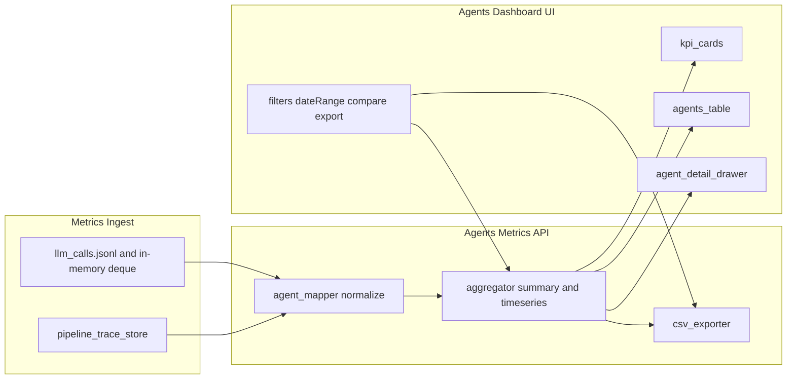

# LLM Agents Dashboard Plan

## Goal

Implement `/analytics/agents` as an admin-grade observability page that clearly shows all LLM-using agents in the current system, including performance, cost/token usage, reliability, trends, and deep drill-down.

## Scope Confirmed

- Agent scope: **LLM-calling agents only**
- Delivery depth: **Full + CSV export + date-range compare**

## Agent Catalog (normalized)

Create a canonical agent registry and mapping layer so metrics from `feature_tag` and trace spans roll up consistently:

- Chat generation: `chat_langgraph`, `chat_langgraph_retry_not_found`, `chat_langgraph_retry_incomplete`
- Routing/classification: `intent_classifier`, query rewrite
- Retrieval LLM steps: rerank, context selection (if LLM-backed)
- Moderation/classifier calls: OpenAI moderation and safety-related LLM calls
- Studio generation flows

Use normalized keys (e.g., `generate`, `intent_classify`, `query_rewrite`, `cohere_rerank`, `moderation`, `studio_generate`) with display labels/tooltips.

## Backend API Additions

### 1) New agents metrics endpoint family in [apps/api/routes/metrics.py](c:/Users/ManishReddy/OneDrive/Desktop/NotebookLM/apps/api/routes/metrics.py)

- `GET /api/v1/metrics/agents/summary`
  - returns totals + top agents by calls/tokens/cost/errors + comparison window deltas
- `GET /api/v1/metrics/agents/timeseries`
  - returns per-day/per-hour stats by agent (calls, avg latency, p95, tokens, cost, error-rate)
- `GET /api/v1/metrics/agents/details`
  - returns agent table rows with sortable metrics and health status
- `GET /api/v1/metrics/agents/recent`
  - recent executions/errors with request_id/trace_id linkage
- `GET /api/v1/metrics/agents/export.csv`
  - CSV export for current filter/date range

### 2) Data sources and joins

- Primary: `MetricsCollector._llm_calls` in [packages/core/monitoring/metrics.py](c:/Users/ManishReddy/OneDrive/Desktop/NotebookLM/packages/core/monitoring/metrics.py)
- Secondary (for rich drill-down): pipeline spans from trace store in [packages/core/monitoring/pipeline_trace.py](c:/Users/ManishReddy/OneDrive/Desktop/NotebookLM/packages/core/monitoring/pipeline_trace.py)
- Build a resilient mapper from `feature_tag` + span names to normalized agent IDs.

### 3) Reliability guardrails

- Reuse DB/connection-failure fallback pattern already used in metrics/admin routes.
- Always return valid empty payload shapes (no frontend crashes).

## Frontend Implementation

### 1) Replace placeholder page in [apps/web/src/app/analytics/agents/page.tsx](c:/Users/ManishReddy/OneDrive/Desktop/NotebookLM/apps/web/src/app/analytics/agents/page.tsx)

Implement sections:

- Header controls: date range, compare toggle, agent filter, search, refresh, export CSV
- KPI cards: total agent calls, total cost, avg latency, p95 latency, error rate, active agents
- Main table (sortable): agent name, calls, tokens, cost, avg/p95 latency, error-rate, last seen, trend
- Trend charts: calls/cost/latency/error-rate over time
- Recent runs/errors panel with trace link to pipeline debugger
- Detail drawer per agent: endpoint usage, provider/model split, top failure reasons, sample recent executions

### 2) API client additions in [apps/web/src/lib/api-client.ts](c:/Users/ManishReddy/OneDrive/Desktop/NotebookLM/apps/web/src/lib/api-client.ts)

Add typed methods:

- `getAgentSummary(params)`
- `getAgentTimeseries(params)`
- `getAgentDetails(params)`
- `getAgentRecent(params)`
- `downloadAgentCsv(params)`

### 3) UX clarity

- Human-readable labels and explanations for each metric.
- Empty states that explain "no agent traffic yet".
- Consistent formatting with existing analytics pages.

## Data Model for UI (target)

- `agent_id`, `agent_label`, `calls`, `tokens_in`, `tokens_out`, `cost_total`
- `latency_avg_ms`, `latency_p95_ms`, `error_count`, `error_rate`
- `last_seen_at`, `trend_calls_pct`, `trend_cost_pct`, `trend_latency_pct`
- `providers[]`, `models[]`, `top_endpoints[]`, `top_errors[]`

## Rollout & Validation

1. Unit test mapper (feature_tag/span -> agent_id).
2. API response-shape tests for empty/non-empty windows.
3. Manual validation in `/analytics/agents` with existing logs.
4. Verify trace links open `/analytics/pipeline?trace_id=...` correctly.
5. Verify export CSV content matches filtered table.

## Architecture Flow

