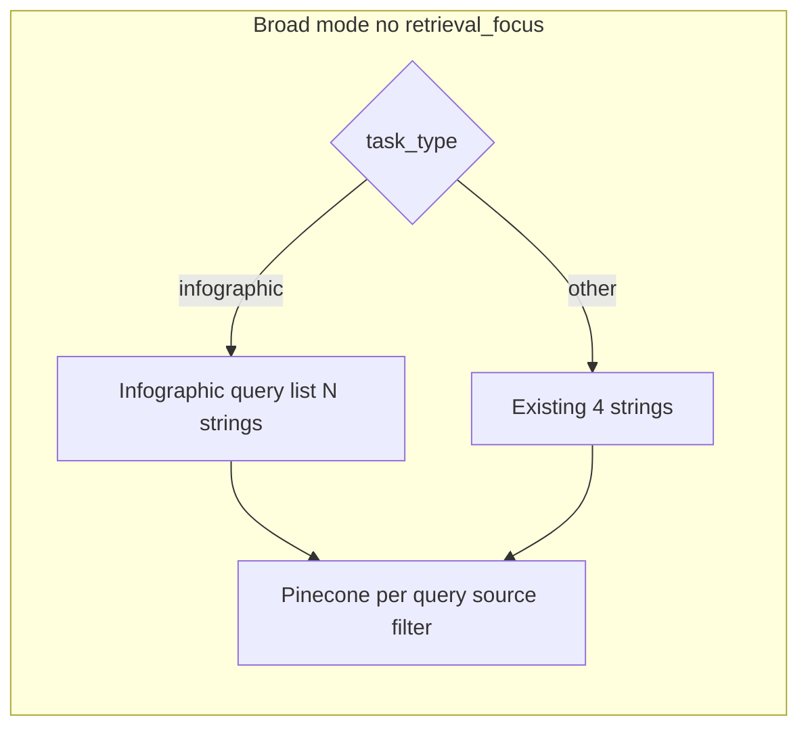

# Infographic: single-source + richer retrieval + prompt

## Context

- Broad retrieval today uses a shared tuple `[STUDIO_BROAD_RETRIEVAL_QUERIES](packages/core/services/studio_service.py)` for **every** Studio task when `retrieval_focus` is empty (`[_retrieve_studio_context](packages/core/services/studio_service.py)` lines 238–240). Adding many new strings there would **multiply embeddings and Pinecone calls for quiz, flashcards, mind map, slide deck, report** as well.
- **Recommendation:** Introduce a **separate** constant, e.g. `STUDIO_INFOGRAPHIC_BROAD_QUERIES`, used **only** when `task_type == "infographic"` and there is no `retrieval_focus`. Keep the existing four-theme intent and **add** additional generic English lines so varied documents (stats-heavy, narrative, geographic, procedural) still surface useful chunks.

## 1. Backend: infographic-only broad queries

**File:** `[packages/core/services/studio_service.py](packages/core/services/studio_service.py)`

- Define `STUDIO_INFOGRAPHIC_BROAD_QUERIES` as a tuple including:
  - The **current four** themes (optionally slightly enriched wording—short phrases, not paragraphs).
  - **Additional** generic retrieval lines, for example (tune final wording in implementation): numerical data and statistics; trends percentages measurements; timeline chronological order events and dates; comparisons and contrasts; causes effects and relationships; charts tables figures and captions; geographic locations maps regions; step-by-step processes and workflows; glossary terms and definitions; lists and enumerations.
- In `_retrieve_studio_context`, when `not focus`:
  - If `task_type == "infographic"`: `queries_used = list(STUDIO_INFOGRAPHIC_BROAD_QUERIES)` (optionally sliced).
  - Else: keep `STUDIO_BROAD_RETRIEVAL_QUERIES` unchanged.
- **Cost control:** Add `[config/settings.py](config/settings.py)` setting e.g. `STUDIO_INFOGRAPHIC_RETRIEVAL_QUERIES_CAP` (default: run **all** defined lines, or cap at e.g. **10** if the list grows large). Document that each line = one embed + one Pinecone query.
- **Optional:** `STUDIO_INFOGRAPHIC_CONTEXT_MAX_CHUNKS` (slightly higher than `STUDIO_CONTEXT_MAX_CHUNKS`) for infographic-only merge cap, since single-doc + visual use cases benefit from a bit more evidence—only if you accept higher LLM/DALL·E prompt size.

## 2. Backend: enforce single source for infographic (defense in depth)

**Files:** `[packages/core/services/studio_service.py](packages/core/services/studio_service.py)` (`generate` or `_generate_infographic`) and/or `[apps/api/routes/studio.py](apps/api/routes/studio.py)`

- If `task_type == "infographic"` and `len(source_ids) != 1`, return **400** with a clear message (e.g. “Infographic requires exactly one selected source”).
- This protects against direct API calls even if the UI is bypassed.

## 3. Frontend: enable Infographic only when one source is selected

**File:** `[apps/web/src/components/studio/StudioSuite.tsx](apps/web/src/components/studio/StudioSuite.tsx)`

- Compute `const infographicDisabled = selectedSources.size !== 1` (or `Array.from(selectedSources).length !== 1`—match how `selectedSources` is typed in context).
- For the Infographic `StudioCard`, set `disabled={isGenerating || loading || infographicDisabled}` (same pattern as other cards).
- **UX:** Add a short hint when disabled—e.g. `title` attribute on the card wrapper, or one line under the grid: *“Infographic: select exactly one source.”* Optional: extend `[StudioCard](apps/web/src/components/studio/StudioCard.tsx)` with optional `hint` / `title` for accessibility.
- **Client guard:** In `handleGenerate`, if `type === 'infographic'` and `sourceIds.length !== 1`, set `localError` and return (mirrors API).

## 4. Prompt template: DALL·E briefing aligned with product

**File:** `[packages/core/prompts/templates/studio/infographic_prompt.j2](packages/core/prompts/templates/studio/infographic_prompt.j2)`

Rewrite the instructions (still **plain text DALL·E prompt output only**, no markdown/JSON) to encode:

- **Definition:** Infographic = visual representation of **information in the user’s document** for quick understanding; prioritize **charts, graphs, maps (only if geography appears in the source), timelines** when the text supports them; otherwise use clear process or concept diagrams.
- **Single document:** Explicitly state that **all** visual content must reflect **only** the provided source material below (no other notebooks/sources).
- **Grounding:** Do not invent numbers, dates, or labels not supported by the excerpt; if data is sparse, prefer high-level conceptual layouts with minimal numeric labels.
- Keep existing mechanical rules (start with visual scene, 180–350 words, short on-image labels, etc.) and the existing Jinja blocks for `retrieval_queries_note`, `context`, and `custom_instructions`.

`[_normalize_dalle_prompt](packages/core/services/studio_service.py)` can stay; only adjust if the new template introduces patterns that need stripping (unlikely).

## 5. Docs and traces (light touch)

- Optionally add a short subsection to `[docs/STUDIO_QUIZ_FLOW.md](docs/STUDIO_QUIZ_FLOW.md)` or a new `docs/STUDIO_INFOGRAPHIC_FLOW.md` describing single-source + infographic query list—**only if** you want doc parity; not required for functionality.
- Pipeline traces already record `queries_used`; infographic runs will show the longer list automatically.

## 6. Verification

- UI: With 0 or 2+ sources, Infographic card disabled / error on generate; with exactly 1 source, generation proceeds.
- API: POST with `task_type=infographic` and two `source_ids` returns 400.
- Logs/trace: `queries_used` length matches infographic list (respecting cap).
- Smoke: one small ingested PDF → infographic completes (or `STUDIO_SKIP_IMAGE` path in dev).

