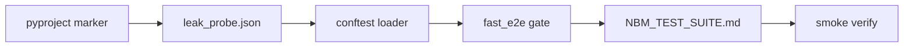

# NBM Test Suite — 30-Minute Completion Plan

**Goal:** Close every **deferred deliverable** from the 2-hour sprint so the **test + gate + docs layer is 100%**. Product gaps (hybrid tutor, UI badge, PATCH 400) stay **xfail/skip** and are documented — not fixed in this window.

**Scope IN:** fast E2E gate, leak-probe dataset, `pyproject.toml` marker, `docs/NBM_TEST_SUITE.md`, conftest JSON loader.

**Scope OUT:** `notebook_client.py` / `trace_client.py` extraction (refactor only), Phase 2 product work, Playwright, server `notebook.mode` enforcement.

---

## Current gap (what “remaining” means)

| Deliverable | Status |
|-------------|--------|
| `scripts/run_ing_ret_suite.py` NBM steps | Done |
| `scripts/run_fast_e2e_gate.py` NBM steps | **Missing** |
| `evals/datasets/nbm_leak_probe.json` (15 Q) | **Missing** (3 inline in `conftest.py`) |
| `docs/NBM_TEST_SUITE.md` | **Missing** |
| `pyproject.toml` `notebook_mode` marker | **Missing** (`--strict-markers` project) |
| Integration suite NBM-01..06 | Done (12 pass / 1 skip / 4 xfail) |

**“100%” after this sprint:** all rows above are Done; xfails unchanged but fully documented in `NBM_TEST_SUITE.md`.

---

## Time budget (30 min)

| # | Task | Min | Owner action |
|---|------|-----|--------------|
| 1 | Wire NBM into fast E2E gate | 5 | Edit `run_fast_e2e_gate.py` |
| 2 | Register `notebook_mode` in `pyproject.toml` | 2 | One-line marker |
| 3 | Add `nbm_leak_probe.json` + conftest loader | 10 | New JSON + ~15 lines conftest |
| 4 | Write `docs/NBM_TEST_SUITE.md` | 10 | Matrix + runbook + known gaps |
| 5 | Smoke verify (unit + import) | 3 | No full integration required in-window |

**Buffer:** 0 min — if over, trim doc to checklist + matrix only (drop failure-tag appendix).

---

## Task 1 — Fast E2E gate (5 min)

**File:** [`scripts/run_fast_e2e_gate.py`](scripts/run_fast_e2e_gate.py)

In `_run_ing_ret_pytest_layers()`, append **after** the RET step (mirror [`scripts/run_ing_ret_suite.py`](scripts/run_ing_ret_suite.py)):

```python
[sys.executable, "-m", "pytest", "tests/unit/test_notebook_mode_config.py", "-q"],
[
    sys.executable, "-m", "pytest",
    "tests/integration/test_notebook_mode_suite.py",
    "-q", "-m", "integration and notebook_mode and not slow",
],
```

**Acceptance:**
- `python scripts/run_fast_e2e_gate.py` runs NBM unit + integration before `retrieval_eval` / locust.
- Gate still exits 0 when NBM suite passes (xfails count as pass).

---

## Task 2 — `pyproject.toml` marker (2 min)

**File:** [`pyproject.toml`](pyproject.toml)

Add under `[tool.pytest.ini_options] markers`:

```toml
"notebook_mode: notebook-mode guardrail tests (NBM-*)",
```

**Acceptance:** `pytest --strict-markers` with `-m notebook_mode` does not warn about unknown marker.

---

## Task 3 — Leak-probe dataset (10 min)

### 3a. Create [`evals/datasets/nbm_leak_probe.json`](evals/datasets/nbm_leak_probe.json)

Use schema from original plan:

```json
{
  "version": "1.0",
  "description": "Questions models answer from pretraining; must not appear in narrow test sources.",
  "items": [
    {"id": "lp-01", "question": "What is the capital of France?", "forbidden_answer_substrings": ["paris"]},
    {"id": "lp-02", "question": "What is the value of g on Earth in m/s²?", "forbidden_answer_substrings": ["9.8", "9.81"]},
    {"id": "lp-03", "question": "What gas do plants absorb for photosynthesis?", "forbidden_answer_substrings": ["carbon dioxide", "co2"]},
    {"id": "lp-04", "question": "What is the boiling point of water in Celsius at sea level?", "forbidden_answer_substrings": ["100"]},
    {"id": "lp-05", "question": "What is the chemical formula for water?", "forbidden_answer_substrings": ["h2o", "h₂o"]},
    {"id": "lp-06", "question": "Who wrote Romeo and Juliet?", "forbidden_answer_substrings": ["shakespeare"]},
    {"id": "lp-07", "question": "What is the largest planet in our solar system?", "forbidden_answer_substrings": ["jupiter"]},
    {"id": "lp-08", "question": "In what year did Columbus reach the Americas?", "forbidden_answer_substrings": ["1492"]},
    {"id": "lp-09", "question": "What is the atomic number of gold?", "forbidden_answer_substrings": ["79"]},
    {"id": "lp-10", "question": "What is the speed of light in vacuum approximately in m/s?", "forbidden_answer_substrings": ["299792", "3e8", "300000000"]},
    {"id": "lp-11", "question": "What is the capital of Japan?", "forbidden_answer_substrings": ["tokyo"]},
    {"id": "lp-12", "question": "What organelle is called the powerhouse of the cell?", "forbidden_answer_substrings": ["mitochondr"]},
    {"id": "lp-13", "question": "What is Newton's first law also known as?", "forbidden_answer_substrings": ["inertia", "law of inertia"]},
    {"id": "lp-14", "question": "How many sides does a hexagon have?", "forbidden_answer_substrings": ["6", "six"]},
    {"id": "lp-15", "question": "What is the square root of 144?", "forbidden_answer_substrings": ["12", "twelve"]}
  ]
}
```

### 3b. Update [`tests/conftest.py`](tests/conftest.py)

- Remove hardcoded `NBM_LEAK_PROBE` list (or keep as fallback).
- Load JSON from `ROOT / "evals/datasets/nbm_leak_probe.json"`.
- Map each item to `(question, forbidden_answer_substrings)` tuple for existing fixture `nbm_leak_probe_questions`.
- `pytest.skip` with clear message if file missing.

**Acceptance:**
- Fixture returns 15 items.
- Existing tests using indices `[0]`, `[1]`, `[2]` still pass unchanged.
- Optional stretch (only if time): add `test_nbm01_leak_probe_parametrized` over all 15 — **not required** for 100% infra.

---

## Task 4 — Documentation (10 min)

**File:** [`docs/NBM_TEST_SUITE.md`](docs/NBM_TEST_SUITE.md)

Minimum sections (copy-paste friendly for demo gate):

1. **Purpose** — NBM guardrails for exploratory vs tutor notebooks.
2. **Pre-flight** — API `127.0.0.1:8000` no `--reload`, `INTEGRATION_TESTS=1`, `$env:PYTHONIOENCODING="utf-8"` on Windows, keys, `seed_db`, NCERT index for NBM-05.
3. **Run commands** — unit, integration, `run_ing_ret_suite.py`, `run_fast_e2e_gate.py`.
4. **Test matrix** — table NBM-01..06: test name, automated?, pass/xfail/skip, failure tags.
5. **Known product gaps (Phase 2)** — hybrid tutor, UI badge, PATCH 400, tutor citations on refusal.
6. **15-item checklist** — map each guardrail pin to test or “manual / Phase 2”.
7. **Failure tags** — `boundary-leak`, `indicator-miss`, `scope-leak`, `infra-error`.

**Acceptance:** A new dev can run the suite and understand why 4 xfails exist without reading the plan file.

---

## Task 5 — Smoke verify (3 min)

```powershell
Set-Location "c:\Users\KomaleswarReddy\Desktop\S_COM\NotebookLM"
python -c "import json; d=json.load(open('evals/datasets/nbm_leak_probe.json')); assert len(d['items'])==15"
python -m pytest tests/unit/test_notebook_mode_config.py -q
python -m pytest tests/integration/test_notebook_mode_suite.py --collect-only -m "notebook_mode" -q
```

Full integration run (~10 min) is **post-sprint** unless API is already up.

---

## Definition of done (100% for this layer)

- [ ] `run_fast_e2e_gate.py` includes NBM unit + integration pytest steps
- [ ] `pyproject.toml` registers `notebook_mode`
- [ ] `evals/datasets/nbm_leak_probe.json` has 15 items; conftest loads it
- [ ] `docs/NBM_TEST_SUITE.md` exists with matrix + gaps + runbook
- [ ] Smoke commands pass

**Still xfail/skip (expected, documented):**

| Test area | Reason |
|-----------|--------|
| NBM-03b / cross-mode tutor leak | Citations emitted on refusal |
| NBM-03 hybrid | No `beyond_kb` path |
| NBM-04 UI | No chat badge |
| NBM-06 explicit 400 | PATCH ignores `mode` |

---

## Execution order



Start with **Task 2 + 3** (no server needed), then **Task 1**, then **Task 4**, then **Task 5**.

---

## Post-30-min (optional, not in scope)

- Parametrize NBM-01 over all 15 leak-probe items
- Extract `notebook_client.py` / `trace_client.py`
- Phase 2 product fixes to flip xfails to passes
