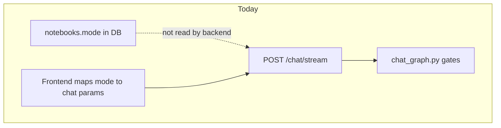
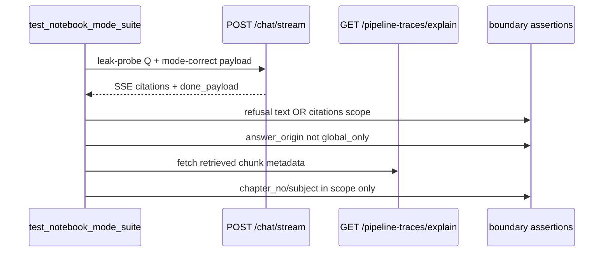

# Notebook-Mode (NBM-01..06) Test Implementation Plan

## What you chose vs recommended defaults

| Decision | Your choice | Recommendation (fastest accurate path) |
|----------|-------------|----------------------------------------|
| Sprint scope | **Tests + docs only** | Correct for speed; document product gaps as `xfail`/`skip` with trace evidence |
| NBM-05 fixtures | **Seeded NCERT** | Use live Pinecone NCERT + `POST /api/v1/tutor/notebooks/prepare` for stable scope |
| Gate wiring | **Demo + fast E2E** | Add `notebook_mode` pytest layer after RET in both scripts |
| Tutor hybrid (NBM-03/04) | Fastest impl | **Test current strict-tutor behavior**; `xfail` hybrid half (b) until product ships hybrid + badge |
| NBM-04 UI | Fastest impl | **API/SSE assertions only** + 3-line manual demo checklist (no Playwright this sprint) |
| Server mode enforcement | Fastest impl | **Defer** — tests send mode-correct payloads; document gap in `docs/NBM_TEST_SUITE.md` |
| Time budget | Fastest | **~1–1.5 focused days** (8–12 hrs) for full bucket tests-only |
| Cut priority | Recommended P0 | **NBM-01 → NBM-02 → NBM-06 → NBM-05 → NBM-03/04 (xfail)** |

---

## Current codebase reality (from exploration)



**Key gaps vs your guardrail sheet** (tests will expose, not fix this sprint):

| NBM | Spec expectation | Code today | Test strategy |
|-----|------------------|------------|---------------|
| NBM-01 | Strict exploratory grounding | Implemented via `ContextGroundingGate` + `SourceRelevanceGate` in [`packages/core/langgraph/chat_graph.py`](packages/core/langgraph/chat_graph.py); `CHAT_STRICT_CONTEXT_GROUNDING=True` | Leak-probe Q + assert refusal + **no citations** + `done.answer_origin != global_only` |
| NBM-02 | Fallback default OFF | `CHAT_ALLOW_GLOBAL_KNOWLEDGE_FALLBACK: bool = False` in [`config/settings.py`](config/settings.py) line ~260 | Unit pin + runtime refusal |
| NBM-03 | Tutor hybrid KB-first | **Strict NCERT only** — `tutor_strict_ncert_only` in [`rag_prompt.j2j`](packages/core/prompts/templates/chat/rag_prompt.j2) blocks; no bounded fallback | Test (a) citations; **xfail (b)** hybrid |
| NBM-04 | Beyond-KB UI badge | **No chat UI indicator** in `apps/web/src/components/chat/` | SSE/text: tutor must not emit `General knowledge:`; manual UI checklist |
| NBM-05 | Scope filter | Implemented in [`packages/core/rag/retriever.py`](packages/core/rag/retriever.py) `_retrieve_ncert_global_matches` | Assert chunk metadata via `GET /api/v1/pipeline-traces/{id}/explain` |
| NBM-06 | Mode immutable | PATCH schema omits `mode` ([`apps/api/schemas/notebook.py`](apps/api/schemas/notebook.py)); no explicit 400 | Assert mode unchanged after PATCH; document missing 400 as gap |

**Reuse existing patterns:**
- RET-06 refusal smoke: [`tests/integration/test_retrieval_suite.py`](tests/integration/test_retrieval_suite.py) `TestRET06NoAnswerBehavior`
- SSE helper: [`tests/helpers/chat_client.py`](tests/helpers/chat_client.py) — **extend** with `include_ncert_global`, `ncert_*`, `notebook_id`
- Config pin: [`tests/unit/test_context_grounding_gate.py`](tests/unit/test_context_grounding_gate.py)
- Ad-hoc tutor filter script (not in pytest): [`test_tutor_mode_filtering.py`](test_tutor_mode_filtering.py) — logic to mirror in NBM-05

---

## Architecture: how NBM tests prove boundaries



**Non-negotiable rule (your guardrail):** every test logs `notebook.mode`, config flags, and asserts **source of answer** — never pass on “answer looked right.”

---

## Files to add / modify

### New files

| File | Purpose |
|------|---------|
| [`evals/datasets/nbm_leak_probe.json`](evals/datasets/nbm_leak_probe.json) | ~15 questions (capital of France, g=9.8, photosynthesis, etc.) — answers known to LLM, absent from test sources |
| [`tests/helpers/notebook_client.py`](tests/helpers/notebook_client.py) | `create_notebook`, `get_notebook`, `patch_notebook`, `prepare_tutor_notebook` |
| [`tests/helpers/trace_client.py`](tests/helpers/trace_client.py) | `get_trace_explain(trace_id)` → chunk list with metadata |
| [`tests/unit/test_notebook_mode_config.py`](tests/unit/test_notebook_mode_config.py) | NBM-02 config pins |
| [`tests/integration/test_notebook_mode_suite.py`](tests/integration/test_notebook_mode_suite.py) | NBM-01..06 integration classes |
| [`docs/NBM_TEST_SUITE.md`](docs/NBM_TEST_SUITE.md) | Matrix, guardrails, pre-flight checklist, known gaps, failure tagging |

### Modify

| File | Change |
|------|--------|
| [`tests/helpers/chat_client.py`](tests/helpers/chat_client.py) | Add optional `include_ncert_global`, `ncert_class`, `ncert_subject`, `ncert_chapter_no`, `ncert_chapter_name`, `ncert_concept`, `notebook_id` |
| [`tests/conftest.py`](tests/conftest.py) | Marker `notebook_mode`; optional `ncert_scope` fixture from env or catalog API |
| [`pyproject.toml`](pyproject.toml) | Register `notebook_mode` marker |
| [`scripts/run_ing_ret_suite.py`](scripts/run_ing_ret_suite.py) | Add pytest step: `tests/integration/test_notebook_mode_suite.py -m "integration and notebook_mode and not slow"` |
| [`scripts/run_fast_e2e_gate.py`](scripts/run_fast_e2e_gate.py) | Same NBM layer after RET pytest |

---

## Per-test implementation (exact assertions)

### NBM-01 — Exploratory strict grounding

1. `POST /api/v1/notebooks` with `mode=exploratory`
2. Upload narrow fixture (e.g. `tests/fixtures/ingestion/sample_phrase_alpha.txt`) — **not** containing leak-probe facts
3. Pick random item from `nbm_leak_probe.json`
4. `stream_chat(..., active_source_ids=[source_id], notebook_id=...)`
5. **Pass iff ALL:**
   - Text contains refusal (`not found in provided sources` / `not found in the selected sources`)
   - `len(citations) == 0` OR citations only from uploaded source (no fabricated chunk_ids)
   - `done_payload.get("answer_origin")` not in `("global_only", "combined")`
   - `done_payload.get("generation_blocked_reason")` in allowed set OR refusal path
6. **Fail if:** confident factual answer to leak-probe (e.g. “Paris”) — that is a grounding leak

### NBM-02 — Global fallback default OFF

**Unit** (`test_notebook_mode_config.py`):
```python
assert settings.CHAT_ALLOW_GLOBAL_KNOWLEDGE_FALLBACK is False
assert settings.CHAT_STRICT_CONTEXT_GROUNDING is True
```

**Integration:** repeat NBM-01; additionally assert `done_payload.get("chat_global_fallback")` is not true (if exposed) and `generation_blocked_reason != "GLOBAL_FALLBACK_USED"`

### NBM-03 — Tutor hybrid KB-first

1. `POST /api/v1/tutor/notebooks/prepare` with known seeded scope (e.g. Class 10 Science Ch 3 from catalog)
2. **(a) In-scope question** from catalog/concepts → expect `len(citations) > 0`, NCERT metadata in citations
3. **(b) Thin-KB / off-corpus question** → **current behavior:** NCERT block message, no citations
   - Mark `@pytest.mark.xfail(reason="FR-NB-4 hybrid+beyond-KB not implemented; strict block only")` for hybrid pass criteria
   - Still assert: no silent confident answer without citations

**Cross-mode guardrail (ALL NBM):** run same leak-probe in tutor payload (`include_ncert_global=true`, scoped) — exploratory global fallback must **not** apply

### NBM-04 — Out-of-KB visual indicator

- **Automated (API):** for tutor responses, assert `"general knowledge:"` not in answer text (strict mode)
- **Manual demo gate** (in `NBM_TEST_SUITE.md`): open tutor notebook, trigger thin-KB question, confirm UI shows badge — **document as NOT IMPLEMENTED / manual N/A until product ships**
- `@pytest.mark.skip` or `xfail` for full NBM-04 pass criteria

### NBM-05 — Scope filter limits retrieval

Use **seeded NCERT** (your choice):

1. Prepare tutor notebook scoped to **Chapter A**
2. Ask question whose answer exists in **Chapter A** and **Chapter B** (pick from catalog / prior knowledge of seed)
3. Read `trace_id` from `done_payload`
4. `GET /api/v1/pipeline-traces/{trace_id}/explain`
5. Assert top-5 `explain.chunks[]` metadata: all `chapter_no == A` (and subject/class match)
6. Repeat at three scope tightness levels via API params:
   - subject only (`ncert_class` + `ncert_subject`)
   - + chapter (`ncert_chapter_no`)
   - + concept (`ncert_concept`) — narrowest must ⊆ wider scopes

**Infra guardrail:** if chat returns 500, tag failure `infra-error` and skip boundary conclusion (per your checklist item 15)

### NBM-06 — Mode immutability

1. Create exploratory notebook → `mode == "exploratory"`
2. `PATCH /api/v1/notebooks/{id}` with `{"title": "x"}` → mode unchanged
3. Attempt `PATCH` with `{"mode": "tutor"}` in JSON body → Pydantic **ignores** extra field today → assert GET still `exploratory`
4. Document gap: no explicit 400/403 (spec wants it; **xfail** optional test `test_nbm06_mode_change_rejected_with_400`)
5. **UI:** manual checklist — CreateNotebookPopover has no mode toggle on existing notebook (no code change this sprint)

---

## Leak-probe dataset shape

```json
{
  "version": "1.0",
  "items": [
    {"id": "lp-01", "question": "What is the capital of France?", "forbidden_answer_substrings": ["paris"]},
    {"id": "lp-02", "question": "What is the value of g on Earth in m/s²?", "forbidden_answer_substrings": ["9.8", "9.81"]}
  ]
}
```

Load in tests; rotate across NBM-01/02/03 edge cases.

---

## Gate integration

Add to [`scripts/run_ing_ret_suite.py`](scripts/run_ing_ret_suite.py) after RET step:

```python
[sys.executable, "-m", "pytest", "tests/integration/test_notebook_mode_suite.py",
 "-q", "-m", "integration and notebook_mode and not slow"]
```

Mirror in [`scripts/run_fast_e2e_gate.py`](scripts/run_fast_e2e_gate.py) inside `_run_ing_ret_pytest_layers()`.

**Prerequisites** (same as ING/RET):
- API on `127.0.0.1:8000` **without `--reload`**
- `INTEGRATION_TESTS=1`, keys in `.env`, `alembic upgrade head`, `python scripts/seed_db.py`
- NCERT index populated (for NBM-05)

**Estimated gate time added:** ~8–12 minutes (3–4 chat turns + trace fetches)

---

## Failure tagging (required in test output)

Each assertion failure should include a tag in the assertion message:

- `boundary-leak` — answered from training data
- `indicator-miss` — NBM-04 (xfail)
- `scope-leak` — out-of-chapter chunk in trace
- `infra-error` — 500 / pool / timeout

---

## Time estimate

| Workstream | Hours | Notes |
|------------|-------|-------|
| Helpers + leak-probe JSON + config unit tests | 2–3 | Extend `chat_client`, add notebook/trace clients |
| NBM-01, 02, 06 integration | 2–3 | Highest P0; mirrors RET-06 pattern |
| NBM-05 NCERT scope + trace assertions | 2–4 | Depends on stable seed; may need env vars for scope |
| NBM-03/04 with xfail/skip | 1–2 | Document hybrid gap |
| Gate wiring + `NBM_TEST_SUITE.md` | 1–2 | Demo + fast E2E |
| **Total (tests-only)** | **8–12 hrs (~1–1.5 days)** | |
| Future: hybrid tutor + UI badge + server enforcement | **+2–3 days** | Phase 2 product work |

---

## Phase 2 backlog (when you move beyond tests-only)

Not in this sprint, but ordered by impact:

1. **Server enforce `notebook.mode`** on [`apps/api/routes/chat.py`](apps/api/routes/chat.py) when `notebook_id` present (400 on mismatch)
2. **Explicit NBM-06** — reject `mode` in PATCH with 400
3. **Tutor hybrid path** in `chat_graph.py` — bounded fallback + `answer_origin=beyond_kb` in SSE `done`
4. **UI badge** in [`ChatInterface.tsx`](apps/web/src/components/chat/ChatInterface.tsx) when `beyond_kb` flag set
5. Playwright for NBM-04 + NBM-06 UI

---

## Developer pre-flight (maps to your 15-item checklist)

The new [`docs/NBM_TEST_SUITE.md`](docs/NBM_TEST_SUITE.md) will embed your checklist verbatim. Tests automate items 1–9, 12–14; items 4 (full UI indicator), 10 (both-mode cross-test), 11 (empty scope), 15 (infra) partially automated with documented manual steps.

---

## Verification command (after implementation)

```powershell
$env:INTEGRATION_TESTS = "1"
python scripts/generate_test_fixtures.py
python -m pytest tests/unit/test_notebook_mode_config.py -q
python -m pytest tests/integration/test_notebook_mode_suite.py -m "integration and notebook_mode and not slow" -v
python scripts/run_fast_e2e_gate.py
```
