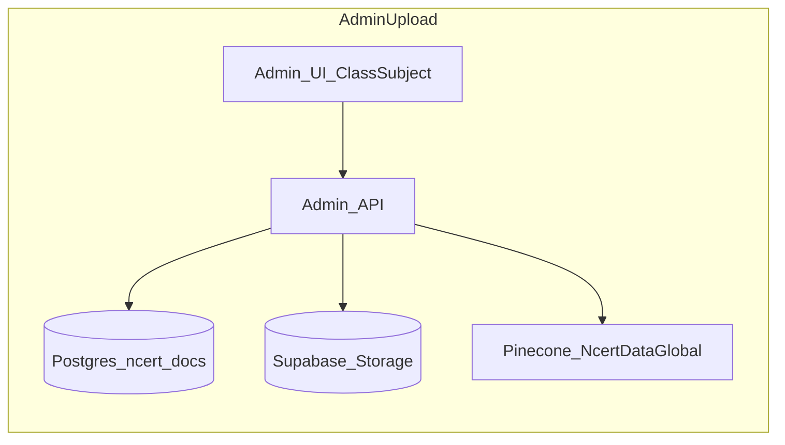

# NCERT Global Knowledge (Admin) — Implementation Plan

## Goals (from product spec + docs)

- Admin uploads NCERT PDFs via a **Class → Subject → (optional Chapter) → File** flow; **metadata for class/subject/chapter comes from the UI**, not from LLM inference ([docs/ncert_pinecone_storage_retrieval_architecture_guide_markdown.md](docs/ncert_pinecone_storage_retrieval_architecture_guide_markdown.md), [docs/contextual_retrieval_ncert_system_markdown_conversion.md](docs/contextual_retrieval_ncert_system_markdown_conversion.md)).
- All vectors for this corpus live in a **single Pinecone namespace**: `NcertDataGlobal` (non-UUID string is preserved by [packages/core/rag/vectorstores/namespace.py](packages/core/rag/vectorstores/namespace.py) `normalize_pinecone_namespace`).
- **Contextual Retrieval** at chunk time follows the same principles as [docs/contextual_retrieval_guide_markdown_conversion.md](docs/contextual_retrieval_guide_markdown_conversion.md) and the existing implementation in [packages/core/rag/llama_adapters/ingestion.py](packages/core/rag/llama_adapters/ingestion.py) / [packages/core/rag/contextual_retrieval/contextualizer.py](packages/core/rag/contextual_retrieval/contextualizer.py): keep `**metadata["text"]` = raw chunk** for citations; store `**chunk_context`, `chunk_summary`, `chunk_type`, `section_title`, `concept_hint`, `contextual_version=1`**; embed **concatenated** text on the node (not into `metadata.text`).
- **Models (target)**:
  - **Context generation**: `gpt-5.4-mini` (wire via settings + task routing; validate against live OpenAI model list at implementation time—fallback remains current `gpt-4o-mini` in [packages/core/llm/factory.py](packages/core/llm/factory.py) until confirmed).
  - **Embeddings**: `text-embedding-3-large` with explicit `**dimensions`** that **match the Pinecone index** (see Risk section—today [config/settings.py](config/settings.py) uses `text-embedding-3-small` + `OPENAI_EMBEDDING_DIMENSIONS=1024`).
  - **Reranker**: **Cohere Rerank** applies at **chat query time** only ([packages/core/rag/retriever.py](packages/core/rag/retriever.py)); **not** during bulk NCERT ingestion. Admin “per run” cost should label stages clearly (contextualization LLM vs embeddings vs optional future re-rank in unrelated flows).

## Current codebase constraints (must design around)

| Area                 | Today                                                                                                                                                             | Implication                                                                                                                                                                    |
| -------------------- | ----------------------------------------------------------------------------------------------------------------------------------------------------------------- | ------------------------------------------------------------------------------------------------------------------------------------------------------------------------------ |
| User upload + ingest | [packages/core/services/source_service.py](packages/core/services/source_service.py) + [apps/api/routes/sources.py](apps/api/routes/sources.py)                   | Tenant-scoped `Source`, `PineconeVectorStore(tenant_id)`, storage path `{tenant_id}/{source_id}.pdf`                                                                           |
| Delete cascade       | [packages/core/services/source_service.py](packages/core/services/source_service.py) `delete_source`                                                              | Strips citations → Pinecone `delete_vectors_by_source` in **tenant** namespace → Supabase delete → DB row                                                                      |
| Chat retrieval       | [packages/core/langgraph/chat_graph.py](packages/core/langgraph/chat_graph.py) `_node_retrieval`                                                                  | Queries **only** `Retriever(tenant_id)` namespace; filters by user-selected `source_id` ([apps/api/routes/chat.py](apps/api/routes/chat.py))                                   |
| Admin auth           | [apps/api/routes/admin.py](apps/api/routes/admin.py) `check_admin_role`                                                                                           | Reuse for all new admin endpoints                                                                                                                                              |
| Cost / tokens        | [packages/core/guardrails/cost_manager.py](packages/core/guardrails/cost_manager.py) + [packages/core/monitoring/metrics.py](packages/core/monitoring/metrics.py) | `record_llm_call` supports `request_id`; pricing from [config/models.yaml](config/models.yaml); `record_document_cost` exists but is **unused**—good hook for ingestion totals |

**Dependency note (Phase 2, not optional for end-user value):** Uploading to `NcertDataGlobal` alone does **not** make chunks appear in chat until retrieval is extended to **query/merge** the global namespace (or expose “virtual” selectable sources). This plan phases that explicitly so admin work is shippable while retrieval merge is scheduled.

---

## Phase 0 — Decisions and prerequisites

1. **Pinecone index dimension vs `text-embedding-3-large`**
  - `text-embedding-3-large` default vector size is **3072** unless `dimensions` is set on the API call.
  - **Rule**: Pick one: (A) **new / migrated Pinecone index** at 3072 for global corpus, or (B) keep existing index dimension (e.g. 1024) and call embeddings with **matching** `dimensions` (OpenAI supports reduction for `-3-*` models).
  - Document the choice in runbooks; mismatch causes upsert/query failures.
2. **Separate embedding settings for global ingest (recommended)**
  - Add settings such as `NCERT_GLOBAL_EMBEDDING_MODEL`, `NCERT_GLOBAL_EMBEDDING_DIMENSIONS`, `NCERT_CONTEXT_MODEL` so tenant chat embeddings stay unchanged while NCERT uses the requested stack.
3. **Model registry**
  - Add `gpt-5.4-mini` and `text-embedding-3-large` entries to [config/models.yaml](config/models.yaml) with **documented** `cost_per_1k_tokens` (update from OpenAI pricing page at implementation time).
  - Add task route e.g. `ncert_chunk_contextualization` in [packages/core/llm/factory.py](packages/core/llm/factory.py) **or** drive model from settings to avoid hardcoding wrong names.

---

## Phase 1 — Database schema (Postgres / Alembic)

Create a dedicated table (keeps tenant `sources` clean and avoids FK to `tenants` for global rows).

**Table: `ncert_global_documents`** (name flexible)

| Column                      | Type          | Notes                                                                               |
| --------------------------- | ------------- | ----------------------------------------------------------------------------------- |
| `id`                        | UUID PK       | **Canonical `source_id`** stored in Pinecone metadata for all chunks of this upload |
| `class`                     | smallint      | 6–10                                                                                |
| `subject`                   | text          | normalized slug: `science`, `mathematics`, …                                        |
| `chapter_no`                | int nullable  | From admin form when applicable                                                     |
| `chapter_name`              | text nullable |                                                                                     |
| `title`                     | text          | Display title (e.g. file or book name)                                              |
| `original_filename`         | text          |                                                                                     |
| `storage_key`               | text not null | Supabase object key (see Storage)                                                   |
| `content_hash`              | text nullable | SHA-256 for idempotency / “already ingested?” warnings                              |
| `status`                    | text/enum     | `processing` / `indexed` / `error`                                                  |
| `chunks_count`              | int           |                                                                                     |
| `error_message`             | text nullable |                                                                                     |
| `uploaded_by_clerk_user_id` | text          | Admin                                                                               |
| `pinecone_namespace`        | text          | constant `NcertDataGlobal` (denormalized for ops)                                   |
| `created_at`, `updated_at`  | timestamptz   |                                                                                     |

**Table: `ncert_global_ingestion_runs`** (industrial observability)

| Column                          | Type          | Notes                                        |
| ------------------------------- | ------------- | -------------------------------------------- |
| `id`                            | UUID PK       | **Ingestion job id**                         |
| `document_id`                   | UUID FK       |                                              |
| `status`                        | enum          | `running` / `success` / `failed`             |
| `started_at`, `completed_at`    | timestamptz   |                                              |
| `context_llm_prompt_tokens`     | int           | Sum over chunk calls                         |
| `context_llm_completion_tokens` | int           |                                              |
| `context_llm_cost_usd`          | numeric       |                                              |
| `embedding_prompt_tokens`       | int           | Prefer actual usage from API where available |
| `embedding_cost_usd`            | numeric       |                                              |
| `total_cost_usd`                | numeric       |                                              |
| `chunks_processed`              | int           |                                              |
| `error_message`                 | text nullable |                                              |

**Migration**: new Alembic revision under [packages/core/database/migrations/versions/](packages/core/database/migrations/versions/) (follow [0001_initial_schema.py](packages/core/database/migrations/versions/0001_initial_schema.py) patterns).

**Indexes**: `(class, subject)`, `(status)`, `(created_at DESC)` for admin list.

---

## Phase 2 — Storage (Supabase)

- **Bucket/path convention** (global, not tenant-prefixed): e.g. `global/ncert/{document_id}.pdf` (or single bucket + prefix). Align with [packages/core/storage/s3.py](packages/core/storage/s3.py) (Supabase Storage client).
- **Delete**: mirror [IngestionService.delete_source](packages/core/services/source_service.py) step 3: `delete_file(storage_key)` on document delete.
- **Optional**: store extracted text snapshot keyed by `content_hash` for reprocessing without re-OCR (future optimization).

---

## Phase 3 — Ingestion service (backend core)

New module e.g. `packages/core/services/ncert_global_ingestion_service.py` (name TBD) responsible for:

1. **Validate** admin + payload (class 6–10, subject allowed list from config file e.g. `config/ncert_subjects_by_class.yaml` or DB seed).
2. **Create** `ncert_global_documents` row (`status=processing`) + `**ncert_global_ingestion_runs`** row (`running`).
3. **Upload PDF** to Supabase; persist `storage_key`.
4. **Extract text** — reuse [packages/core/services/source_service.py](packages/core/services/source_service.py) PDF extraction / [packages/core/processing/pdf_preprocessor.py](packages/core/processing/pdf_preprocessor.py) patterns (factor shared helper if needed).
5. **Chunk + contextualize + embed + upsert**:
  - **Refactor or duplicate** the minimal surface of [packages/core/rag/llama_adapters/ingestion.py](packages/core/rag/llama_adapters/ingestion.py):
    - Force `namespace = "NcertDataGlobal"` (new constructor param or dedicated `LlamaIndexIngestionAdapter` subclass).
    - Pass **document-level context** for contextualizer: prefer full extracted text with same caps as `CONTEXTUAL_RETRIEVAL_MAX_DOC_CONTEXT_CHARS` ([config/settings.py](config/settings.py)).
    - **Augment metadata** on every chunk (in addition to existing keys):
      - `source: "ncert"`
      - `source_id: str(document.id)` (**required** for Pinecone delete-by-source)
      - `tenant_id`: use a **sentinel** consistent across chunks (e.g. literal `NcertDataGlobal` or `global`) — document choice; must match any future metadata filters.
      - `class`, `subject`, `chapter_no`, `chapter_name`, `display_source` (human string per NCERT doc)
      - `chunk_index`, page fields (reuse page mapping logic from existing adapter)
    - **Contextualization model**: call `ChunkContextualizer` with a **wrapper** that uses `NCERT_CONTEXT_MODEL` / task override instead of default `chunk_contextualization` routing.
    - **Embeddings**: `OpenAIEmbedding(model=NCERT_GLOBAL_EMBEDDING_MODEL, dimensions=NCERT_GLOBAL_EMBEDDING_DIMENSIONS)` for this code path only.
6. **Per-chunk cost attribution**:
  - Pass **same `request_id`** (ingestion run UUID) into every `get_cost_manager().record_usage(...)` for contextualization.
  - For embeddings, extend [packages/core/rag/llama_adapters/ingestion.py](packages/core/rag/llama_adapters/ingestion.py) aggregate recording **or** add per-batch recording with run id (prefer batch totals written to run row at end).
7. **Finalize run**: update `ncert_global_ingestion_runs` totals; set document `status=indexed`, `chunks_count`; on failure, `error` + message.
8. **Background execution**: use FastAPI `BackgroundTasks` or existing worker pattern ([docker-compose.yml](docker-compose.yml) Celery worker) for long PDFs; return `202` + `job_id` if async.

**Vector ID strategy**: `{document_id}_chunk_{i}` (matches existing `{source_id}_chunk_{i}` pattern) for compatibility with [packages/core/rag/vectorstores/pinecone_store.py](packages/core/rag/vectorstores/pinecone_store.py) `delete_vectors_by_source` prefix conventions if any; ensure delete uses metadata `source_id` filter (already implemented).

---

## Phase 4 — Cascade delete (admin)

New service method `delete_ncert_global_document(document_id)`:

1. **Authorize** admin.
2. **Pinecone**: `index.delete(filter={"source_id": {"$eq": str(document_id)}}, namespace="NcertDataGlobal")` — mirror try/except behavior in [packages/core/rag/vectorstores/pinecone_store.py](packages/core/rag/vectorstores/pinecone_store.py) `delete_vectors_by_source` (may need a **static method** or `PineconeVectorStore` variant that accepts explicit namespace).
3. **Supabase**: delete `storage_key`.
4. **DB**: delete `ncert_global_ingestion_runs` rows (FK cascade or explicit) + `ncert_global_documents`.
5. **Citations**: optional—if any message citations reference global `source_id`, apply same strip pattern as `_strip_citations_referencing_source` in [packages/core/services/source_service.py](packages/core/services/source_service.py) (only if chat ever references these UUIDs).

**Idempotency**: tolerate missing Pinecone vectors / missing file.

---

## Phase 5 — Admin API (FastAPI)

Under [apps/api/routes/admin.py](apps/api/routes/admin.py) or new `apps/api/routes/admin_ncert_global.py` mounted in [apps/api/main.py](apps/api/main.py):

| Method | Path                                                 | Purpose                                                             |
| ------ | ---------------------------------------------------- | ------------------------------------------------------------------- |
| POST   | `/api/v1/admin/ncert-global/documents`               | multipart: file + class + subject + optional chapter fields + title |
| GET    | `/api/v1/admin/ncert-global/documents`               | paginated list + filters (class, subject, status)                   |
| GET    | `/api/v1/admin/ncert-global/documents/{id}`          | detail                                                              |
| DELETE | `/api/v1/admin/ncert-global/documents/{id}`          | cascade delete                                                      |
| GET    | `/api/v1/admin/ncert-global/ingestion-runs`          | list runs (filter by document_id)                                   |
| GET    | `/api/v1/admin/ncert-global/ingestion-runs/{run_id}` | run detail (tokens + cost breakdown)                                |

All endpoints: `check_admin_role` **raise_on_db_unavailable=True** for consistency with existing admin routes.

**Pydantic schemas**: new file e.g. `apps/api/schemas/ncert_global.py`.

---

## Phase 6 — Admin frontend (Next.js)

- **Location**: new route e.g. `apps/web/src/app/analytics/ncert-global/page.tsx` (alongside existing admin analytics under [apps/web/src/app/analytics/](apps/web/src/app/analytics/)) **or** `apps/web/src/app/dashboard/admin/ncert-global/page.tsx` — pick one navigation entry visible only to admins (pattern from [apps/web/src/app/analytics/page.tsx](apps/web/src/app/analytics/page.tsx)).
- **UX**:
  - Stepper: Class (6–10) → Subject (from config-driven list) → optional Chapter № / Name → Dropzone + title.
  - **List view**: table with class, subject, chapter, title, status, chunks, uploaded_at, uploaded_by, actions (Delete, View runs).
  - **Run detail drawer/modal**: show **context LLM** tokens + cost, **embedding** tokens + cost, **total**, duration, errors.
- **API client**: extend [apps/web/src/lib/api-client.ts](apps/web/src/lib/api-client.ts) with admin methods (Bearer token via existing refresh flow).

**Cost display source of truth**: read from `**ncert_global_ingestion_runs`** (DB), not only JSONL logs—so admin sees consistent numbers after restarts.

---

## Phase 7 — Metrics and pricing hardening

- Extend [config/models.yaml](config/models.yaml) with NCERT models and embedding model pricing.
- Ensure every contextualization call uses `feature_tag` like `ncert_global_chunk_contextualization` and `request_id=<run_id>` for optional correlation with [logs/metrics/llm_calls.jsonl](logs/metrics/llm_calls.jsonl).
- Optionally call `metrics.record_document_cost` with **aggregated** cost at end of run (wire `tenant_id` as `global` or empty string consistently for admin filters).

---

## Phase 8 — Chat retrieval merge (separate milestone)

To satisfy “accessible to any user from any tenant”:

- Extend [packages/core/rag/retriever.py](packages/core/rag/retriever.py) (or a thin orchestrator) to perform **second query** against `NcertDataGlobal` when user toggles “Include NCERT” (or always-on product flag), with metadata filters derived from UI.
- Merge candidate lists before MMR/rerank with explicit **caps** (avoid doubling latency/cost).
- Update [apps/api/routes/chat.py](apps/api/routes/chat.py) validation so users are not forced to “own” NCERT sources (today requires user `Source` rows).

---

## Testing and acceptance criteria

- **Upload**: single PDF → rows in DB `indexed`, vectors in Pinecone under `NcertDataGlobal`, metadata contains class/subject + contextual fields + `contextual_version=1`.
- **Delete**: DELETE removes DB row, Supabase object, and Pinecone vectors for that `source_id` (spot-check with Pinecone console or script).
- **Cost**: ingestion run row shows non-zero token/cost fields when keys are configured; admin UI matches DB within rounding.
- **Security**: non-admin receives 403 on all endpoints.

## Documentation deliverable

Add a short internal runbook (only if you want it in-repo later) referencing the three NCERT/contextual docs and this plan’s metadata contract (`metadata.text` raw vs embed text).