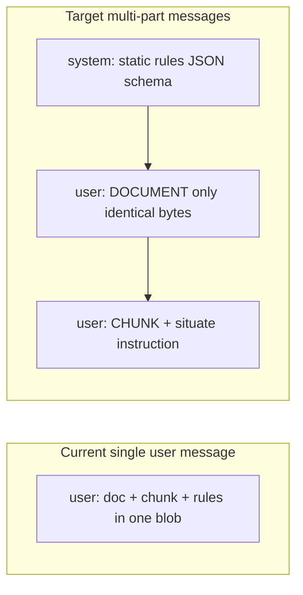

# NCERT contextualization: OpenAI prompt caching (prefix) + unchanged Pinecone schema

## Reality check vs your pseudo-code

OpenAI **Chat Completions** ([prompt caching guide](https://platform.openai.com/docs/guides/prompt-caching)) applies **automatic** caching on **identical long prefixes** (minimum length and model rules apply). There is **no** `create_prompt_cache()` / `cache_id` string you pass on each call in the **standard** `chat.completions` API used by [`packages/core/llm/openai_client.py`](packages/core/llm/openai_client.py).

The implementation goal is therefore: **make the serialized prompt share the largest possible identical prefix** across chunk calls, then **optionally** read `usage` fields such as `prompt_tokens_details.cached_tokens` (when present) for metrics and cost.

**Do not** change the JSON field names returned to Pinecone: keep [`ChunkEnrichment`](packages/core/rag/contextual_retrieval/contextualizer.py) and [`ingestion.py`](packages/core/rag/llama_adapters/ingestion.py) mapping (`chunk_context`, `chunk_summary`, `chunk_type`, `section_title`, `concept_hint`, `contextual_version`, `topic` from `section_title`, plus static `class`, `subject`, `chapter_*`, etc.). Your sketch’s `keywords` / `contextual_summary` are **not** the app contract; the screenshot schema stays authoritative.

## Current behavior (baseline)

- [`chunk_contextualization.j2`](packages/core/prompts/templates/rag/chunk_contextualization.j2) concatenates `whole_document`, then chunk, then rules in **one** user string.
- [`ChunkContextualizer.enrich_chunk`](packages/core/rag/contextual_retrieval/contextualizer.py) calls `OpenAIClient.generate` with `system_prompt` + **one** `user` message containing that full string.
- [`_enrich_nodes_contextual`](packages/core/rag/llama_adapters/ingestion.py) builds `doc_context` (NCERT: header + capped excerpt) once and passes it to every `enrich_chunk` in parallel (semaphore-limited).

Because chunk-specific text is **embedded in the middle** of a single user message, the **byte-identical prefix** that OpenAI can cache may still be large (everything before the chunk), but the layout is fragile (any template whitespace change breaks cache). A **clean split** is more reliable and easier to reason about.

## Implementation plan

### 1. Add a “cached-prefix” prompt path for NCERT (and optional global flag)

- **New Jinja templates** (or one template with two blocks):
  - **System**: static instructions + exact JSON key list (matches current rules: `chunk_context`, `chunk_summary`, `chunk_type`, `section_title`, `concept_hint` only).
  - **Document user message**: *only* the shared `doc_context` string (same bytes for all chunks of this ingest), with a fixed delimiter label e.g. `FULL_DOCUMENT_EXCERPT:` so the model knows role boundaries.
  - **Chunk user message**: chunk text + short “situate this chunk using the document above” + repeat minimal JSON constraint if needed.

- **Wire in `ChunkContextualizer`**:
  - Add parameter e.g. `use_split_document_messages: bool = False` or detect NCERT via optional `static_metadata_hint` passed from adapter.
  - When enabled, call OpenAI with `messages=[system, user_doc, user_chunk]` instead of folding everything into one user prompt.
  - When disabled (default for non-NCERT), keep today’s single-message behavior to limit blast radius.

- **Extend `OpenAIClient.generate`** (minimal API surface):
  - Support either `messages: Optional[List[dict]]` **or** a dedicated kwarg `extra_user_messages` that builds the list internally—**without** breaking existing `prompt` + `system_prompt` callers.
  - Pass through `**kwargs` to `chat.completions.create` as today; ensure `response_format` still applies.

### 2. Preserve identical `doc_context` bytes across chunk calls

- In [`_enrich_nodes_contextual`](packages/core/rag/llama_adapters/ingestion.py), `doc_context` is already computed once; **do not** per-chunk mutate it.
- Ensure the **document message** is exactly `doc_context` (optionally with a fixed one-line prefix that is also identical for all chunks).
- Keep NCERT caps (`CONTEXTUAL_RETRIEVAL_NCERT_DOC_CONTEXT_CHARS`, header) as today unless product wants a **larger** excerpt for quality now that cached input is cheaper on repeats—expose a **single setting** if you tune this later.

### 3. Cache warmup and concurrency

- OpenAI caching typically **starts helping after** the first completed request with that prefix. Parallel chunk 2–N may race before the cache is warm.
- **NCERT-only policy**: run **first** `enrich_chunk` **await** (or a no-op “primer” completion with `max_tokens=1` if you want to avoid throwing away work—product choice), **then** `asyncio.gather` the rest with existing semaphore; or temporarily set `CONTEXTUAL_RETRIEVAL_NCERT_MAX_CONCURRENCY=1` for the first N=1 only.
- Document tradeoff: slight latency increase vs higher cache hit rate.

### 4. Usage and cost accounting

- Parse `response.usage` for optional nested fields (e.g. `prompt_tokens_details.cached_tokens` / similar—**verify against live SDK response** for your `openai` version).
- Thread through [`LLMResponse`](packages/core/llm/_base.py) `metadata` or extend `usage` dict.
- Update [`CostManager.calculate_cost`](packages/core/guardrails/cost_manager.py) (or a small helper) to apply **discounted** input rate for cached tokens per OpenAI’s published rules, while keeping backward compatibility when details are absent.
- Aggregate into `usage_accumulator` in [`contextualizer.py`](packages/core/rag/contextual_retrieval/contextualizer.py) for `ncert_global_ingestion_runs` so the admin UI stays meaningful.

### 5. Metadata contract (no schema drift)

- **No change** to [`ChunkEnrichment.to_metadata()`](packages/core/rag/contextual_retrieval/contextualizer.py) keys.
- **No change** to [`_enrich_nodes_contextual`](packages/core/rag/llama_adapters/ingestion.py) post-processing: `contextual_version=1`, `topic` from `section_title`, embed text concatenation unchanged.
- Static keys from [`ncert_global_service.py`](packages/core/services/ncert_global_service.py) / `_build_nodes` remain the source of `class`, `subject`, `chapter_no`, `chapter_name`, `display_source`, `source`, `tenant_id`, `source_id`, page fields.

### 6. Testing and acceptance

- **Unit / integration**: mock OpenAI client to assert `messages` order and that document message is identical for two different chunks.
- **Manual**: ingest one NCERT PDF, compare Pinecone metadata to existing good record (your screenshot): all keys present; values non-empty where expected.
- **Optional**: log `cached_tokens` per request in dev to confirm non-zero on chunk 2+.

### 7. Out of scope / follow-ups

- **Explicit provider `cache_id` APIs** (if OpenAI adds or if you move to **Responses API** / other surface): abstract behind `LLMClient` in a later phase once product picks the API.
- **Anthropic prompt caching** (different headers): only if you add a Claude path to `ChunkContextualizer`.

## Files likely touched

| Area | Files |
|------|--------|
| Prompts | New or updated templates under [`packages/core/prompts/templates/rag/`](packages/core/prompts/templates/rag/) |
| Contextualizer | [`packages/core/rag/contextual_retrieval/contextualizer.py`](packages/core/rag/contextual_retrieval/contextualizer.py) |
| OpenAI client | [`packages/core/llm/openai_client.py`](packages/core/llm/openai_client.py) |
| Ingestion | [`packages/core/rag/llama_adapters/ingestion.py`](packages/core/rag/llama_adapters/ingestion.py) |
| Cost | [`packages/core/guardrails/cost_manager.py`](packages/core/guardrails/cost_manager.py), possibly [`config/models.yaml`](config/models.yaml) notes |
| Settings | [`config/settings.py`](config/settings.py): e.g. `CONTEXTUAL_RETRIEVAL_NCERT_PROMPT_CACHE_SPLIT=true`, warmup toggle |

## Risk notes

- **SDK version**: confirm `openai` package returns cached-token breakdown; adjust parsing defensively.
- **Multi-worker ingest**: each process has independent cache priming; still valid per document batch.
- **Quality**: if `doc_context` cap is too small, enrichment quality drops; tuning is independent of caching mechanics.
