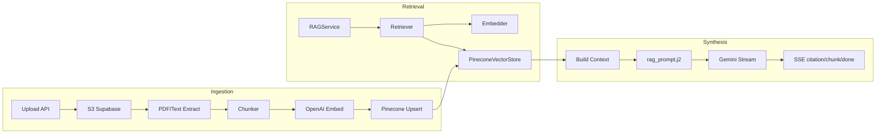
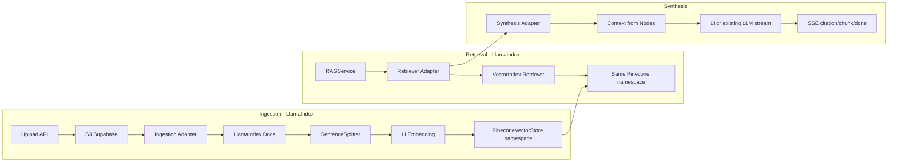

# Plan A: LlamaIndex for Ingestion, Retrieval, and Synthesis

## Goal

Replace the current custom RAG pipeline (ingestion, retrieval, synthesis) with **LlamaIndex** while keeping all external contracts unchanged:

- **FastAPI**: Same routes and request/response shapes (e.g. `POST /api/v1/ingest/upload`, `POST /api/v1/chat/stream`).
- **SSE**: Same event types and payloads — `citation` (list of citation objects), `chunk` (`{"text": "..."}`), `done` (optional metadata), `error` (`{"error": "..."}`).
- **Pinecone**: Namespace remains `tenant_id`; vector IDs and metadata schema stay compatible so existing data continues to work.
- **Supabase Storage**: Path pattern `{tenant_id}/{source_id}.pdf` (and `.txt`) unchanged; no change to [packages/core/storage/s3.py](packages/core/storage/s3.py) or upload flow in [apps/api/routes/sources.py](apps/api/routes/sources.py).

Orchestration (guardrails, memory, cache, etc.) stays as-is; LangGraph is out of scope for this plan.

---

## Current Architecture (Simplified)

---

## Target Architecture (After LlamaIndex)

---

## Implementation Phases

### Phase 1: Dependencies and Adapter Contracts

- Add LlamaIndex dependencies to [requirements.txt](requirements.txt) (e.g. `llama-index`, `llama-index-vector-stores-pinecone`, `llama-index-embeddings-openai`). Pin versions for reproducibility.
- Define **adapter interfaces** (in a new module, e.g. `packages/core/rag/llama_adapters/`) so that:
  - **Ingestion**: Input = (tenant_id, source_id, file bytes or stream, content_type, optional pdf_password). Output = same DB update and Pinecone state as today (vector ids `{source_id}_chunk_{i}`, metadata: source_id, tenant_id, text, chunk_index, page_start, page_end).
  - **Retrieval**: Input = (tenant_id, query, top_k, filter by source_ids). Output = `{"matches": [{"id", "metadata": {"text", "source_id", "page_start", ...}, "score"}, ...]}` — identical to current [Retriever](packages/core/rag/retriever.py) return shape.
  - **Synthesis**: Input = (message, context from retrieval, history). Output = async generator of `{"event": "citation"|"chunk"|"done"|"error", "data": ...}` — same as [RAGService.stream_chat](packages/core/services/rag_service.py).

No route or SSE contract changes in this phase; only interfaces and dependency add.

---

### Phase 2: LlamaIndex Ingestion Adapter

- **New module**: e.g. `packages/core/rag/llama_adapters/ingestion.py`.
  - Use LlamaIndex document loading from bytes (PDF via existing pypdf or LlamaIndex reader; keep [PDFPreprocessor](packages/core/processing/pdf_preprocessor.py) as optional pre-step if needed).
  - Use LlamaIndex `SentenceSplitter` (or equivalent) with `chunk_size` and `chunk_overlap` aligned to current [settings](config/settings.py) (`CHUNK_SIZE`, `CHUNK_OVERLAP_PERCENT`).
  - Create nodes with metadata: `source_id`, `tenant_id`, `page_start`, `page_end`, `chunk_index`, `text` (and any existing fields). Set node `id`_ to `{source_id}_chunk_{i}` for Pinecone compatibility.
  - Use LlamaIndex `PineconeVectorStore` with **namespace = tenant_id** and existing OpenAI embedding model (`text-embedding-3-small`). Ensure upsert payload matches current metadata schema so existing and new vectors are queryable the same way.
- **Integration**: From [IngestionService.process_file_background](packages/core/services/source_service.py), after downloading from storage and optional caching:
  - Call the LlamaIndex ingestion adapter instead of Chunker + vector_store.batch_generate_embeddings + batch_upsert_vectors.
  - Keep: S3 path `{tenant_id}/{source_id}.pdf`, DB status transitions (PROCESSING → INDEXED), ContextCache usage (optional: cache raw text and pass to LI to avoid re-parsing), and error handling that sets status to ERROR.
- **Backward compatibility**: Existing vectors (same namespace, same id/metadata shape) must remain valid. New ingestions must produce the same vector id and metadata so retrieval does not need to distinguish “legacy” vs “LlamaIndex” vectors.

---

### Phase 3: LlamaIndex Retrieval Adapter

- **New module**: e.g. `packages/core/rag/llama_adapters/retrieval.py`.
  - Build a LlamaIndex `VectorStoreIndex` from the existing **Pinecone** index and **namespace = tenant_id** (reuse same Pinecone connection/settings).
  - Implement a **retriever adapter** that:
    - Takes (query, top_k, filter by source_ids).
    - Uses LlamaIndex retriever with metadata filter for `source_id` in `active_source_ids`.
    - Converts `NodeWithScore` (or equivalent) list into `{"matches": [{"id", "metadata": {...}, "score"}, ...]}` so [RAGService](packages/core/services/rag_service.py) and any Phase 2 agents (query rewriter, reranker, etc.) keep working unchanged.
  - Preserve optional behavior: if `USE_RETRIEVAL_AGENTS` is true, keep using existing [Retriever](packages/core/rag/retriever.py) pipeline (intent, scope, rewrite, hybrid, MMR, reranker, context selector) but feed it **either** current vector_store query **or** LlamaIndex retriever output converted to `matches` — so one code path uses LI under the hood.
- **Minimal change in RAGService**: Replace direct `Retriever` + `Embedder` usage with a single “retrieval adapter” that returns the same `results` dict; guardrails and cache logic remain unchanged.

---

### Phase 4: LlamaIndex Synthesis Adapter

- **New module**: e.g. `packages/core/rag/llama_adapters/synthesis.py`.
  - **Option A (recommended for minimal risk)**: Keep current flow — build context string from retrieval `matches` (same grouping by source as today), use existing [load_prompt("chat/rag_prompt.j2")](packages/core/prompts/templates/chat/rag_prompt.j2) and existing `llm_client.stream_generate`. Only swap the **source** of `matches` to the LlamaIndex retrieval adapter. No change to SSE emission (citations first, then chunk, then done).
  - **Option B**: Use LlamaIndex `ResponseSynthesizer` (streaming) with the same retriever output converted to nodes; then map LlamaIndex streamed tokens to SSE `chunk` events and build citation list from nodes for SSE `citation` events. Ensures citation format and order (citation → chunk → done) stay identical.
- **Contract**: The synthesis adapter yields the same event types and payloads as today (including `citation` with source_id, chunk_id, text, score, source_title, page_number; `chunk` with text; `done` with optional metadata; `error` with error message). All existing frontend and middleware expectations remain valid.

---

### Phase 5: Feature Flag and Wiring

- Add a feature flag (e.g. `USE_LLAMA_INDEX_RAG` in [config/settings.py](config/settings.py)) to switch between:
  - **Off**: Current ingestion (Chunker + PineconeVectorStore), current Retriever, current RAGService stream_chat.
  - **On**: LlamaIndex ingestion adapter, LlamaIndex retrieval adapter, synthesis adapter (Option A or B).
- Wire the flag in:
  - [apps/api/routes/sources.py](apps/api/routes/sources.py): background task calls either current `process_file_background` or a thin wrapper that uses the LI ingestion adapter.
  - [packages/core/services/rag_service.py](packages/core/services/rag_service.py): retrieval and synthesis use adapters when flag is on; otherwise existing code path.
- No change to route handlers themselves: same request/response and SSE stream shape.

---

### Phase 6: Testing and Rollback

- **Unit tests**: Adapter output shape tests — ingestion adapter produces vectors with correct ids/metadata; retrieval adapter returns `matches` in the exact format RAGService expects; synthesis adapter yields SSE events with correct keys and citation structure.
- **Integration test**: One full flow: upload PDF via `/api/v1/ingest/upload`, wait for INDEXED, send one message to `/api/v1/chat/stream`, assert SSE contains `citation`, `chunk`, `done` in order and citation objects have source_id, chunk_id, text, page_number, score.
- **Rollback**: If `USE_LLAMA_INDEX_RAG=false`, system behaves exactly as before. No data migration required because Pinecone schema and namespace are preserved.

---

## File-Level Summary

| Area                 | Files to add                                                                       | Files to modify                                                                                                                                                         |
| -------------------- | ---------------------------------------------------------------------------------- | ----------------------------------------------------------------------------------------------------------------------------------------------------------------------- |
| Dependencies         | —                                                                                  | [requirements.txt](requirements.txt)                                                                                                                                    |
| Contracts / Adapters | `packages/core/rag/llama_adapters/` (interfaces + ingestion, retrieval, synthesis) | —                                                                                                                                                                       |
| Config               | —                                                                                  | [config/settings.py](config/settings.py) (flag)                                                                                                                         |
| Ingestion            | —                                                                                  | [packages/core/services/source_service.py](packages/core/services/source_service.py) (branch on flag, call LI ingestion adapter)                                        |
| Retrieval            | —                                                                                  | [packages/core/rag/retriever.py](packages/core/rag/retriever.py) or RAGService: use retrieval adapter when flag on                                                      |
| Synthesis            | —                                                                                  | [packages/core/services/rag_service.py](packages/core/services/rag_service.py) (use synthesis adapter when flag on)                                                     |
| Routes               | —                                                                                  | No change to [apps/api/routes/sources.py](apps/api/routes/sources.py) or [apps/api/routes/chat.py](apps/api/routes/chat.py) beyond optional wrapper for background task |
| Tests                | Tests for adapters + one integration test                                          | —                                                                                                                                                                       |

---

## Invariants (Do Not Change)

- Pinecone namespace = `tenant_id` for all operations.
- Vector id format: `{source_id}_chunk_{i}`.
- Vector metadata: at least `source_id`, `tenant_id`, `text`, `chunk_index`; `page_start`/`page_end` when available.
- Supabase storage path: `{tenant_id}/{source_id}.pdf` (or `.txt`).
- SSE: `event: citation` / `event: chunk` / `event: done` / `event: error` with existing payload shapes.
- FastAPI endpoints and request/response schemas for ingest and chat.

This plan keeps the system backward-compatible and allows a safe, flag-based rollout of LlamaIndex for ingestion, retrieval, and synthesis only.