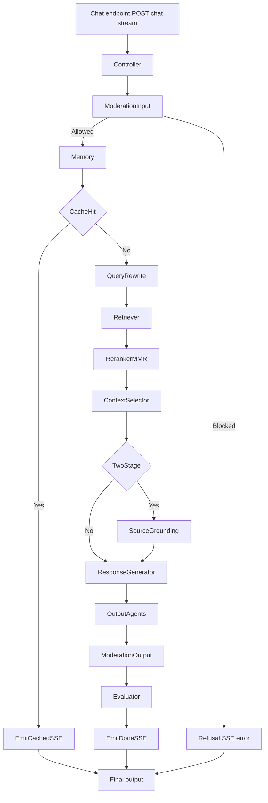

# Plan B: LangGraph Chat Orchestration

## Goal

Once Plan A (LlamaIndex) is stable, wrap the **CHAT** flow in a **LangGraph** graph that:

- Mirrors [docs/mermaid-diagram.mmd](docs/mermaid-diagram.mmd) (and the CHAT subgraph in [docs/mermaid-diagram.png](docs/mermaid-diagram.png)): guardrails → memory → cache → query rewrite → retriever → reranker/MMR → context selector → two-stage grounding → response generator → output agents → moderation output → evaluator → done.
- Preserves the existing **SSE contract**: `citation` (one or more), then `chunk` (streamed text), then `done` (metadata), or `error` on failure.
- Uses **Cohere Rerank API** for the reranking node (replacing current LLM/keyword reranker).
- Uses **OpenAI Moderation API** with model **omni-moderation-latest** for input and output moderation (replacing or supplementing the current [SafetyFilter](packages/core/security/safety_filter.py) keyword-based checks).

**Scope:** CHAT path only. STUDIO flow remains unchanged and is out of scope for this plan.

**Prerequisite:** Plan A (LlamaIndex) completed and stable; chat retrieval and synthesis are assumed to go through LlamaIndex adapters when `USE_LLAMA_INDEX_RAG` is on.

---

## Target Flow (LangGraph CHAT)

---

## 1. State Schema

Define a **typed state** (e.g. `TypedDict` or Pydantic) that flows through the graph and is read/written by nodes. It must carry everything needed to emit the SSE stream at the end.

**Suggested fields:**

- **Input (set once):** `message`, `history`, `active_source_ids`, `tenant_id`, `user_id`, `db` (session reference or None if not passed).
- **Control flags:** `blocked` (bool), `use_cached_response` (bool), `cold_start` (bool), `error` (optional str).
- **Moderation:** `redacted_message` (after input moderation).
- **Memory:** `effective_history` (after prune/summarize).
- **Cache:** `cached_answer`, `cached_citations` (when cache hit).
- **Retrieval:** `rewritten_query`, `matches`, `reranked_matches`, `selected_matches`, `context` (str), `citations` (list of citation dicts).
- **Two-stage:** `use_mini_context` (bool).
- **Generation:** `full_prompt`, `streamed_text` (accumulated), `final_answer` (after output agents).
- **Output moderation:** `final_output_text` (after safety + PII redact).
- **Eval:** `confidence_score`, `done_payload` (dict for `done` event).

The **SSE emitter** (or a dedicated “sink” node) reads from state and yields `citation`, `chunk`, `done`, or `error` in the exact format expected by [apps/api/routes/chat.py](apps/api/routes/chat.py) (e.g. `event['event']`, `event['data']`).

---

## 2. Nodes and Responsibilities

| Node                  | Responsibility                                                                                                                                                                                                         | LLM?                                                    | Notes                                                                                                                                                                                                                          |
| --------------------- | ---------------------------------------------------------------------------------------------------------------------------------------------------------------------------------------------------------------------- | ------------------------------------------------------- | ------------------------------------------------------------------------------------------------------------------------------------------------------------------------------------------------------------------------------ |
| **Controller**        | Build initial state from request; route into graph.                                                                                                                                                                    | No                                                      | Single entry.                                                                                                                                                                                                                  |
| **ModerationInput**   | Run **OpenAI Moderation API** (omni-moderation-latest) on `message`; optionally keep existing PII/injection/intent checks or fold into one step. If blocked, set `blocked=True` and `error=refusal_message`.           | No (OpenAI Moderation is a separate API)                | Replace or supplement [SafetyFilter](packages/core/security/safety_filter.py) for input.                                                                                                                                       |
| **Memory**            | Cold start check; prune history; summarize if needed. Set `effective_history`, `cold_start` flags.                                                                                                                     | Optional (summarize: heuristic or LLM per current code) | Reuse [ColdStartHandler](packages/core/evaluation/), [MemoryManager](packages/core/memory/), [ChatSummarizer](packages/core/memory/chat_summarizer.py).                                                                        |
| **CacheCheck**        | Look up answer cache. If hit: set `use_cached_response`, `cached_answer`, `cached_citations`.                                                                                                                          | No                                                      | Reuse [AnswerCache](packages/core/memory/).                                                                                                                                                                                    |
| **QueryRewrite**      | Intent, scope narrow, query rewrite. Set `rewritten_query`.                                                                                                                                                            | Yes (existing agents)                                   | Reuse [IntentClassifier](packages/core/rag/agents/intent_classifier.py), [ScopeNarrower](packages/core/rag/agents/scope_narrower.py), [QueryRewriter](packages/core/rag/agents/query_rewriter.py) when `USE_RETRIEVAL_AGENTS`. |
| **Retriever**         | Call LlamaIndex retrieval adapter (or current Retriever) with tenant, `rewritten_query`/message, `active_source_ids`. Set `matches`.                                                                                   | No (embeddings only)                                    | After Plan A, retrieval is via LlamaIndex adapter.                                                                                                                                                                             |
| **RerankerMMR**       | **Cohere Rerank API** on `matches` + query; then MMR diversity. Set `reranked_matches`.                                                                                                                                | No                                                      | **New:** Cohere client, `COHERE_API_KEY`; model e.g. `rerank-v3.5` or `rerank-v4.0-fast`. Map chunks to documents list and back to existing match shape. Keep [MMRDiversity](packages/core/rag/agents/mmr_diversity.py).       |
| **ContextSelector**   | Dedupe, token budget, build `context` and `citations`.                                                                                                                                                                 | No                                                      | Reuse [ContextDeduper](packages/core/rag/agents/), [ContextSelector](packages/core/rag/agents/context_selector.py).                                                                                                            |
| **TwoStageGrounding** | If simple query + enough chunks, check answerable with mini context; set `use_mini_context` and possibly reduced `context`/`citations`.                                                                                | Yes                                                     | Reuse [TwoStageAnswering](packages/core/rag/agents/two_stage_answering.py).                                                                                                                                                    |
| **ResponseGenerator** | Build prompt from `context` + `message`; stream LLM (Gemini/OpenAI); append to `streamed_text`; set `final_answer` when done.                                                                                          | Yes                                                     | Reuse [load_prompt](packages/core/prompts/loader.py) and existing `llm_client.stream_generate`.                                                                                                                                |
| **OutputAgents**      | Early stop, length limit, citation check. Update `final_answer`.                                                                                                                                                       | No                                                      | Reuse [EarlyStopDetector](packages/core/rag/agents/early_stop_detector.py), [OutputLengthLimiter](packages/core/rag/agents/), [CitationEnforcer](packages/core/rag/agents/citation_enforcer.py).                               |
| **ModerationOutput**  | Run **OpenAI Moderation API** (omni-moderation-latest) on `final_answer`; if blocked, replace with refusal. Then PII redact. Set `final_output_text`.                                                                  | No                                                      | Replace/supplement current output [SafetyFilter](packages/core/security/safety_filter.py) with OpenAI Moderation.                                                                                                              |
| **Evaluator**         | Confidence scoring; build `done_payload` (e.g. confidence, cold_start, cached, retrieval_trace).                                                                                                                       | Optional (LLM-based confidence if enabled)              | Reuse [ConfidenceScorer](packages/core/evaluation/confidence_scorer.py), RAGService’s `_evaluate_answer_confidence_with_llm` if desired.                                                                                       |
| **EmitSSE**           | Map state to SSE events: if `blocked` or `error` → `error`; if `use_cached_response` → citation events + chunk (simulated stream) + done; else citation + chunk (from `final_output_text`) + done with `done_payload`. | No                                                      | Must match [apps/api/schemas/chat.py](apps/api/schemas/chat.py) and [apps/api/routes/chat.py](apps/api/routes/chat.py) (event names and data shape).                                                                           |

Conditional edges:

- After **ModerationInput**: if `blocked` → go to **EmitSSE** (refusal path); else → **Memory**.
- After **CacheCheck**: if `use_cached_response` → go to **EmitSSE** (cached path); else → **QueryRewrite**.
- After **ContextSelector**: optional branch for two-stage (TwoStageGrounding) then **ResponseGenerator**; else straight to **ResponseGenerator**.

---

## 3. Cohere Rerank Integration

- **Config:** Add `COHERE_API_KEY` and optionally `COHERE_RERANK_MODEL` (e.g. `rerank-v3.5` or `rerank-v4.0-fast`) to [config/settings.py](config/settings.py).
- **New module:** e.g. `packages/core/rag/rerank/cohere_reranker.py` (or under `packages/core/rag/agents/`). Input: list of chunk dicts (with `metadata.text`), query string, top_n. Call Cohere Rerank API; map results back to existing chunk shape and order (preserve `id`, `metadata`, attach new score). Return list of chunks in reranked order.
- **Reranker node:** In the LangGraph, call this Cohere reranker first; then run MMR on the reranked list if desired (or keep current order). Replace or bypass the existing [Reranker](packages/core/rag/agents/reranker.py) LLM/keyword logic when LangGraph is enabled.
- **Dependency:** Add `cohere` to [requirements.txt](requirements.txt).

---

## 4. OpenAI Moderation API (omni-moderation-latest)

- **Config:** Use existing `OPENAI_API_KEY`; add optional `OPENAI_MODERATION_MODEL: str = "omni-moderation-latest"` in [config/settings.py](config/settings.py) if you want it configurable.
- **New module:** e.g. `packages/core/security/openai_moderation.py`. Function: `check_moderation(text: str, model: str = "omni-moderation-latest")` calling OpenAI Moderation API; return `{ "flagged": bool, "categories": {...}, "category_scores": {...} }`. If `flagged`, caller sets refusal message (from [RefusalTemplates](packages/core/security/)) and blocks.
- **ModerationInput node:** Before any retrieval, call `check_moderation(state["message"])`. If flagged, set `blocked=True` and `error=<refusal>` and route to EmitSSE.
- **ModerationOutput node:** After generation, call `check_moderation(state["final_answer"])`. If flagged, set `final_output_text` to a safe refusal message instead of the model output; then run PII redaction on that.
- **Fallback:** If `omni-moderation-latest` is not available in the API, document fallback to `text-moderation-latest` or current SafetyFilter until the model is available.

---

## 5. LangGraph Wiring and SSE Contract

- **Graph build:** Use `langgraph` to define nodes and edges. State type = the schema above. Conditional edges: ModerationInput → (Refusal | Memory); CacheCheck → (EmitSSE cached | QueryRewrite); rest linear until EmitSSE.
- **Streaming:** The **ResponseGenerator** node streams tokens. LangGraph supports streaming of state updates; the **EmitSSE** “node” can be an async generator that:
  - Consumes the final state after the graph run, and
  - Yields SSE events in order: `citation` (one per citation), `chunk` (e.g. by splitting `final_output_text` or by feeding from a queue filled during ResponseGenerator stream), `done` with `done_payload`.
- **Route integration:** In [apps/api/routes/chat.py](apps/api/routes/chat.py), when a feature flag (e.g. `USE_LANGGRAPH_CHAT`) is True, call the LangGraph chat pipeline instead of `RAGService.stream_chat`. The pipeline must return an async generator that yields the same `{"event": str, "data": dict}` structure so the existing `generate_stream()` loop and `StreamingResponse` stay unchanged.
- **Contract:** Preserve [ChatStreamEvent](apps/api/schemas/chat.py) semantics: `event` in `citation` | `chunk` | `done` | `error`; `data` for citation = citation object (source_id, chunk_id, text, page_number, score, source_title); for chunk = `{"text": "..."}`; for done = optional metadata; for error = `{"error": "..."}`.

---

## 6. Feature Flag and Rollback

- Add `USE_LANGGRAPH_CHAT: bool = False` to [config/settings.py](config/settings.py).
- When `USE_LANGGRAPH_CHAT` is False: [apps/api/routes/chat.py](apps/api/routes/chat.py) keeps using `RAGService.stream_chat` (with or without LlamaIndex per Plan A). When True: use the LangGraph pipeline and Cohere reranker + OpenAI Moderation as above.
- Rollback: set `USE_LANGGRAPH_CHAT=false`; no data migration.

---

## 7. File-Level Summary

| Area              | Files to add                                                                                                      | Files to modify                                                                                                                     |
| ----------------- | ----------------------------------------------------------------------------------------------------------------- | ----------------------------------------------------------------------------------------------------------------------------------- |
| Config            | —                                                                                                                 | [config/settings.py](config/settings.py) (`COHERE_API_KEY`, `COHERE_RERANK_MODEL`, `OPENAI_MODERATION_MODEL`, `USE_LANGGRAPH_CHAT`) |
| State / graph     | `packages/core/langgraph/` (or `packages/core/chat/graph/`): state schema, node implementations, graph definition | —                                                                                                                                   |
| Cohere rerank     | `packages/core/rag/rerank/cohere_reranker.py` (or under `agents/`)                                                | —                                                                                                                                   |
| OpenAI Moderation | `packages/core/security/openai_moderation.py`                                                                     | [packages/core/security/**init**.py](packages/core/security/__init__.py) (export)                                                   |
| Chat route        | —                                                                                                                 | [apps/api/routes/chat.py](apps/api/routes/chat.py) (branch on `USE_LANGGRAPH_CHAT`, call graph and yield same SSE)                  |
| Dependencies      | —                                                                                                                 | [requirements.txt](requirements.txt) (`langgraph`, `cohere`)                                                                        |

---

## 8. Implementation Order (Suggested)

1. **State schema and Cohere reranker** — Add config, Cohere reranker module, and state TypedDict/Pydantic.
2. **OpenAI Moderation module** — Implement `openai_moderation.py` and wire into a single “moderation” helper used by both input and output nodes.
3. **LangGraph nodes (non-streaming)** — Implement each node as a function that takes state and returns state updates (Controller, ModerationInput, Memory, CacheCheck, QueryRewrite, Retriever, RerankerMMR, ContextSelector, TwoStageGrounding, OutputAgents, ModerationOutput, Evaluator). ResponseGenerator can first be “generate full response then put in state” for simplicity.
4. **Graph build and conditional edges** — Compile the graph with LangGraph; add conditional edges for blocked/cache-hit.
5. **SSE emitter** — Implement EmitSSE so that, given final state, it yields citation/chunk/done/error events in the exact format the route expects. For streaming, either (a) stream from ResponseGenerator via state updates and have the route consume a queue, or (b) have the graph return full state and EmitSSE simulate chunk streaming from `final_output_text`.
6. **Route integration and flag** — Branch in chat route on `USE_LANGGRAPH_CHAT`; test with flag off then on.
7. **Tests** — Unit tests for Cohere reranker output shape, OpenAI Moderation return shape, state transitions; integration test: one chat request with LangGraph on, assert SSE events and citation/chunk/done structure.

---

## 9. Invariants (Do Not Change)

- SSE event types and payload shapes (citation, chunk, done, error) as consumed by the frontend and [apps/api/routes/chat.py](apps/api/routes/chat.py).
- FastAPI endpoint `POST /api/v1/chat/stream` request/response contract (StreamingResponse, same headers).
- Pinecone namespace = tenant_id and retrieval filtered by active_source_ids (handled inside Retriever node / LlamaIndex adapter).
- Plan A LlamaIndex retrieval and synthesis behavior when used inside the graph (retriever node calls LlamaIndex retrieval adapter; response generator uses same prompt and LLM as today).

This plan keeps the CHAT flow consistent with the diagram, preserves your SSE contract, and introduces Cohere Rerank and OpenAI Moderation (omni-moderation-latest) as specified, with a clear path to rollout and rollback.