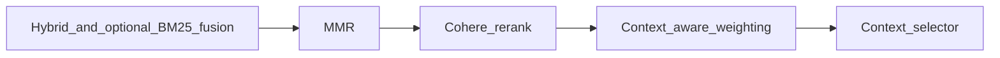

# Retrieval quality: production implementation plan

## Primary objective

Improve **final context quality** for the educational RAG app (user PDFs/notes): better ordering after hybrid retrieval, smarter use of existing **LangGraph intent**, and safe rollout of **optional** LLM steps—without blowing up ingest/query cost or index complexity.

## What we deliberately skip (for now)

- **True multi-representation / multi-vector Pinecone records** (separate embeddings per chunk for raw vs summary vs `concept_hint`): highest engineering and cost surface (index size, query fan-out, fusion tuning). Your stack already uses a **single concatenated embedding** plus **lexical** signals in `[packages/core/rag/hybrid_retriever.py](packages/core/rag/hybrid_retriever.py)` and optional **BM25+RRF** in `[packages/core/rag/retriever.py](packages/core/rag/retriever.py)`. Revisit only after an offline eval shows concat+fusion plateaus.
- **Large new doc/ADR files**: keep changes in code + `[config/settings.py](config/settings.py)` with concise comments.

---

## Phase A — Fix pipeline semantics (highest ROI)

**Problem:** Context-aware boosts run **after hybrid merge** but **before MMR and Cohere rerank** (`[retriever.py` ~593–627](packages/core/rag/retriever.py)), which can fight the reranker’s ordering.

**Target flow:**

**Implementation:**

1. **Remove** the current post-hybrid block that mutates `hybrid_matches` scores (lines ~593–627).
2. **Extract** boost logic into a small pure function (e.g. `apply_context_aware_scores(matches, query, intent, max_boost) -> list[dict]`) in a dedicated module under `[packages/core/rag/](packages/core/rag/)` or a private method on `Retriever`—prefer module if you want unit tests without constructing the full retriever.
3. **Invoke** that function **once** on `reranked_matches` **after** the rerank stage completes (including branches: cache hit, Cohere success/failure, skip rerank). Apply the same step when `get_rerank` returns cached ordering so **cache + weighting** stays consistent.
4. **Re-sort** by `score` after boosting; preserve existing guardrails (`min_chunks_after_rerank`, low-confidence rerank fallback) so you never drop chunks—only reorder.
5. **Telemetry:** append `context_aware_weighting_post_rerank` to `debug_trace["guardrails_applied"]` and add a `record_retrieval_span` (or extend existing) with `chunks_in/out` for observability.

**Settings:** Keep `[ENABLE_CONTEXT_AWARE_RETRIEVAL_WEIGHTING](config/settings.py)` and `[CONTEXT_AWARE_WEIGHTING_MAX_BOOST](config/settings.py)`; default can remain `False` until canary.

---

## Phase B — Intent “hard routing” (leverage existing classifier)

**Current state:** `[intent_classifier_system.j2](packages/core/prompts/templates/agents/intent_classifier_system.j2)` already outputs rich intents (`explanation`, `comparison`, `how_to`, …). `[Retriever.retrieve](packages/core/rag/retriever.py)` maps `classified_intent` → `[UserIntent](packages/core/rag/agents/__init__.py)` and only varies `**top_k`** via `[get_context_size](packages/core/rag/retriever.py)` (~137–168).

**Implementation:**

1. Add `**RetrievalStrategy`** (dataclass or typed dict) with fields you will actually use first, e.g. `initial_retrieval_k_multiplier`, `enable_query_decomposition_for_this_request`, `skip_mmr` (optional, conservative default False), `mmr_target_multiplier` (optional).
2. Add `**resolve_retrieval_strategy(intent: UserIntent, intent_confidence: float, query: str, complexity_result: dict) -> RetrievalStrategy`** in a new small file e.g. `[packages/core/rag/retrieval_strategy.py](packages/core/rag/retrieval_strategy.py)`.
3. **Confidence gate:** if `intent_confidence` < new setting `RETRIEVAL_INTENT_ROUTING_MIN_CONFIDENCE` (e.g. 0.55), return **neutral** strategy (current behavior).
4. **Wire** in `retrieve()` right after intent + complexity are known: replace/adjust hard-coded `initial_retrieval_k = max(top_k * 3, 20)` with something like `max(int(top_k * strategy.initial_retrieval_k_multiplier), 20)` (tune defaults to avoid regressions on `definition` / `question`).
5. **Tests:** table-driven tests for 3–5 intents (e.g. `comparison` → higher multiplier; `definition` → lower) and “low confidence → neutral”.

**Why:** Uses the classifier you already pay for in LangGraph (`[chat_graph.py](packages/core/langgraph/chat_graph.py)` passes `classified_intent`) without a second LLM call in the common path.

---

## Phase C — Query decomposition (safe production rollout)

**Current state:** `[QueryDecomposer](packages/core/rag/agents/query_decomposer.py)` is integrated but `[ENABLE_QUERY_DECOMPOSITION](config/settings.py)` defaults **False**.

**Implementation:**

1. Add gates so decomposition runs only when **strategy says so** (Phase B), not only the global flag—e.g. enable for `comparison`, `analysis`, and vague `explanation` when word count > N **and** not `should_skip_rerank` simple-query path.
2. Keep **hard cap** on sub-queries (`[QUERY_DECOMPOSITION_MAX_SUB_QUERIES](config/settings.py)`); dedupe against `rewritten_queries` (already partially done).
3. Add optional `**ENABLE_QUERY_DECOMPOSITION_SHADOW`**: log `primary_concept` + sub-queries and **do not** append to `rewritten_queries`—lets you validate lift before enabling writes.
4. **Operational:** one JSONL metric line or existing pipeline trace field: `decomposition_used`, `sub_query_count`.

**Default recommendation:** ship Phase A + B with decomposition still off or shadow-only; enable append path in staging/canary.

---

## Phase D — Contextual chunk enrichment (minimal production hardening)

**Current state:** Ingestion path is implemented with flags in `[config/settings.py](config/settings.py)` (~137–152) and adapter logic in `[packages/core/rag/llama_adapters/ingestion.py](packages/core/rag/llama_adapters/ingestion.py)`.

**Implementation (only if gaps appear in logs):**

1. **Structured counters** (or log sampling): `contextualization_ok`, `contextualization_fallback`, `empty_chunk_summary`—avoid silent broad `except` without visibility.
2. **Re-ingest policy:** document in code comment or settings: when bumping prompt/model, bump `contextual_version` and optionally add a one-off backfill script (reuse patterns from existing smoke/ingest scripts)—no need to build a full job runner in-repo unless you already use one.

Skip heavy new validation pipelines unless product requires them.

---

## Rollout and validation

1. **Unit tests:** `retrieval_strategy` resolution; `apply_context_aware_scores` ordering; optional snapshot of score deltas on synthetic metadata.
2. **Integration / smoke:** extend or re-run `[scripts/smoke_contextual_retrieval.py](scripts/smoke_contextual_retrieval.py)` with flags: post-rerank weighting on/off; intent routing neutral vs aggressive.
3. **Canary:** enable `ENABLE_CONTEXT_AWARE_RETRIEVAL_WEIGHTING=True` in a narrow environment; watch latency (rerank unchanged; one extra sort) and qualitative answers on comparison/long questions.

## Risk notes

- **Rerank cache:** Applying weighting **after** `get_rerank` avoids storing two different orderings in cache; same query always gets the same Cohere order from cache, then the same deterministic metadata boost.
- **Intent misroutes:** mitigated by confidence threshold and conservative multipliers.

