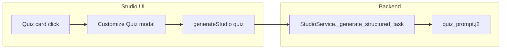

# Studio Quiz customization plan

## Current behavior

- Clicking **Quiz** in `[apps/web/src/components/studio/StudioSuite.tsx](apps/web/src/components/studio/StudioSuite.tsx)` calls `handleGenerate('quiz')` immediately; optional global **Custom Instructions** may apply.
- Backend `[packages/core/services/studio_service.py](packages/core/services/studio_service.py)` loads `[packages/core/prompts/templates/studio/quiz_prompt.j2](packages/core/prompts/templates/studio/quiz_prompt.j2)` with `context` (from selected sources via Pinecone) and `custom_instructions`.
- `[apps/web/src/lib/api-client.ts](apps/web/src/lib/api-client.ts)` `generateStudio` already sends `custom_instructions`; no schema change is required for MVP.

## Target behavior

1. **Quiz** opens a dedicated modal (same pattern as slide deck: intercept click, then call `handleGenerate('quiz', sourceIds, combinedInstructions)`).
2. Modal collects:
  - **Question volume**: `fewer` | `standard` | `more` (map to explicit counts in instructions, e.g. 3–4 / 5–7 / 8–10, and align with JSON schema expectations).
  - **Difficulty**: `easy` | `medium` | `hard`.
  - **Topic (optional)**: free text; if **empty**, instructions must say to use the **full retrieved context** across all selected sources (no artificial narrow focus).
3. **Visual design**: Intentionally **different** from the reference—e.g. single-column form with clear section labels, stacked controls (selects or radio list), subtle borders, and one primary CTA—reusing tokens/classes already used in the slide-deck modal (`border-border-default`, `bg-surface-subtle`, `[Button](apps/web/src/components/ui/Button.tsx)`).

## Implementation steps

### 1. Frontend — modal state and wiring

**File:** `[apps/web/src/components/studio/StudioSuite.tsx](apps/web/src/components/studio/StudioSuite.tsx)`

- Add state: `isQuizConfigOpen`, `quizSpec` (e.g. `{ volume: 'fewer'|'standard'|'more', difficulty: 'easy'|'medium'|'hard', topicFocus: string }`) with sensible defaults (`standard`, `medium`, `''`).
- On **Quiz** `StudioCard` click: open modal (mirror `[slide_deck` branch](apps/web/src/components/studio/StudioSuite.tsx) around lines 459–463).
- **Generate** button: build `buildQuizInstructions(spec)` returning a short, numbered block (similar to `buildSlideDeckInstructions`) that includes:
  - Exact question count range for the chosen volume.
  - Difficulty rules (vocabulary, distractor quality, reasoning depth).
  - If `topicFocus.trim()`: "Prioritize questions about: …"
  - If empty: "No narrow topic was specified—cover the **entire** breadth of the provided source material (all selected sources represented), not only one section."
- Merge with existing global `customInstructions` if non-empty: `[quiz block]\n\n[global custom]`.
- Call `handleGenerate('quiz', undefined, combinedInstructions)` then close modal.
- **Retry**: ensure `lastCustomInstructions` already stores the payload sent (same as current slide-deck fix)—quiz retry should reuse the last combined string.

**Optional cleanup:** If the file grows too large, extract `QuizCustomizeModal` (and optionally `SlideDeckCustomizeModal`) into `apps/web/src/components/studio/QuizCustomizeModal.tsx`—only if you want parity/maintainability; not strictly required.

### 2. Backend — prompt contract

**File:** `[packages/core/prompts/templates/studio/quiz_prompt.j2](packages/core/prompts/templates/studio/quiz_prompt.j2)`

- Replace the fixed line **"Generate at least 5 questions"** with guidance that:
  - Defers **exact count** to `custom_instructions` when present (Studio will always send the structured quiz block from the modal).
  - Keeps a **sensible default** when `custom_instructions` is absent (e.g. 5–7 questions) so other callers/tests stay valid.
- Add a short **Compliance** subsection: honor difficulty, question count range, topic focus vs whole-coverage when instructed; still enforce JSON-only output and 4 options per question.

No change required to `[StudioService._generate_structured_task](packages/core/services/studio_service.py)` unless you later add typed API fields; `custom_instructions` already flows into the template.

### 3. Validation and edge cases

- **Frontend:** Keep existing quiz validation in `StudioSuite` (`questions` array non-empty). Optionally assert minimum count matches selected volume (lenient: if model returns slightly fewer, show message vs hard fail—product choice; plan default: keep current "non-empty" check).
- **Empty topic:** Do not send placeholder text; only the instruction line about whole-source coverage.
- **Sources:** Unchanged—context still built from `source_ids` in `[_get_context_from_sources](packages/core/services/studio_service.py)`.

### 4. Verification

- Manual: select sources → Quiz → set volume/difficulty/topic → generate; repeat with empty topic and confirm broader quiz.
- Optional: extend `[scripts/test_studio_report_infographic.py](scripts/test_studio_report_infographic.py)` pattern with a tiny script or pytest that mocks context and checks prompt rendering if you want regression safety (not mandatory for first ship).

## Out of scope (unless you ask later)

- New Pydantic fields on `StudioRequest` for `quiz_volume` / `quiz_difficulty` (nice for analytics; not needed for correctness).
- Persisting last quiz preferences in `localStorage` (can mirror slide-deck UX later).

