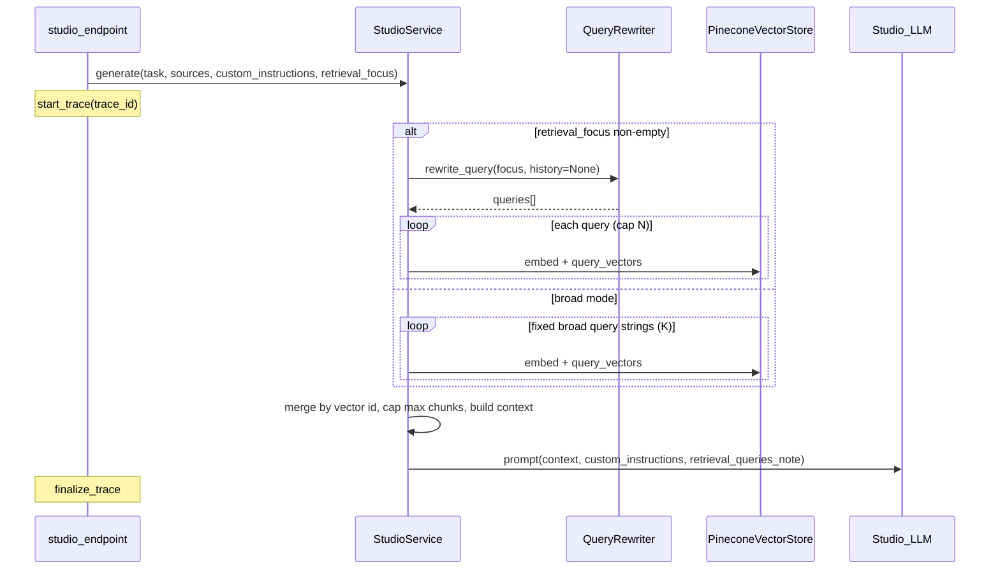

# Studio retrieval upgrade + pipeline traces

## Current behavior (baseline)

- `[packages/core/services/studio_service.py](packages/core/services/studio_service.py)` builds context via `_get_context_from_sources`: a **single** embedding from `[context_embedding_query.j2](packages/core/prompts/templates/studio/context_embedding_query.j2)`, Pinecone `query_vectors` with `source_id $in`, `top_k = TOP_K_CHUNKS * 2`, then concatenated chunk text. **User topic in `custom_instructions` does not change retrieval.**
- Chat RAG uses `[QueryRewriter](packages/core/rag/agents/query_rewriter.py)` + full `[Retriever](packages/core/rag/retriever.py)` (includes rerank path when configured). **Studio will not use `Retriever`** — requirement: **no reranking**; only embeddings + Pinecone query + deterministic merge.
- Pipeline traces today: `[PipelineTraceStore](packages/core/monitoring/pipeline_trace.py)` + `start_trace` / `add_span` / `finalize_trace`; chat wires this in `[chat_graph.py](packages/core/langgraph/chat_graph.py)`. Studio `[apps/api/routes/studio.py](apps/api/routes/studio.py)` does **not** start a trace.

## Target architecture

## 1. API contract: optional retrieval focus

- Add optional `**retrieval_focus: Optional[str]**` to `[StudioRequest](apps/api/schemas/studio.py)` (Pydantic). Semantics: **raw user intent for what to pull from the vector DB** (not a replacement for `custom_instructions`, which stays format/difficulty/etc.).
- **Frontend** (`[api-client.ts](apps/web/src/lib/api-client.ts)` `generateStudio`): send `retrieval_focus` when present.
- **Studio UI** (`[StudioSuite.tsx](apps/web/src/components/studio/StudioSuite.tsx)`): for quiz, set `retrieval_focus` to `quizSpec.topicFocus.trim()` or omit when empty. Optionally map slide deck **objective** the same way later (same field).

## 2. Retrieval implementation in `StudioService` (no reranker)

Replace `_get_context_from_sources(source_ids)` with an internal async helper, e.g. `_retrieve_studio_context(source_ids, retrieval_focus: Optional[str]) -> tuple[str, dict]`, returning **(context_text, metadata)** where metadata holds `queries_used: list[str]`, `chunk_count`, `mode: "topic_rewrite" | "broad"`.

**When `retrieval_focus` is non-empty (after strip):**

- Instantiate `[QueryRewriter(self.tenant_id, self.user_id)](packages/core/rag/agents/query_rewriter.py)` and call `rewrite_query(retrieval_focus, conversation_history=None, max_rewrites=3)` (empty history = standalone topic; same JSON contract as chat).
- Take the returned `**queries` list** (already ordered best-first). For each query, up to a small cap (e.g. **first 3** strings), `generate_embedding` + `query_vectors` with the existing `source_id $in` filter and a **per-query** `top_k` (e.g. `max(8, TOP_K_CHUNKS // 2)` — tune via settings constants).
- **Merge**: union matches by Pinecone `**id`** (vector id); keep **max score** per id when deduplicating. Sort final list by score descending, then take top `**STUDIO_CONTEXT_MAX_CHUNKS`** (new setting, default ~24–32).

**When `retrieval_focus` is empty (broad / “whole sources” intent):**

- Do **not** call the rewriter.
- Use a **fixed list** of 3–4 coverage-oriented English strings (constants in `studio_service.py` or a tiny new template file under `packages/core/prompts/templates/studio/` loaded once). Same per-query embed + query + merge + cap as above.

**Explicitly out of scope (per your note):** Cohere/LLM **reranking**, and the full chat `**Retriever`** pipeline (MMR, context selector, etc.).

## 3. Pass retrieval queries into every Studio LLM prompt

- Extend `[_load_prompt_template](packages/core/services/studio_service.py)` (and any direct `load_prompt` calls in `_generate_report` / `_generate_infographic`) to pass a new Jinja variable, e.g. `**retrieval_queries_note`** (a short human-readable string: primary query + alternates, truncated for safety), or `**retrieval_queries`** as a list rendered in templates.
- Update **all** task templates under `[packages/core/prompts/templates/studio/](packages/core/prompts/templates/studio/)` that receive `context`: `quiz_prompt.j2`, `flashcards_prompt.j2`, `mind_map_prompt.j2`, `slide_deck_prompt.j2`, `report_prompt.j2`, `infographic_prompt.j2` with a small shared block, e.g. “Retrieval focus used for source search: …” so the **generation model** aligns answers with what was actually retrieved (your requirement: rewritten / used queries **also passed to the LLM**).

## 4. Pipeline traces (parity with chat, visible on admin pipeline UI)

- In `[apps/api/routes/studio.py](apps/api/routes/studio.py)`: generate `trace_id = str(uuid.uuid4())`, call `get_pipeline_trace_store().start_trace(trace_id, tenant_id, user_id or "")` before `service.generate`, and `finalize_trace(trace_id, success=...)` in `finally` (mirror error handling in `[chat_graph.py](packages/core/langgraph/chat_graph.py)`).
- Pass `trace_id` into `StudioService.generate` **or** rely on `ContextVar` set by `start_trace` (already how `[add_span](packages/core/monitoring/pipeline_trace.py)` works).
- Inside `StudioService`, after trace is active, record **manual timed spans** via `get_pipeline_trace_store().add_span(...)` (or `record_retrieval_span`) with `**feature_tag=f"studio_{task_type}"`**:
  - `**StudioRetrieval`** — input: `task_type`, `source_ids` count, `retrieval_focus` snippet; output: `mode`, `queries_used` (snippets), `chunk_count`.
  - `**StudioRetrieval/QueryRewrite`** (only when focus path) — input/output: raw focus, rewritten query list (sanitized length).
  - `**StudioRetrieval/VectorQuery`** (optional: one span per batch or one aggregated span) — `queries_run`, `top_k`, `matches_before_merge`.
  - `**StudioGenerate`** (or reuse name `**Generate`**) — input: `context_chars`, `task_type`; output: `content_preview` / length.

The existing pipeline UI (`[apps/web/src/app/analytics/pipeline/page.tsx](apps/web/src/app/analytics/pipeline/page.tsx)`) lists recent traces from the same store; **no UI change is strictly required** if span names are clear. Optional polish: filter or badge traces that contain `StudioRetrieval`.

- **Response body**: add `**trace_id`** to the successful JSON response (and optionally on errors after partial trace) so operators can open `/analytics/pipeline?trace_id=...` like chat’s console hint.

## 5. Query rewriter observability

- Prefer passing an optional `**feature_tag`** into `QueryRewriter.rewrite_query` (default `"query_rewriter"`) so Studio calls can log `**studio_query_rewriter`** in LLM metrics without forking prompt logic. If you want zero change to `QueryRewriter`, keep `"query_rewriter"` — acceptable but less clear in dashboards.

## 6. Settings / safety

- New settings in `[config/settings.py](config/settings.py)`: e.g. `STUDIO_RETRIEVAL_QUERIES_CAP` (how many rewritten strings to run), `STUDIO_RETRIEVAL_TOP_K_PER_QUERY`, `STUDIO_CONTEXT_MAX_CHUNKS`.
- Preserve current behavior as a **fallback**: if Pinecone/embeddings fail, return `""` context as today (with trace span `status=error` where appropriate).

## 7. Testing / verification

- Unit-style: mock `query_vectors` to return overlapping ids and assert merge dedupes and respects max chunks.
- Manual: quiz with topic → pipeline trace shows `QueryRewrite` + multiple queries + merged retrieval; quiz without topic → broad multi-query path, no rewrite span; confirm prompts include `retrieval_queries_note`.

## Follow-ups (not in initial scope)

- **Per-source quotas** after merge (ensure each selected `source_id` appears in context) — industrial nice-to-have, extra logic on top of merge.
- **Hybrid keyword + vector** for Studio — you asked for rewriter + vector only.

