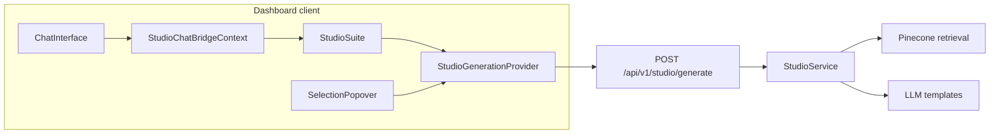

# Studio: hybrid chat + sources and text-selection flows

## Current behavior (baseline)

- **Frontend**: [`StudioSuite.tsx`](apps/web/src/components/studio/StudioSuite.tsx) calls [`apiClient.generateStudio`](apps/web/src/lib/api-client.ts) with `task_type`, `source_ids`, optional `custom_instructions` / `retrieval_focus` / `report_format`. It **requires** `validSelectedIds.length > 0` before calling the API.
- **API**: [`apps/api/routes/studio.py`](apps/api/routes/studio.py) validates [`StudioRequest`](apps/api/schemas/studio.py) — **`source_ids` must have `min_items=1`**.
- **Backend**: [`StudioService.generate`](packages/core/services/studio_service.py) always calls `_retrieve_studio_context` (Pinecone, `source_id` filter) and passes a **single** `context` string into Jinja templates (e.g. [`studio/mind_map_prompt.j2`](packages/core/prompts/templates/studio/mind_map_prompt.j2), etc.). **Infographic** additionally enforces **exactly one** `source_id` at the start of `generate`.

There is **no** shared state today between [`ChatInterface`](apps/web/src/components/chat/ChatInterface.tsx) (local `messages`) and `StudioSuite` (siblings under [`DashboardWrapper`](apps/web/src/components/layout/DashboardWrapper.tsx)).

---

## Target semantics

| Flow | Trigger | Context |
|------|---------|--------|
| **1. Source-based** | User selects sources, clicks a Studio card in the right rail | Unchanged: retrieval from selected `source_ids` only |
| **2. Chat + source hybrid** | User has a **non-empty** chat transcript **and** ≥1 selected source, clicks a Studio card | Send **formatted conversation** + **retrieved chunks**; enforce **~60% emphasis on chat / ~40% on sources** in the **composed prompt** (see below) |
| **3. Selection-only** | User highlights text in the **chat column**; small **floating menu** offers the same six actions | **No retrieval**, **no full chat** — model sees **only** the highlighted string (plus task instructions) |

**Disambiguation for rail clicks**: If `messages.length > 0` (or a stricter rule: at least one user message) **and** `source_ids.length >= 1`, treat rail Studio actions as **hybrid**. If chat is empty, keep **source-only**. If user has chat but **no** sources, keep current UX: block with a clear message (hybrid requires sources per your spec).

**60/40 implementation (practical)**: Do **not** rely on the model to “measure” percentages. Instead:

1. **Retrieval budget**: In hybrid mode, set `max_chunks` (or an effective cap) to roughly **`floor(STUDIO_CONTEXT_MAX_CHUNKS * 0.4)`** (configurable constant) so source material stays a minority by bulk.
2. **Transcript budget**: Truncate/normalize chat to a max character/token budget so it can dominate (~60% of total context in rough size).
3. **Prompt contract**: Build one composite `context` string (or add explicit Jinja variables) with two labeled sections, e.g. `## Conversation (primary — reflect this discussion)` and `## Source excerpts (supporting — ground facts here)`, plus a short system/user instruction line stating the weighting.

Apply the same composition helper for **all** `task_type` paths (structured, report, infographic) so behavior is consistent.

**Infographic in selection-only / hybrid**: Relax the **“exactly one source”** rule when `context_mode == selection_only` (0 sources) or keep single-source for infographic in hybrid if product prefers; **recommendation**: allow selection-only infographic from **text only**; for hybrid, allow infographic with **one or more** sources like other tasks **or** keep 1-source for infographic only in hybrid to limit scope — **default plan**: hybrid infographic uses same multi-source retrieval as report unless you want to preserve today’s single-doc infographic behavior (call out in implementation as a one-line product choice).

---

## Backend changes

1. **Schema** — [`apps/api/schemas/studio.py`](apps/api/schemas/studio.py)  
   - Add `context_mode: Literal["sources_only", "chat_hybrid", "selection_only"]` defaulting to `"sources_only"`.  
   - Make `source_ids` **conditionally** required: e.g. allow empty list only when `context_mode == "selection_only"`; require `min_items=1` for `sources_only` and `chat_hybrid`.  
   - Add `chat_transcript: Optional[str]` (required for `chat_hybrid`, max length enforced).  
   - Add `selection_text: Optional[str]` (required for `selection_only`, `min_length` e.g. 15–32 chars).  
   - Use a `@model_validator` to enforce cross-field rules.

2. **Route** — [`apps/api/routes/studio.py`](apps/api/routes/studio.py)  
   - Replace the blanket “at least one source” check with validation aligned to `context_mode`.  
   - Pass new fields into `StudioService.generate`.

3. **Service** — [`packages/core/services/studio_service.py`](packages/core/services/studio_service.py)  
   - Extend `generate(...)` signature with `context_mode`, `chat_transcript`, `selection_text`.  
   - **Branch context assembly**:  
     - `sources_only`: current path.  
     - `selection_only`: skip `_retrieve_studio_context`; set `context` from `selection_text` only; `retrieval_meta` marks mode.  
     - `chat_hybrid`: run retrieval with **reduced** `max_chunks`; build composite context from truncated transcript + source excerpts.  
   - Thread composite context into existing `_load_prompt_template` / `_generate_*` (minimal template churn if composite is a single `context` string).  
   - Optional: add `STUDIO_HYBRID_SOURCE_CHUNK_FRACTION` (0.4) and `STUDIO_HYBRID_CHAT_MAX_CHARS` in [`config/settings.py`](config/settings.py).

4. **Tests**  
   - New/extended unit tests: schema validation matrix; `StudioService.generate` with mocked retrieval for hybrid; selection-only skips vector calls (mock `PineconeVectorStore`).

---

## Frontend changes

1. **Bridge chat → Studio**  
   - Introduce a small **React context** (e.g. `StudioChatBridgeProvider`) mounted in [`DashboardWrapper`](apps/web/src/components/layout/DashboardWrapper.tsx) **above** both `{children}` and the right rail so `ChatInterface` and `StudioSuite` share it.  
   - `ChatInterface` updates the context whenever `messages` change: serialize to a stable transcript (role labels + plain text; strip or simplify markdown for assistant if needed).  
   - Expose `hasChatContext: boolean` derived from transcript.

2. **Centralize generation + modal (recommended)**  
   - Extract the logic now inside `StudioSuite` (`handleGenerate`, modal state, retry, `formatContent`, etc.) into either:  
     - a **`StudioGenerationProvider`** + `useStudioGeneration()` hook, or  
     - a dedicated hook module with provider.  
   - `StudioSuite` becomes mostly **buttons + config sub-modals** calling `generate(...)`.  
   - This avoids duplicating `GenerationModal` wiring for the selection menu.

3. **`StudioSuite` rail behavior**  
   - When opening generation from a card:  
     - If `hasChatContext && validSelectedCount > 0` → call API with `context_mode: "chat_hybrid"` and `chat_transcript`.  
     - Else if `validSelectedCount > 0` → `context_mode: "sources_only"` (current).  
     - Else → show existing “select a source” error.  
   - Update [`api-client.ts`](apps/web/src/lib/api-client.ts) `generateStudio` to send the new fields.

4. **Text selection + floating menu (chat column)**  
   - In [`ChatInterface.tsx`](apps/web/src/components/chat/ChatInterface.tsx) (or a child wrapper around the message list): listen to `mouseup` / `selectionchange` within the scrollable chat area; if `window.getSelection()` text is non-trivial and **contained** in the chat pane, show a **small anchored popover** (Mind Map, Reports, Flashcards, Quiz, Infographic, Slide Deck).  
   - On action: call the same `useStudioGeneration().generate(...)` with `context_mode: "selection_only"`, `selection_text`, **`source_ids: []`** (schema must allow).  
   - **Infographic** from selection: either allow in API for `selection_only` only, or hide Infographic in the selection menu if you keep strict single-source infographic — **plan default**: show all six; backend allows selection-only infographic.

5. **Tutor layout**  
   - If tutor pages use `ChatInterface` without `StudioGenerationProvider`, either wrap them or no-op the bridge (empty transcript); selection menu only where provider exists.

---

## Documentation / trace

- Log `context_mode` in existing studio pipeline trace spans for debugging.  
- Short note in [`docs/CHAT_FLOW.md`](docs/CHAT_FLOW.md) or existing Studio doc (only if you already maintain one — optional).

---

## Architecture sketch

---

## Implementation order (suggested)

1. Backend schema + `StudioService` branching + tests (unblocks API contract).  
2. `api-client` + `StudioGenerationProvider` / hook extraction.  
3. `StudioChatBridgeContext` + `ChatInterface` sync.  
4. `StudioSuite` hybrid vs source-only wiring.  
5. Selection popover + same `generate` entry point.  
6. Manual QA: three flows × six task types (at least smoke).
