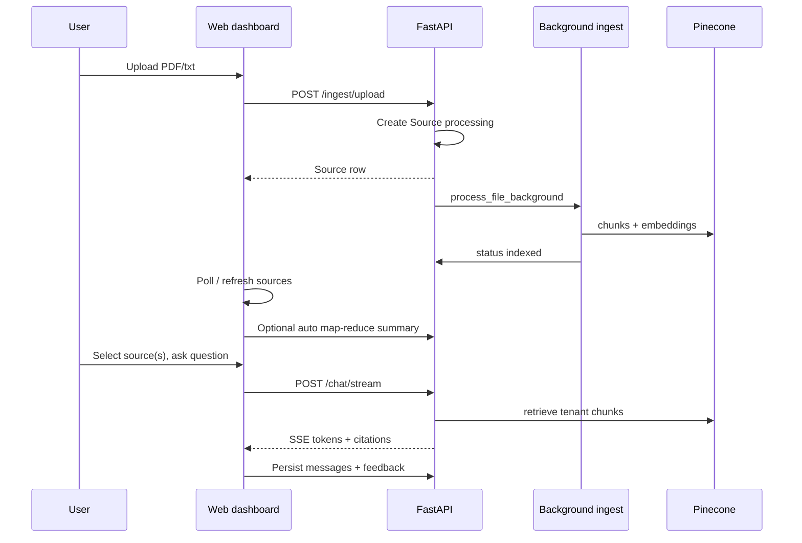

# ScholarSync — Implemented Features & Workflows

**Purpose**: Planning reference for what exists in code today vs what the [V1 product spec](SOURCE_OF_TRUTH_PRODUCT_SPEC.md) targets.  
**Audience**: Product / engineering planning for MVP completion.  
**Status**: Grounded in codebase as of 2026-05-29.  
**Legend**: ✅ Implemented · ⚠️ Partial · ❌ Not implemented (or stub only)

---

## 1) How to use this document

| Column | Meaning |
|--------|---------|
| **Implemented** | End-to-end path exists (API + UI or API-only ops surface). |
| **Partial** | Backend or UI exists but incomplete, dev-only, or not aligned with spec roles/NFRs. |
| **Gap for MVP** | Required by `SOURCE_OF_TRUTH_PRODUCT_SPEC.md` but missing or insufficient. |

Cross-check spec sections **§6 (functional)**, **§7 (NFRs)**, and **§12 (open questions)** when prioritizing backlog.

---

## 2) System snapshot (what runs today)

| Layer | Stack | Notes |
|-------|--------|------|
| **Web** | Next.js App Router, Clerk auth | Protected routes via `apps/web/src/middleware.ts` |
| **API** | FastAPI (`apps/api/main.py`) | Tenant + JWT middleware; routers under `/api/v1/*` |
| **Core** | `packages/core` | RAG (LangGraph chat, LlamaIndex ingestion), Studio, guardrails, metrics |
| **Data** | Postgres, Pinecone, S3 (or local storage), Redis | Redis used for caches/sketches; ingestion uses FastAPI `BackgroundTasks` (not Celery for uploads) |
| **Worker** | Celery app (`apps/worker`) | ⚠️ Stub tasks only (`cleanup_task`, `usage_aggregation` TODO) |

**Tenancy**: Subdomain → tenant row in DB (production `*.scholarsync.com`); localhost → `default` tenant. Backend resolves tenant from host; web also sets `x-tenant-id` cookie/header (not security boundary).

---

## 3) Feature inventory (by product area)

### 3.1 Authentication & session — ✅ / ⚠️

| Capability | Status | Detail |
|------------|--------|--------|
| Clerk sign-in / sign-up | ✅ | `(auth)/sign-in`, `(auth)/sign-up` |
| Protected app routes | ✅ | `/home`, `/dashboard`, `/tutor*`, `/studios`, `/notes`, `/analytics` |
| API JWT validation | ✅ | `apps/api/middleware/auth.py` + tenant middleware |
| User row sync (Clerk → DB) | ✅ | Middleware upserts user on authenticated requests |
| Formal RBAC (Student / Teacher / SchoolAdmin / PlatformAdmin) | ❌ | DB `users.role` is `admin` \| `user` only; no route-level Teacher/SchoolAdmin gates |
| Dev unauthenticated metrics/dashboards | ⚠️ | `TENANT_ONLY_PATHS` allows metrics without JWT in development |

**MVP gaps**: FR-AUTH role matrix; SchoolAdmin UX; production-harden “tenant-only” paths.

---

### 3.2 Tenant isolation — ✅ / ⚠️

| Capability | Status | Detail |
|------------|--------|--------|
| Tenant from subdomain | ✅ | API middleware + web middleware |
| `tenant_id` on sources, chats, notes | ✅ | SQLAlchemy models |
| Per-user source ownership | ✅ | `source.user_id`; chat stream validates `active_source_ids` belong to user |
| Pinecone namespace per tenant | ✅ | Vector store scoped by tenant |
| NCERT global namespace (shared corpus) | ✅ | Separate Pinecone namespace `NcertDataGlobal` |
| Cross-tenant isolation tests / audit | ⚠️ | Logic in code; formal test suite & audit log not productized |

**MVP gaps**: NFR-SEC-4 audit events; documented isolation acceptance tests.

---

### 3.3 Sources — upload & ingestion — ✅ / ⚠️

| Capability | Status | Detail |
|------------|--------|--------|
| Upload PDF | ✅ | `POST /api/v1/ingest/upload`, max **10MB** |
| Upload plain text | ✅ | Same endpoint |
| Encrypted PDF (password) | ✅ | Optional `pdf_password` form field |
| Background ingestion | ✅ | Extract → semantic chunking → contextual enrichment → embed → Pinecone |
| Source list | ✅ | `GET /api/v1/ingest/sources` (user-scoped) |
| Delete source | ✅ | DB + `delete_vectors_by_source` + storage |
| Status lifecycle | ⚠️ | `processing` → `indexed` \| `error` (spec mentions pending/ready naming) |
| URL / connected sources | ❌ | `SourceType.URL` in model/schema only; no upload flow |
| Shared / class library sources | ❌ | All sources are per-user within tenant |
| Ingestion via Celery worker | ❌ | Uses FastAPI background task on API process |

**UI**: Source panel on dashboard (`SourceList`, upload, selection checkboxes, processing/error states).

**MVP gaps**: URL ingest if in scope; teacher-shared library; larger file limits if pilot needs them; worker-based ingestion for scale.

---

### 3.4 Dashboard chat (source-grounded RAG) — ✅

| Capability | Status | Detail |
|------------|--------|--------|
| SSE streaming chat | ✅ | `POST /api/v1/chat/stream` |
| Require selected sources (dashboard) | ✅ | 400 if no sources and NCERT not enabled for request |
| Multi-source selection | ✅ | `active_source_ids` |
| Optional NCERT merge in dashboard | ✅ | Checkbox `include_ncert_global` (flag `ENABLE_NCERT_GLOBAL_IN_CHAT`) |
| Chat history CRUD | ✅ | List, get, patch title, delete chat |
| Messages persist | ✅ | `POST /{chat_id}/messages`, load on chat open |
| Citations in responses | ✅ | Structured citation metadata (UI can de-emphasize inline `[n]` via `ENFORCE_CITATIONS`) |
| Message feedback | ✅ | `PATCH /messages/{id}/feedback` thumbs up/down |
| Chat sidebar | ✅ | `ChatListSidebar` — new chat, switch, delete |
| Post-upload auto-summary | ✅ | Map-reduce whole-file summary after ingest completes |
| Conversation summarization | ✅ | In-graph + optional `POST /{chat_id}/summarize` |
| Strict grounding / relevance gates | ✅ | Settings: `CHAT_STRICT_CONTEXT_GROUNDING`, selected-source gates, global fallback **off** by default |
| LangGraph orchestration | ✅ | `USE_LANGGRAPH_CHAT` — intent, retrieval agents, guardrails, streaming |
| Dialog router (greetings) | ✅ | `ENABLE_DIALOG_ROUTER` |
| Rate limiting & answer cache | ✅ | Per-user RPM, debounce, Redis/in-memory cache |
| Safety: moderation, injection, PII | ✅ | OpenAI moderation, embedding injection sim, PII detector |
| Citation modal / chunk preview | ✅ | `CitationModal` |

**MVP gaps**: Policy UI for school admins; explicit “refuse when ungrounded” copy consistency; WCAG on chat controls.

---

### 3.5 Tutor mode (NCERT) — ✅ / ⚠️

| Capability | Status | Detail |
|------------|--------|--------|
| Dedicated tutor UX | ✅ | `/tutor` landing → `/tutor-mode` with `ChatInterface mode="tutor"` |
| NCERT-only chat (no user uploads required) | ✅ | Tutor sends `include_ncert_global=true`, empty `active_source_ids` |
| Class / subject / chapter filters | ✅ | UI selectors + `GET /api/v1/chat/ncert-filters` |
| Relevance gating | ✅ | `TUTOR_NCERT_RELEVANCE_GATE_ENABLED`, cosine threshold |
| Hybrid general knowledge when corpus weak | ⚠️ | Tutor path can differ from dashboard; governed by settings/pipeline — not a separate “policy UI” |
| Curriculum scope enforcement | ⚠️ | Retrieval filters + gates; not full syllabus-lock product (`ENABLE_SYLLABUS_LOCK` default false) |

**MVP gaps**: FR-TUTOR-3 policy toggles per tenant; teacher vs student tutor policies; document hybrid behavior in admin settings.

---

### 3.6 Studio generation — ✅ / ⚠️

| Task type | API | UI display | Persisted server-side |
|-----------|-----|------------|------------------------|
| Quiz | ✅ | `QuizDisplay`, PDF export | ❌ (localStorage hub) |
| Flashcards | ✅ | Studio components | ❌ |
| Mind map | ✅ | `MindMapDisplay`, image export | ❌ |
| Report | ✅ | Report formats in modal | ❌ |
| Infographic | ✅ | `InfographicBriefDisplay` + structured JSON | ❌ |
| Slide deck | ✅ | `SlideDeckDisplay` | ❌ |

| Capability | Status | Detail |
|------------|--------|--------|
| Single generate endpoint | ✅ | `POST /api/v1/studio/generate` |
| Context modes | ✅ | `sources_only`, `chat_hybrid`, `selection_only` |
| Multi-query retrieval | ✅ | Task-specific caps (infographic wider) |
| Pipeline trace id on response | ✅ | Links to analytics pipeline viewer |
| Studios hub page | ✅ | `/studios` — tiles + recent from **localStorage** |
| Generate from dashboard selection | ✅ | `ChatStudioSelectionToolbar`, `StudioSuite`, `GenerationModal` |
| Server-side Studio artifact storage | ❌ | No `StudioOutput` DB model |

**MVP gaps**: FR-STUDIO-4 persistence if pilots need shared/reviewable outputs; teacher export/share policies.

---

### 3.7 Notes — ✅ / ⚠️

| Capability | Status | Detail |
|------------|--------|--------|
| CRUD API | ✅ | `/api/v1/notes` |
| Tenant + user scoped | ✅ | `NotesService` |
| Optional `source_ref_id` | ✅ | Links note to a source |
| Dashboard notes section | ✅ | `NotesSection`, draft save modal |
| Dedicated notes page | ✅ | `/notes` — filters (bookmark, short, source-backed heuristics) |
| Rich text / collaboration | ❌ | Plain text content |

**MVP gaps**: Formal note↔source UX in spec; retention on delete.

---

### 3.8 Admin, analytics & ops — ✅ / ⚠️

| Surface | Status | Detail |
|---------|--------|--------|
| Admin role in DB | ⚠️ | `users.role == 'admin'`; script `scripts/set_admin_by_email.py` |
| Admin API | ✅ | Users list, backfill, per-user metrics, aggregate, sessions |
| NCERT global admin API | ✅ | Upload/list/delete docs, ingestion runs, subjects-by-class |
| NCERT global admin UI | ✅ | `/analytics/ncert-global` |
| Metrics API | ✅ | Summary, RAG quality, tokens, cost, cache, latency, logs, agents |
| Dashboards API | ✅ | RAG quality, tokens, cost, cache, latency |
| Alerts API | ✅ | `/api/v1/alerts/status` |
| Pipeline traces API | ✅ | Recent (user vs admin scope), get trace, explain |
| Analytics web hub | ✅ | `/analytics` + subpages: cost-tokens, rag-metrics, pipeline, guardrails, agents, endpoints, queries, users, documents, alerts |
| Hardcoded admin email redirect | ⚠️ | `scombinator26@gmail.com` → `/analytics` on login (dashboard + root) |
| School admin tenant config UI | ❌ | No retention/policy/budget UI |
| Platform-wide feature flags UI | ❌ | Env/settings only |

**MVP gaps**: FR-ADMIN school-facing dashboards; remove email allowlist in favor of role; audit log.

---

### 3.9 Non-functional requirements (spec §7) — summary

| NFR area | Status | What exists |
|----------|--------|-------------|
| Security / auth | ⚠️ | JWT, tenant scoping, guardrails; weak formal RBAC & audit |
| Privacy / retention | ❌ | `packages/core/compliance/privacy.py` stub; no tenant retention jobs |
| Latency measurement | ⚠️ | Metrics endpoints; SLO targets TBD in spec |
| Scale / backpressure | ⚠️ | Rate limits; pool timeout fail-open for lists |
| Reliability | ⚠️ | Retries in external calls; graceful empty lists on DB pressure |
| Cost controls | ⚠️ | Token/cost metrics; rate limits; per-tenant budgets **not** enforced |
| Observability | ✅ | Pipeline traces, structured logging middleware, analytics pages |
| Accessibility (WCAG) | ❌ | Not systematically implemented |

---

## 4) User workflows (end-to-end)

### Workflow A — First login → home

```mermaid
flowchart LR
  A[Landing /] --> B{Signed in?}
  B -->|No| C[Clerk sign-in]
  B -->|Yes| D{Admin email?}
  D -->|Yes| E[/analytics]
  D -->|No| F[/home]
  F --> G[Continue learning / Dashboard / Tutor / Studios / Notes]
```

1. User hits `/` → Clerk redirect to sign-in or `/home` (or `/analytics` for hardcoded admin email).  
2. **Home** (`/home`): greeting, continue learning, recent notes, recent studio items (localStorage), navigation cards.

---

### Workflow B — Upload source → chat (dashboard)



1. Open **Dashboard** (`/dashboard`) — `ChatInterface` + source panel.  
2. Upload file → shows **processing** → **indexed** or **error** (with message).  
3. Select one or more sources (required for chat unless NCERT checkbox on).  
4. Send message → streaming answer; citations available; thumbs feedback.  
5. Chats saved in sidebar; can rename/delete.  
6. After single-source upload, system may trigger **silent whole-document summary** (user sees assistant message only).

---

### Workflow C — Tutor mode (NCERT)

1. **Tutor landing** (`/tutor`) → **Start** → `/tutor-mode`.  
2. User sets **class / subject / chapter** (optional).  
3. Questions use global NCERT namespace only (no personal uploads required).  
4. Backend applies tutor relevance gate; may block low-similarity answers.  
5. Same chat persistence and feedback as dashboard (separate chat threads possible).

---

### Workflow D — Studio generation

**From Studios hub (`/studios`)**  
1. Pick tile (quiz, flashcards, etc.) → stores intent in localStorage → opens **dashboard** with studio modal flow.

**From dashboard**  
1. Select sources (and/or highlight text / use chat hybrid).  
2. Open Studio suite or selection toolbar → `GenerationModal`.  
3. `POST /api/v1/studio/generate` with `task_type`, `context_mode`, options.  
4. Render result in modal; user can save to **localStorage** via studios hub.  
5. `trace_id` returned for ops debugging in **Analytics → Pipeline**.

**Context modes**  
- `sources_only`: requires `source_ids`.  
- `chat_hybrid`: sources + `chat_transcript`.  
- `selection_only`: highlighted text only (min 15 chars).

---

### Workflow E — Notes

1. Create/edit from dashboard `NotesSection` or view all on `/notes`.  
2. API CRUD; optional link to `source_ref_id`.  
3. Client-side flags: bookmark, generated heuristic, filters on notes page.

---

### Workflow F — Platform admin / ops

1. Grant admin: DB `users.role = 'admin'` (or `set_admin_by_email.py`).  
2. **Analytics** pages for cost, RAG quality, guardrails, users, etc.  
3. **NCERT global**: upload PDFs with class/subject/chapter metadata → background ingest → Pinecone global namespace.  
4. **Pipeline traces**: inspect retrieval/generation steps for chat or studio (`trace_id`).

---

## 5) API surface (implemented routes)

| Prefix | Key endpoints |
|--------|----------------|
| `/api/v1/chat` | `stream`, `ncert-filters`, CRUD chats, messages, feedback, summarize |
| `/api/v1/ingest` | `upload`, `sources`, `DELETE sources/{id}` |
| `/api/v1/studio` | `generate` |
| `/api/v1/notes` | CRUD |
| `/api/v1/metrics` | summary, dashboard, rag-quality, tokens, cost, cache, latency, logs, agents |
| `/api/v1/dashboards` | rag-quality, tokens, cost, cache, latency |
| `/api/v1/alerts` | status |
| `/api/v1/admin` | users, metrics, NCERT global CRUD, ingestion runs |
| `/api/v1/pipeline-traces` | recent, `{id}`, explain |
| `/health` | health check |

OpenAPI: `/api/docs` (development only).

---

## 6) MVP gap matrix (spec → build priority)

Use this table to plan backlog against `SOURCE_OF_TRUTH_PRODUCT_SPEC.md`.

| Spec ID / theme | Target (spec) | Current state | Suggested MVP action |
|-----------------|---------------|---------------|----------------------|
| **FR-AUTH / §3.2 RBAC** | Student, Teacher, SchoolAdmin, PlatformAdmin | `admin` / `user` only | Define permission matrix; enforce on routes + UI nav |
| **FR-SRC** | Upload + ingest + delete | ✅ PDF/text | Add URL ingest only if pilot needs it |
| **FR-SRC shared** | Teacher class library | Per-user only | Design shared `Source` ownership or collections |
| **FR-CHAT** | Grounded chat + history + feedback | ✅ | Polish refusal UX; optional citation display policy |
| **FR-TUTOR** | NCERT + gating + hybrid policy | ✅ core | Tenant-level tutor policy UI |
| **FR-STUDIO** | All task types | ✅ generate | **Persist outputs** if teachers must revisit/share |
| **FR-NOTES** | CRUD + source ref | ✅ | Retention/export if required |
| **FR-ADMIN** | Usage + policies + corpus | Ops-heavy ✅ | **SchoolAdmin** subset: usage view, no NCERT upload |
| **NFR-PRIV** | Retention + delete propagation | ❌ stub | Retention config + cleanup worker |
| **NFR-SEC-4** | Audit log | ❌ | Minimum event set for pilot |
| **NFR-COST-4** | Per-tenant budgets | Metrics only | Soft alerts → hard caps if needed |
| **NFR-A11Y** | WCAG AA | ❌ | Keyboard + SR pass on dashboard/tutor/studio |
| **§12 Q2** | Shared vs personal sources | Open | Product decision → schema |
| **§12 Q3** | Studio storage | localStorage | DB table + optional S3 for exports |
| **§12 Q8** | Tenant export | ❌ | Roadmap unless compliance requires V1 |

---

## 7) What is intentionally out of scope (today)

Matches spec **§2.2 Non-goals** — not started in code:

- Full LMS (gradebook, assignments, submissions)  
- Real-time multi-user collaboration  
- Offline-first mobile  
- Full DRM / licensing beyond access control  

---

## 8) Configuration knobs (behavior without code changes)

Important flags in `config/settings.py` for pilot tuning:

| Area | Examples |
|------|----------|
| NCERT in chat | `ENABLE_NCERT_GLOBAL_IN_CHAT`, `TUTOR_NCERT_RELEVANCE_GATE_ENABLED` |
| Grounding | `CHAT_STRICT_CONTEXT_GROUNDING`, `CHAT_ALLOW_GLOBAL_KNOWLEDGE_FALLBACK` (default false) |
| Safety | `ENABLE_SAFETY_FILTERS`, `MODERATION_*`, `ENABLE_PII_DETECTION` |
| Cost | `ENABLE_RATE_LIMITING`, `ENABLE_ANSWER_CACHE`, `RATE_LIMIT_REQUESTS_PER_MINUTE` |
| RAG quality | `USE_RETRIEVAL_AGENTS`, `ENABLE_BM25_RANK_FUSION`, `USE_WHOLE_FILE_MAP_REDUCE` |

---

## 9) Related docs in repo

| Doc | Use |
|-----|-----|
| `SOURCE_OF_TRUTH_PRODUCT_SPEC.md` | Target V1 requirements |
| `docs/STUDIO_QUIZ_FLOW.md` | Studio quiz pipeline detail |
| `docs/AGENTIC_RAG_AGENTS.md` | Chat retrieval agents |
| `docs/ncert_pinecone_storage_retrieval_architecture_guide_markdown.md` | NCERT corpus architecture |

---

## 10) Change log

- **2026-05-29**: Initial inventory from codebase audit for MVP planning.
