# Chat (RAG + LangGraph): End-to-End Flow

This document describes **what happens today** when a learner uses **Chat** with selected documents: the web client streams from **`POST /api/v1/chat/stream`**, the API validates sources and runs **`LangGraphChatPipeline`**, and the graph executes **guardrails → memory → cache → routing → (optional retrieval) → generation → output moderation → evaluation → cache store**. File paths match the current codebase.

**Transport:** **Server-Sent Events (SSE)** with events **`chunk`** (assistant text), **`citation`** (source snippets), and **`done`** (metadata including optional **`trace_id`** for **Analytics → Pipeline**).

For comparison, **Studio** tools (flashcards, mind map, report, etc.) use **`POST /api/v1/studio/generate`** and a different orchestration path—see [`STUDIO_FLASHCARDS_FLOW.md`](STUDIO_FLASHCARDS_FLOW.md), [`STUDIO_MIND_MAP_FLOW.md`](STUDIO_MIND_MAP_FLOW.md), [`STUDIO_REPORT_FLOW.md`](STUDIO_REPORT_FLOW.md), [`STUDIO_SLIDE_DECK_FLOW.md`](STUDIO_SLIDE_DECK_FLOW.md).

---

## 1. Preconditions

- **At least one** **`active_source_id`** must be selected and authorized (tenant + **source ownership** checks in the API). Empty selection returns **400**.
- Sources should be **ingested** and **indexed** (e.g. Pinecone) so retrieval can return chunks.
- User must be **authenticated** (middleware sets **`request.state.user_id`**); streaming uses **JWT** / **`x-user-id`** as implemented in the client.

---

## 2. High-level flow (LangGraph)

This matches **`LangGraphChatPipeline`** in [`packages/core/langgraph/chat_graph.py`](packages/core/langgraph/chat_graph.py) (**`StateGraph`**, **`set_entry_point("ModerationInput")`**, conditional routing functions **`_route_after_moderation`**, **`_route_after_cache`**, **`_route_after_dialog`**, **`_route_after_intent`**, **`_route_after_whole_file`**). **Yes / No** below are the literal branch conditions in code.

```mermaid
flowchart TB
  subgraph http["HTTP entry"]
    REQ["Client: POST /api/v1/chat/stream\nbody: message, history, active_source_ids"]
    SVC["FastAPI route stream_chat\napps/api/routes/chat.py"]
    PIPE["LangGraphChatPipeline.stream\nmessage, history, active_source_ids"]
    REQ --> SVC --> PIPE
  end

  subgraph graph["Compiled graph: packages/core/langgraph/chat_graph.py"]
    START((Start))

    N_MOD_IN["ModerationInput node\n_node_moderation_input\nInput guardrails (personal information, prompt injection, safety)\nsets blocked or redacted_message"]

    D_BLOCKED{"Is ChatGraphState blocked true?\n_route_after_moderation"}

    N_MEMORY["Memory node\n_node_memory\nHistory pruning and optional rolling summary\nsets effective_history"]

    N_CACHE_CHECK["CacheCheck node\n_node_cache\nAnswerCache.get (question + active_source_ids)\nsets use_cached_response"]

    D_CACHE{"Is ChatGraphState use_cached_response true?\n_route_after_cache"}

    N_DIALOG["DialogRoute node\n_node_dialog_route\nshould_skip_rag (small talk router)\nsets skip_rag"]

    D_SKIP_RAG_DIALOG{"Is ChatGraphState skip_rag true?\n_route_after_dialog"}

    N_INTENT["IntentClassify node\n_node_intent_classify\nIntent classification and whole-file-summary decision\nmay set skip_rag for conversational intent"]

    D_INTENT_FIRST{"Is classified_intent conversational or chat_only,\nOR is skip_rag true?\n_route_after_intent first if-branch"}

    D_WHOLE_FLAG{"Is ChatGraphState whole_file_summary true?\n_route_after_intent second branch"}

    N_WHOLE["WholeFileMapReduce node\n_node_whole_file_map_reduce\nWhole-document map-reduce attempt\nmay set precomputed_answer and map_reduce_ok"]

    D_MAP_OK{"Is ChatGraphState map_reduce_ok true?\n_route_after_whole_file"}

    N_RETRIEVAL["Retrieval node\n_node_retrieval\nRetriever.retrieve with filter active_source_ids only\nsets matches and retrieval queries"]

    D_RETRIEVAL_AGENTS{"Is settings.USE_RETRIEVAL_AGENTS true?\n(inside packages/core/rag/retriever.py)"}

    N_QUERY_REWRITER["Query Rewriter (Retriever internal)\nQueryRewriter.rewrite_query (max_rewrites = 2)\nsets rewritten_queries and focused_query"]

    N_CTX["ContextSelector node\n_node_context_select\nSelect and format evidence chunks\nsets context and citations"]

    N_GENERATE["Generate node\n_node_generate\nGenerate answer (RAG prompt or precomputed map-reduce answer)\nsets final_answer"]

    N_DIRECT["DirectChat node\n_node_direct_chat\nDirect answer without retrieval\nsets final_answer"]

    N_MOD_OUT["ModerationOutput node\n_node_moderation_output\nOutput moderation and personal information redaction\nsets final_output_text"]

    N_EVAL["Evaluator node\n_node_eval\nOptional confidence scoring\nbuilds done_payload"]

    N_CACHE_STORE["CacheStore node\n_node_cache_store\nAnswerCache.set for future identical questions"]

    T_BLOCKED(["LangGraph END\ngraph stops here\nstream sends refusal text"])
    T_CACHE(["LangGraph END\ngraph stops here\nstream sends cached answer and citations"])
    T_DONE(["LangGraph END\ngraph stops here\nstream sends new answer chunks and citations"])
  end

  PIPE --> START
  START --> N_MOD_IN
  N_MOD_IN --> D_BLOCKED
  D_BLOCKED -->|Yes| T_BLOCKED
  D_BLOCKED -->|No| N_MEMORY
  N_MEMORY --> N_CACHE_CHECK
  N_CACHE_CHECK --> D_CACHE
  D_CACHE -->|Yes| T_CACHE
  D_CACHE -->|No| N_DIALOG
  N_DIALOG --> D_SKIP_RAG_DIALOG
  D_SKIP_RAG_DIALOG -->|Yes| N_DIRECT
  D_SKIP_RAG_DIALOG -->|No| N_INTENT
  N_INTENT --> D_INTENT_FIRST
  D_INTENT_FIRST -->|Yes| N_DIRECT
  D_INTENT_FIRST -->|No| D_WHOLE_FLAG
  D_WHOLE_FLAG -->|Yes| N_WHOLE
  D_WHOLE_FLAG -->|No| N_RETRIEVAL
  N_WHOLE --> D_MAP_OK
  D_MAP_OK -->|Yes| N_GENERATE
  D_MAP_OK -->|No| N_RETRIEVAL
  N_RETRIEVAL --> D_RETRIEVAL_AGENTS
  D_RETRIEVAL_AGENTS -->|Yes| N_QUERY_REWRITER
  D_RETRIEVAL_AGENTS -->|No| N_CTX
  N_QUERY_REWRITER --> N_CTX
  N_CTX --> N_GENERATE
  N_DIRECT --> N_MOD_OUT
  N_GENERATE --> N_MOD_OUT
  N_MOD_OUT --> N_EVAL
  N_EVAL --> N_CACHE_STORE
  N_CACHE_STORE --> T_DONE
```

### How to read this diagram (same order as the code)

1. **ModerationInput** runs first. **If** `ChatGraphState["blocked"]` is **true** → go to **LangGraph `END`** (no Memory, no cache, no generation). **Else** → **Memory**.
2. **Memory** always leads to **CacheCheck**. **If** `ChatGraphState["use_cached_response"]` is **true** → **LangGraph `END`** (cached path; **ModerationOutput**, **Evaluator**, and **CacheStore** do **not** run). **Else** → **DialogRoute**.
3. **DialogRoute** runs `should_skip_rag`. **If** `ChatGraphState["skip_rag"]` is **true** → **DirectChat** (skip **IntentClassify** entirely). **Else** → **IntentClassify**.
4. **IntentClassify** runs, then routing uses **one nested if / else if / else** in `_route_after_intent`:
   - **If** `classified_intent` is **`conversational`** or **`chat_only`**, **or** `skip_rag` is **true** again → **DirectChat**.
   - **Else if** `whole_file_summary` is **true** → **WholeFileMapReduce**.
   - **Else** → **Retrieval** (skips **WholeFileMapReduce**).
5. **WholeFileMapReduce** runs only when chosen in step 4. **If** `map_reduce_ok` is **true** → **Generate** (often with `precomputed_answer`). **Else** → **Retrieval** (fallback when map-reduce produced no answer).
6. **Retrieval** → **ContextSelector graph node** → **Generate** (standard retrieval-augmented generation path).
   - **Inside `Retriever.retrieve`**: **if** `settings.USE_RETRIEVAL_AGENTS` is **Yes**, the retriever runs **Query Rewriter** (`QueryRewriter.rewrite_query`, `max_rewrites = 2`) to produce **`rewritten_queries`** and a **`focused_query`** before embedding + hybrid retrieval. **Else**, it uses the simple embedding + vector query path (no rewrite variants).
7. **DirectChat** and **Generate** both go to **ModerationOutput** → **Evaluator** → **CacheStore** → **LangGraph `END`**.
8. After the graph returns, **`LangGraphChatPipeline.stream`** turns the final state into **Server-Sent Events** (see §8). **`ainvoke`** is used once per user message; streaming is simulated by splitting `final_output_text` into chunks.

**Note:** The graph object is **compiled once** in **`LangGraphChatPipeline.__init__`** (`self._graph = g.compile()`).

---

## 3. Step-by-step: user → API

| Step | Where | What happens |
|------|--------|----------------|
| 1 | **UI** | User selects **sources** and types a **message**; **`ChatInterface`** requires at least one selected source. |
| 2 | **UI** | **`apiClient.streamChat`** `POST`s to **`/api/v1/chat/stream`** with **`message`**, **`history`**, **`active_source_ids`** (see [`apps/web/src/lib/api-client.ts`](apps/web/src/lib/api-client.ts)). |
| 3 | **API** | [`apps/api/routes/chat.py`](apps/api/routes/chat.py) **`stream_chat`**: validates UUIDs, **authorizes** sources against DB for the user/tenant, optional **rate limit**, **regenerate** metric hook. |
| 4 | **API** | Builds **`LangGraphChatPipeline(tenant_id, user_id, db)`** and **`async for event in service.stream(...)`** → **SSE** `event:` + `data:` lines. |
| 5 | **UI** | Parses SSE: **`chunk`** updates the assistant bubble; **`citation`** attaches sources; **`done`** finalizes (and may include **`trace_id`**). |
| 6 | **Persistence** | **`ChatInterface`** persists user/assistant messages via **`addMessageToChat`** (separate REST calls)—streaming itself does not replace DB persistence. |

**Schema:** [`apps/api/schemas/chat.py`](apps/api/schemas/chat.py) — **`ChatRequest`**.

---

## 4. LangGraph nodes (what runs when)

All node implementations live in [`packages/core/langgraph/chat_graph.py`](packages/core/langgraph/chat_graph.py). State is [`packages/core/langgraph/chat_state.py`](packages/core/langgraph/chat_state.py) (**`ChatGraphState`**).

| Node | Purpose | When it short-circuits or branches |
|------|---------|-----------------------------------|
| **ModerationInput** | Input guardrails: **PII** redact/block, **prompt injection**, **IntentGate** (academic-only), **SafetyFilter**, **OpenAI `check_moderation`**. | Sets **`blocked`** → graph **END**; stream sends refusal text. |
| **Memory** | **`MemoryManager.prune_history`** (if enabled); **`ChatSummarizer`** rolling summary (if enabled); PII redaction on history. | Always runs if not blocked. |
| **CacheCheck** | **`AnswerCache.get`** keyed by query + **active_source_ids** + tenant. | **`use_cached_response`** → **END** after stream from cache. |
| **DialogRoute** | **`should_skip_rag`** ([`dialog_router.py`](packages/core/rag/dialog_router.py)) when **`ENABLE_DIALOG_ROUTER`**. | **`skip_rag`** → **DirectChat** (no Pinecone). |
| **DirectChat** | LLM with **`chat/direct_chat.j2`**—no document context; **`feature_tag`** `chat_langgraph_direct`. | Used for small talk **or** intent **`conversational` / `chat_only`**. |
| **IntentClassify** | **`IntentClassifier.classify_intent`**; **`should_whole_file_map_reduce`**. | Conversational → routes to **DirectChat**; may set **`whole_file_summary`**. |
| **WholeFileMapReduce** | **`run_whole_file_map_reduce`** for whole-document style tasks. | If **`map_reduce_ok`**, goes to **Generate** with **`precomputed_answer`**; else falls through to **Retrieval**. |
| **Retrieval** | **`Retriever.retrieve`** with **`filter={"source_id": {"$in": active_source_ids}}`**. | Supplies **`matches`**, **`rewritten_queries`**, **`focused_query`**. |
| **ContextSelector** (node) | Builds **numbered context** + **citations** from matches; uses **`ContextDeduper`** when **`USE_RETRIEVAL_AGENTS`**; chunk caps; document-summary / metadata-query widen paths. | Always after Retrieval on RAG path. |
| **Generate** | **`chat/rag_prompt.j2`** + **`get_model_for_task("chat")`**; optional **retry** for “not found” / incomplete answers. | If **`precomputed_answer`** set (map-reduce), skips LLM RAG body. |
| **ModerationOutput** | Output **moderation**, **safety**, **PII** on final text. | May replace answer with refusal. |
| **Evaluator** | **`ConfidenceScorer`** (if enabled); builds **`done_payload`**. | — |
| **CacheStore** | **`AnswerCache.set`** for successful RAG answers. | Skips if cache miss path not applicable or blocked. |

**Conditional edges** (exact routing) are defined on **`StateGraph`** in **`LangGraphChatPipeline.__init__`** (same file, ~`set_entry_point` through **`CacheStore` → END**).

---

## 5. Retriever and “agents” (RAG sub-pipeline)

**Important:** Chat **does not** use Studio’s **`STUDIO_BROAD_RETRIEVAL_QUERIES`**. Retrieval is **query-driven**: the user message (and, when **`USE_RETRIEVAL_AGENTS`** is on, **rewrites** and **hybrid** search) drives embeddings and Pinecone.

**Class:** [`packages/core/rag/retriever.py`](packages/core/rag/retriever.py) — **`Retriever.retrieve`**.

When **`settings.USE_RETRIEVAL_AGENTS`** is **True**, the retriever docstring summarizes the **Phase 2** chain (also reflected in code):

1. **Intent classification** (again inside retriever path, complementary to graph node).  
2. **Scope narrowing** (when applicable).  
3. **Query rewriting** — **`QueryRewriter`** variants.  
4. **Hybrid retrieval** — **`HybridRetriever`** (vector + keyword weights).  
5. **MMR diversity** — **`MMRDiversity`**.  
6. **Reranking** — **Cohere** if **`COHERE_API_KEY`** is set.  
7. **Context selection** — token budget / min chunks (**`ContextSelector`**).

**LlamaIndex:** Optional **`LlamaIndexRetrievalAdapter`** when **`USE_LLAMA_INDEX_RAG`**.

**Graph node ContextSelector** additionally uses **`ContextDeduper`**, **document-summary** / **metadata-attribution** chunk sizing, and loads **source titles** for citations.

---

## 6. Post-generation “agents” (output side)

These are **not** separate LangGraph nodes; they run **inside `Generate`** (and related helpers):

| Component | Role |
|-----------|------|
| **`OutputLengthLimiter`** | Caps tokens/chars/sentences. |
| **`OutputFormatter`** | Format bullets / lists per settings. |
| **`CitationEnforcer`** | Optional check vs citations when **`ENFORCE_CITATIONS`**. |
| **`EarlyStopDetector`** | Configurable early-stop (wired in init; generation path uses settings). |

**Confidence:** **`ConfidenceScorer`** in **Evaluator** node when **`ENABLE_CONFIDENCE_THRESHOLDING`**.

---

## 7. Security and guardrails (summary)

| Layer | Location | Notes |
|-------|----------|--------|
| **Source authorization** | [`chat.py`](apps/api/routes/chat.py) `stream_chat` | Only sources owned by the user (per tenant) are passed through as **`validated_source_ids`**. |
| **Input** | **`_node_moderation_input`** | PII, injection, intent gate, safety, OpenAI moderation (with fail-open/fail-closed per settings). |
| **Output** | **`_node_moderation_output`** | Moderation + safety + PII on assistant text. |
| **Refusals** | **`RefusalTemplates`** / **`RefusalReason`** | Used when input is blocked. |

---

## 8. Streaming contract (SSE)

**Implementation:** **`LangGraphChatPipeline.stream`** after **`await self._graph.ainvoke(state)`**:

| Event | Typical `data` |
|-------|----------------|
| **`citation`** | Citation dicts (source id, chunk id, text, score, page, etc.). |
| **`chunk`** | `{ "text": "<piece of assistant reply>" }` — split for UX. |
| **`done`** | `final_output_text`, optional **`trace_id`**, **`cached`**, **`skip_rag`**, **`confidence_score`**, **`low_confidence`**, **`map_reduce`**, **`moderated`/`blocked`**, etc. |

**Blocked / error:** Still emitted as **`chunk`** + **`done`** with **`blocked`**: true so the UI shows a message instead of a hard transport failure.

**Tracing:** If **`ENABLE_PIPELINE_TRACE`**, a **`trace_id`** is started in **`stream()`** and finalized on success/failure; spans are recorded per node via **`_trace_wrap`**.

---

## 9. Situations cheat sheet

| Situation | Typical path |
|-----------|----------------|
| User says “hi” / thanks | **DialogRoute** **`skip_rag`** → **DirectChat** (no vector search). |
| Classifier says conversational | **IntentClassify** → **DirectChat**. |
| “Summarize the whole document” (and map-reduce succeeds) | **WholeFileMapReduce** → **Generate** with **`precomputed_answer`**. |
| Normal factual Q&A | **Retrieval** → **ContextSelector** → **Generate**. |
| Same question + same sources again | **CacheCheck** hit → stream from **AnswerCache** (no full graph recompute for generation). |
| Input hits PII / injection / policy | **ModerationInput** blocks → stream refusal. |
| Output fails moderation | **ModerationOutput** replaces text with safe refusal. |

---

## 10. Operational debugging

- Open **Analytics → Pipeline** with **`trace_id`** from the **`done`** event (or server logs).  
- Compare **`skip_rag`**, **`cached`**, and span names (**`Retrieval`**, **`Generate`**, etc.).  
- Empty or weak answers: check **retrieval** settings (**`TOP_K_CHUNKS`**, **`USE_RETRIEVAL_AGENTS`**, **Cohere** key), **Pinecone** namespace, and **source_id** filters.  
- **Chat history** issues: **`MemoryManager`** / **`ChatSummarizer`** settings in `config/settings.py` (repo root).

---

## 11. Related files (index)

| Role | Path |
|------|------|
| Chat API (stream + CRUD) | `apps/api/routes/chat.py` |
| Request/response schemas | `apps/api/schemas/chat.py` |
| LangGraph pipeline | `packages/core/langgraph/chat_graph.py` |
| Graph state | `packages/core/langgraph/chat_state.py` |
| Retriever + Phase 2 agents | `packages/core/rag/retriever.py` |
| Skip-RAG router | `packages/core/rag/dialog_router.py` |
| Whole-file path | `packages/core/rag/whole_file_map_reduce.py` |
| RAG user prompt | `packages/core/prompts/templates/chat/rag_prompt.j2` |
| Direct chat prompt | `packages/core/prompts/templates/chat/direct_chat.j2` |
| Agent package (classifiers, rewriter, etc.) | `packages/core/rag/agents/` |
| SSE client | `apps/web/src/lib/api-client.ts` (`streamChat`) |
| Main UI | `apps/web/src/components/chat/ChatInterface.tsx` |
| Pipeline traces API | `apps/api/routes/pipeline_traces.py` |
| Pipeline UI | `apps/web/src/app/analytics/pipeline/page.tsx` |

---

## 12. Chat vs Studio (retrieval model)

| Aspect | **Chat** | **Studio** (e.g. flashcards, mind map) |
|--------|----------|--------------------------------------|
| **Endpoint** | `POST /api/v1/chat/stream` | `POST /api/v1/studio/generate` |
| **Orchestration** | **LangGraph** state machine | **`StudioService.generate`** linear flow |
| **Typical queries** | User message + **QueryRewriter** / hybrid (not fixed 7 strings) | Often **`STUDIO_BROAD_RETRIEVAL_QUERIES`** or topic rewrite per task |
| **Output** | SSE stream, Markdown/plain text + citations | JSON or Markdown blob in HTTP JSON body |

This doc is descriptive of **current** behavior; feature flags in **`config/settings.py`** can change branches without this file being updated—when in doubt, read **`chat_graph.py`** and **`retriever.py`**.
