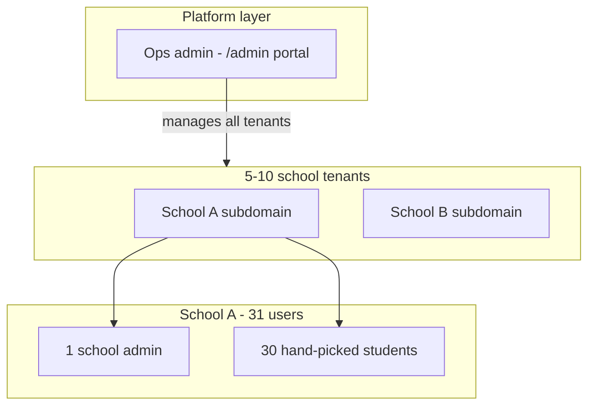
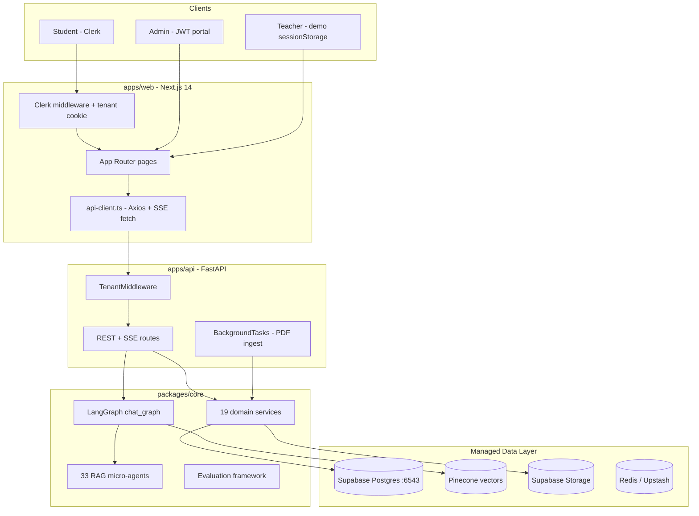
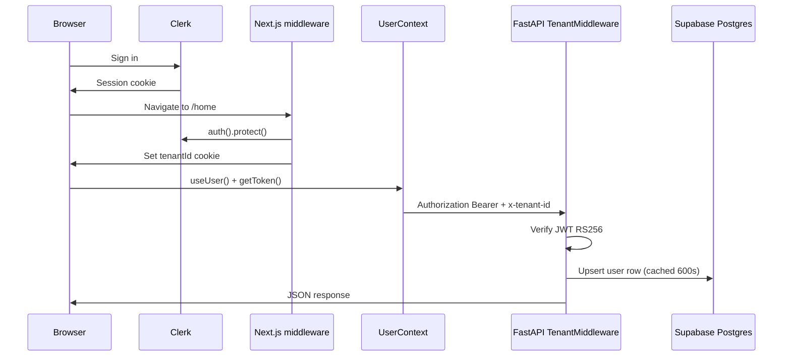
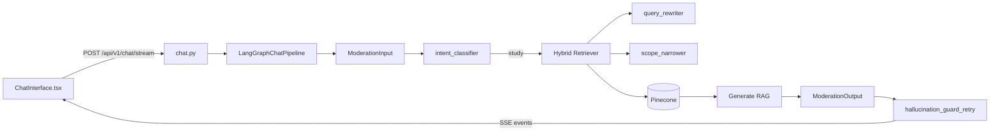
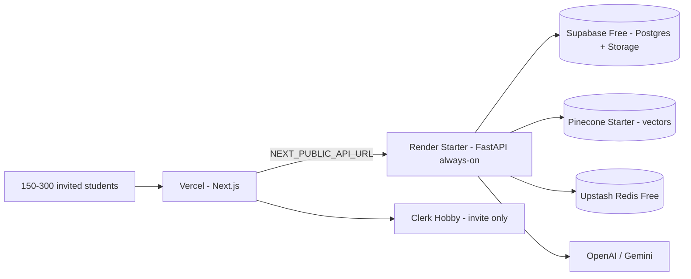
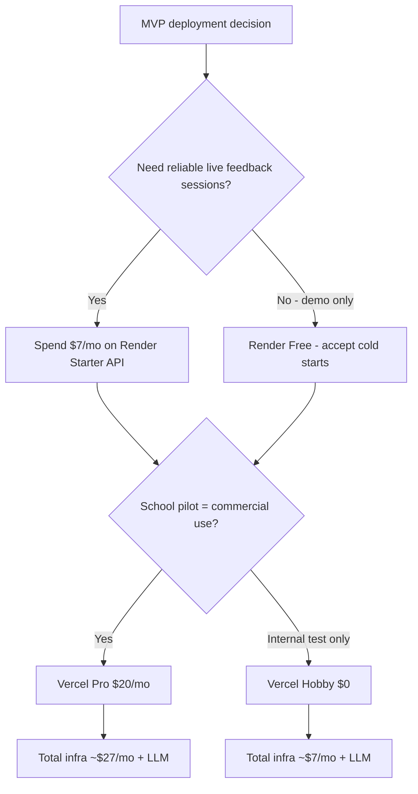
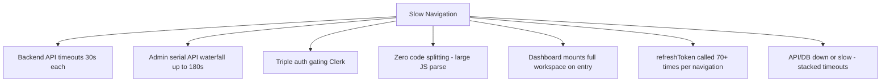

# ScholarSync — Production Deployment Guide

**Product:** ScholarSync (NotebookLM for Schools)  
**Audience:** Engineering, DevOps, and product leads preparing an MVP pilot launch  
**Last updated:** 2026-06-18  
**Launch phase:** **MVP closed beta** — hand-picked students for live feedback  
**Target scale:** 5–10 schools × 30 students + 1 school admin each  

| Role | Count |
|------|-------|
| Schools (tenants) | 5–10 |
| Students per school (hand-picked) | 30 |
| School admins (1 per school) | 5–10 |
| **Total student users** | **150–300** |
| Platform ops admin | 1 |
| **Total authenticated users** | **~156–311** |

**Budget target:** Free-tier first where possible; **$7–35/month** infrastructure if a paid API host is needed (excluding LLM API usage)

---

## Table of Contents

1. [Executive Summary](#1-executive-summary)
2. [MVP Pilot Scope & Access Control](#2-mvp-pilot-scope--access-control)
3. [Codebase Architecture Map](#3-codebase-architecture-map)
4. [End-to-End Request Flow](#4-end-to-end-request-flow)
5. [Deployment Guide (Step-by-Step)](#5-deployment-guide-step-by-step)
6. [Platform Scoring Matrix & Free vs Paid Recommendation](#6-platform-scoring-matrix--free-vs-paid-recommendation)
7. [Security Measures (Pre-Deploy Checklist)](#7-security-measures-pre-deploy-checklist)
8. [Production Readiness Gaps](#8-production-readiness-gaps)
9. [Slow Routing — Root Cause Analysis & Quick Wins](#9-slow-routing--root-cause-analysis--quick-wins)
10. [Monitoring and Post-Deploy Verification](#10-monitoring-and-post-deploy-verification)
11. [Appendix](#11-appendix)

---

## 1. Executive Summary

ScholarSync is an enterprise-grade, multi-tenant AI notebook platform for educational institutions. Students upload curriculum PDFs, chat with RAG-powered agents, generate studio content (quizzes, flashcards, mind maps, slides), use tutor mode, and access a guided problem solver. Admins operate a separate ops portal for user management, NCERT global ingestion, guardrails, and pipeline traces.

### Tech Stack

| Layer | Technology |
|-------|------------|
| Frontend | Next.js 14 (App Router), TypeScript, Tailwind, Clerk auth |
| Backend API | FastAPI, Uvicorn, Python 3.11+ |
| Agents | LangGraph orchestration + 33 versioned prompt agents |
| Database | PostgreSQL via Supabase (SQLAlchemy async + Alembic) |
| Vector store | Pinecone (tenant-scoped namespaces) |
| File storage | Supabase Storage and/or AWS S3 |
| Cache / queue | Redis (Upstash recommended in production) |
| Auth | Clerk (students), HS256 JWT (admin portal), demo sessionStorage (teacher) |
| Eval | `eval.py`, `eval_e2e.py`, LangSmith (optional) |

### Current State

| Area | Status |
|------|--------|
| Core RAG + LangGraph chat | Production-capable with guardrails |
| ING/RET eval gates | Mostly pass — see [PRODUCTION_TEST_REPORT.md](PRODUCTION_TEST_REPORT.md) |
| Docker API image | Ready (`Dockerfile.api`) |
| Celery worker | Scaffold only — not functional |
| Infrastructure as code | Placeholder only (`infrastructure/` empty) |
| CI/CD | Eval regression workflow only (soft-fail) |
| Frontend performance | Slow routing documented in Section 9 |

### Recommended MVP Stack (Final Verdict)

For a **closed beta with 150–300 hand-picked students**, the best end-to-end approach is a **hybrid: free tiers everywhere + one small paid API host**.

```
Vercel Pro or Hobby (Next.js web)          ← $0–20/mo
  → Render Starter (FastAPI, always-on)    ← $7/mo  ★ only paid piece strongly recommended
    → Supabase Free (Postgres :6543 + Storage)  ← $0
    → Pinecone Starter (vectors, namespaces)    ← $0
    → Upstash Redis Free                        ← $0
    → Clerk Hobby (invite-only students)        ← $0
    → OpenAI / Gemini (LLM)                     ← $30–100/mo typical pilot usage
```

| Tier | Infrastructure | LLM (variable) | Total realistic MVP |
|------|----------------|----------------|---------------------|
| **Free-only** (not recommended for live feedback) | **$0** | $30–80/mo | **$30–80/mo** |
| **Recommended MVP** | **$7–27/mo** | $30–100/mo | **$37–127/mo** |
| **Comfortable MVP** | **$25–45/mo** | $50–150/mo | **$75–195/mo** |

**Why not 100% free?** Render’s free API tier spins down after 15 minutes of inactivity, causing **30–60 second cold starts** on the next request. SSE chat and PDF ingestion will feel broken during live feedback sessions. Spending **~$7/month on Render Starter** (always-on, 512 MB RAM) is the single highest-ROI dollar for this MVP.

**Why not skip Vercel Pro?** Vercel Hobby is free but [restricted to non-commercial personal use](https://vercel.com/docs/limits/fair-use-guidelines#commercial-usage). For a school pilot collecting live product feedback, **Vercel Pro ($20/mo)** is the compliant choice. If budget is absolute zero, use Render free for API and accept cold starts, or self-host the API on a $5–6/mo VPS (Hetzner).

**The real cost driver is LLM usage**, not hosting. Enable `ENABLE_BUDGET_ENFORCEMENT=true` and set `TENANT_MONTHLY_BUDGET_USD` per school before inviting students.

---

## 2. MVP Pilot Scope & Access Control

### 2.1 What This MVP Is (and Is Not)

| In scope | Out of scope |
|----------|--------------|
| 5–10 schools as separate tenants | Open public sign-up |
| 30 hand-picked students per school | Full school-wide rollout (500+ per school) |
| 1 school admin per school (ops portal or teacher portal) | Enterprise SSO / SAML |
| Live feedback on chat, upload, studio | DOCX ingestion (ING-02 KNOWN_GAP) |
| PDF upload + RAG chat + studio generation | 40-user classroom load gate (defer until scale-up) |
| Invite-only access via Clerk | Marketing landing page with self-serve signup |

### 2.2 User Roles in MVP



| Role | Portal | Auth | Count (total) |
|------|--------|------|---------------|
| Hand-picked student | `/home`, `/library`, `/dashboard`, etc. | Clerk (invite-only) | 150–300 |
| School admin | `/admin` or `/teacher` | Admin JWT or teacher demo auth | 5–10 |
| Platform ops admin | `/admin` | Admin portal JWT | 1 |

### 2.3 How to Restrict Access to Hand-Picked Students Only

ScholarSync does not ship a built-in allowlist UI. Use **Clerk invite-only** flow for MVP:

1. **Disable public sign-up** in Clerk Dashboard → User & Authentication → Restrictions → disable "Sign up" or set to invite-only.
2. **Invite each of the 30 students** per school via Clerk Dashboard → Users → Invite, or bulk CSV import.
3. **Map each student to the correct school tenant** by having them sign in at `{school}.scholarsync.com` (subdomain sets `tenantId` cookie in `apps/web/src/middleware.ts`).
4. **Do not share the sign-up URL** publicly; only distribute invite links to selected students.
5. **Optional (Clerk Pro, $20/mo):** Enable allowlist mode to block any non-invited email domain.

For school admins, create one admin portal credential per school (rotate `ADMIN_PORTAL_*` env vars) or use the teacher portal demo auth with URL restriction.

### 2.4 MVP Capacity vs Free Tier Limits

At 150–300 users with moderate pilot usage, free tiers are **sufficient for infrastructure** (not LLM):

| Service | Free tier limit | MVP usage estimate | Fits? |
|---------|-----------------|-------------------|-------|
| **Clerk Hobby** | 50,000 MRUs/app | ~156–311 users | Yes |
| **Supabase Free** | 500 MB DB, 1 GB file storage | ~30 PDFs/school × 5–10 schools | Tight — monitor storage |
| **Pinecone Starter** | 2 GB, 5 indexes, 100 namespaces/index | 1 namespace per tenant (5–10) | Yes |
| **Upstash Redis** | 500K commands/mo | Light cache/rate limit | Yes |
| **Vercel Hobby** | 100 GB bandwidth | Low traffic pilot | Yes (bandwidth); commercial use needs Pro |
| **Render Free API** | 750 hrs/mo, 15 min spin-down | SSE chat sessions | No — cold starts break UX |
| **Render Starter API** | Always-on, 512 MB | 10–30 concurrent students | Yes ($7/mo) |

**Supabase watch-out:** 1 GB file storage across 150–300 students uploading PDFs will fill up. For MVP, cap uploads per student (already 10 MB/file in API) and limit to 2–3 PDFs per student during pilot. Upgrade to Supabase Pro ($25/mo) only if storage exceeds 1 GB.

**Pinecone watch-out:** Indexes pause after 3 weeks of inactivity on Starter plan. Run a weekly health-check query or accept one slow wake-up after idle periods.

### 2.5 MVP Feedback Collection Plan

| Feedback channel | Implementation |
|------------------|----------------|
| In-app chat quality | LangSmith tracing (optional, free tier) + admin pipeline traces |
| Structured surveys | Google Form linked from home page banner |
| Session issues | Sentry free tier (5K errors/mo) |
| Usage metrics | Admin portal `/admin/users`, `/admin/cost-tokens` |
| Weekly sync | Export feedback from 1 school admin per school |

---

## 3. Codebase Architecture Map

### Monorepo Structure

```
NotebookLM/
├── apps/
│   ├── api/          # FastAPI HTTP server (entry: apps.api.main:app)
│   ├── web/          # Next.js 14 frontend (@scholarsync/web)
│   └── worker/       # Celery scaffold (not production-ready)
├── packages/
│   ├── core/         # Python: services, RAG, LangGraph, DB, eval
│   └── types/        # Shared TypeScript types + Zod schemas
├── config/           # settings.py, models.yaml, production.yaml
├── prompts/          # Agent prompt registry (registry.yaml)
├── evals/            # Datasets, reports, runners
├── evaluation/       # Eval framework docs
├── docs/             # Engineering documentation
├── scripts/          # Dev, seed, ingest, sign-off scripts
├── tests/            # pytest unit/integration/load
├── docker-compose.yml
├── Dockerfile.api
├── Dockerfile.worker
├── alembic.ini
├── eval.py           # Agent eval CLI
└── eval_e2e.py       # E2E workflow eval CLI
```

### System Architecture Diagram



### Key File Reference

| Layer | Path | Role |
|-------|------|------|
| Web entry | `apps/web/src/app/layout.tsx` | ClerkProvider, global providers |
| Auth middleware | `apps/web/src/middleware.ts` | Route protection, tenant cookie |
| API client | `apps/web/src/lib/api-client.ts` | All HTTP + SSE; 30s timeouts |
| API entry | `apps/api/main.py` | FastAPI app, CORS, route registration |
| Tenant + auth | `apps/api/middleware/tenant.py` | JWT verify, user sync, tenant isolation |
| JWT verification | `apps/api/middleware/auth.py` | Clerk RS256 + admin HS256 tokens |
| Chat agents | `packages/core/langgraph/chat_graph.py` | LangGraph RAG pipeline (~2300 lines) |
| Problem solver | `packages/core/langgraph/problem_solver_graph.py` | Guided solver state machine |
| Agent prompts | `prompts/registry.yaml` | 33 versioned agents |
| Settings | `config/settings.py` | 100+ env tunables (single source of truth) |
| DB connection | `packages/core/database/connection.py` | Async SQLAlchemy, Supabase pooler upgrade |
| Docker | `docker-compose.yml`, `Dockerfile.api` | Local/prod containerization |
| Eval CLI | `eval.py`, `eval_e2e.py` | Agent + E2E evaluation |

### Three User Portals

| Portal | Auth mechanism | Protected by | API auth |
|--------|----------------|--------------|----------|
| **Student** | Clerk JWT | `middleware.ts` → `auth().protect()` | `Authorization: Bearer <Clerk JWT>` |
| **Admin** | HS256 JWT (email/password login) | `admin/layout.tsx` session gate | `Authorization: Bearer <admin JWT>` |
| **Teacher** | Client-side demo credentials | `teacher/layout.tsx` session gate | None (localStorage only) |

> **Accepted risk (v1 launch):** The teacher portal uses hardcoded client-side credentials in `apps/web/src/lib/teacher-auth.ts`. This is bypassable via `sessionStorage` and is **not suitable for sensitive data**. Restrict access via URL obscurity or IP allowlist until proper server-side auth is built.

### Domain Services (`packages/core/services/`)

| Service | Purpose |
|---------|---------|
| `chat_service.py` | Chat persistence, invokes LangGraph |
| `source_service.py` / `IngestionService` | PDF upload + background indexing |
| `studio_service.py` | Quiz, flashcards, mind map, slide generation |
| `problem_solver_service.py` | Guided problem solver |
| `tutor_notebook_bootstrap_service.py` | Tutor mode bootstrap |
| `tutor_notebook_prepare_service.py` | Tutor notebook preparation |
| `ncert_global_service.py` | NCERT global knowledge corpus |
| `notebook_service.py`, `notes_service.py` | Notebooks and rich notes |

### Database Schema (Alembic migrations 0001–0007)

| Entity | Table | Notes |
|--------|-------|-------|
| Multi-tenancy | `tenants` | Subdomain → tenant ID |
| Users | `users` | `clerk_user_id`, role (user/admin) |
| Content | `notebooks`, `sources`, `source_questions`, `notes` | User-scoped per tenant |
| Chat | `chats`, `messages` | Citations JSON, feedback |
| Studio | `studio_features` | Generated artifacts |
| Problem solver | `problem_solver_sessions`, `problem_solver_steps` | State machine |
| NCERT | `ncert_global_documents`, `ncert_catalog_chapters` | Global knowledge |
| Safety | `guardrail_user_blocks`, `alert_user_sessions` | Moderation blocks |

---

## 4. End-to-End Request Flow

### 4.1 Student Sign-In and API Authentication



1. **Sign-in:** Clerk authenticates the user; session stored in browser.
2. **Middleware:** `apps/web/src/middleware.ts` calls `auth().protect()` for protected routes and sets `tenantId` cookie from subdomain.
3. **UserContext:** `apps/web/src/contexts/UserContext.tsx` wires Clerk `getToken()` to `apiClient`.
4. **API call:** Every request calls `apiClient.refreshToken()` then sends `Authorization: Bearer` + `x-tenant-id`.
5. **Backend:** `TenantMiddleware` resolves subdomain → tenant, verifies JWT, syncs user row (cached 600 seconds).

### 4.2 Chat (LangGraph Agent Pipeline)



**LangGraph nodes (in order):** ModerationInput → Memory → CacheCheck → DialogRoute → DirectChat / IntentClassify → WholeFileMapReduce / Retrieval → ContextSelector → relevance gates → Generate → ModerationOutput → Evaluator → TwoStageGrounding → CacheStore.

**SSE events:** `chunk`, `citation`, `done`, `error` streamed via `text/event-stream`.

### 4.3 PDF Ingestion

1. User uploads PDF via `POST /api/v1/ingest/upload`
2. File stored in Supabase Storage (`{tenant_id}/{file_id}.pdf`)
3. `BackgroundTasks` triggers indexing (runs in API process — Celery not wired)
4. Chunks embedded and upserted to Pinecone (tenant namespace)
5. Agents involved: `chunk_contextualization`, `document_sketch`, `ncert_document_sketch`, `image_ocr`

### 4.4 Studio Generation

`POST /api/v1/studio/*` → `StudioService` → versioned prompt agents:

| Task | Agent ID | Template |
|------|----------|----------|
| Quiz | `studio_quiz` | `studio/quiz_prompt.j2` |
| Flashcards | `studio_flashcards` | `studio/flashcards_prompt.j2` |
| Mind map | `studio_mind_map` | `studio/mind_map_prompt.j2` |
| Slide deck | `studio_slide_deck` | `studio/slide_deck_prompt.j2` |

### 4.5 Agent Inventory (33 In-Scope)

Full inventory in [evaluation/current_architecture.md](../evaluation/current_architecture.md). Categories:

| Category | Agent IDs (sample) |
|----------|-------------------|
| Routing | `intent_classifier` |
| Retrieval | `query_rewriter`, `query_decomposer`, `scope_narrower` |
| Generation | `direct_chat`, `chat_summarizer`, `hallucination_guard_retry` |
| Studio | `studio_quiz`, `studio_flashcards`, `studio_mind_map`, `studio_slide_deck` |
| Problem solver | `problem_dna_analyzer`, `help_me_solve_it`, `problem_solver_followup` |
| Tutor | `tutor_notebook_bootstrap`, `tutor_follow_up_questions` |
| Ingestion | `chunk_contextualization`, `document_sketch`, `image_ocr` |
| Safety | `chat_policy_block`, `refusal_templates` |

**Agents run inside the API process** — there is no separate agent microservice. LangGraph executes in the same container as FastAPI.

### 4.6 Evaluation (Offline / CI Only)

| Command | Purpose |
|---------|---------|
| `python eval.py --agent intent_classifier --limit 5` | Single-agent prompt × model experiment |
| `python eval_e2e.py --limit 10` | End-to-end workflow smoke |
| CI: `.github/workflows/eval-regression.yml` | PR gate (soft-fail by default) |

**Do not run eval workloads in production runtime.** Use CI or a dedicated staging environment.

---

## 5. Deployment Guide (Step-by-Step)

### 5.1 Environment Variable Split (Critical)

ScholarSync uses **two separate env files**. Mixing them causes auth failures and API connection errors.

| File | Used by | Key variables |
|------|---------|---------------|
| `/.env` (repo root) | FastAPI, Alembic, scripts, Docker | `DATABASE_URL` (**:6543** pooler), `CLERK_JWT_PUBLIC_KEY`, `PINECONE_*`, `OPENAI_API_KEY`, `CORS_ORIGINS`, `ADMIN_PORTAL_*`, `ENVIRONMENT=production` |
| `apps/web/.env.local` | Next.js dev server / Vercel | `NEXT_PUBLIC_CLERK_PUBLISHABLE_KEY`, `NEXT_PUBLIC_API_URL`, `CLERK_SECRET_KEY` |

See [.env.example](../.env.example) and [API_KEYS_EXPLAINED.md](API_KEYS_EXPLAINED.md) for key-by-key guidance.

**Critical:** `DATABASE_URL` must use Supabase **transaction pooler port `:6543`**, not session pooler `:5432`. SSE chat load exhausts session pooler connections. `packages/core/database/connection.py` auto-upgrades `:5432` → `:6543` unless `DATABASE_FORCE_SESSION_POOLER=1`.

### 5.2 Recommended MVP Deployment Topology



**MVP cost:** $0 (all free tiers) to **$27/mo** (Render Starter $7 + Vercel Pro $20). See [Section 6](#6-platform-scoring-matrix--free-vs-paid-recommendation) for the free vs paid decision.

### 5.3 Deploy Order (MVP Pilot)

#### Step 1 — Supabase (Free tier)

1. Create a Supabase project on the **Free** plan (2 projects max — use one for MVP, one for staging).
2. Copy the **transaction pooler** connection string (port `:6543`).
3. Create storage bucket `scholarsync-files`.
4. Run migrations:
   ```bash
   DATABASE_URL="postgresql://..." alembic upgrade head
   ```
5. Insert **5–10 tenant rows** (one per school):
   ```sql
   INSERT INTO tenants (id, subdomain, name) VALUES
     (gen_random_uuid(), 'school-alpha', 'Alpha Public School'),
     (gen_random_uuid(), 'school-beta', 'Beta High School');
   -- repeat for each pilot school
   ```
6. Set a **weekly ping** (cron or GitHub Action) to prevent 7-day inactivity pause on free tier.

#### Step 2 — Pinecone (Starter / Free)

1. Create a **serverless** index on the Starter plan (dimension **1024** for `text-embedding-3-small`).
2. Use **one index** with **per-tenant namespaces** (supports up to 100 namespaces on Starter — enough for 5–10 schools).
3. Set `PINECONE_API_KEY`, `PINECONE_INDEX_NAME`, `PINECONE_ENVIRONMENT=us-east-1`.

#### Step 3 — Clerk (Hobby / Free)

1. Create a Clerk application (Hobby plan — free up to 50,000 MRUs).
2. **Disable open sign-up**; enable invite-only or invitation links only.
3. Configure JWT template; copy RS256 public key → `CLERK_JWT_PUBLIC_KEY`.
4. **Invite 30 students per school** via Clerk Dashboard (bulk CSV import supported).
5. Set `CLERK_ISSUER`, `CLERK_SECRET_KEY` in both root `.env` and Vercel.

#### Step 4 — Upstash Redis (Free tier)

1. Create a serverless Redis database (free: 256 MB, 500K commands/month).
2. Set `REDIS_URL` in API env.

#### Step 5 — Render Starter (API) — **Recommended paid piece ($7/mo)**

1. Connect GitHub repo on [Render](https://render.com).
2. New **Web Service** → Docker → `Dockerfile.api`.
3. Plan: **Starter** ($7/mo) — always-on, no spin-down. **Do not use Render Free** for live feedback sessions (15 min spin-down → 30–60s cold starts break SSE chat).
4. Set all root `.env` variables in Render Environment.
5. Set `ENVIRONMENT=production`, `CORS_ORIGINS=https://your-app.vercel.app` (or custom domain).
6. Health check path: `/health`.

**Free alternative (not recommended for feedback sessions):** Render Free tier — $0 but cold starts after 15 min idle.

**Budget alternative:** Hetzner CX22 VPS (~$4–6/mo) running `docker compose` with API only — more ops work, but cheapest always-on option.

#### Step 6 — Vercel (Frontend)

| Option | Cost | When to use |
|--------|------|-------------|
| **Vercel Hobby** | $0 | Internal testing only; [non-commercial restriction](https://vercel.com/docs/limits/fair-use-guidelines) |
| **Vercel Pro** | $20/mo | **Recommended** for school pilot collecting live feedback |

1. Import repo; **Root Directory** = `apps/web`.
2. Environment variables:
   ```
   NEXT_PUBLIC_API_URL=https://scholarsync-api.onrender.com
   NEXT_PUBLIC_CLERK_PUBLISHABLE_KEY=pk_live_...
   CLERK_SECRET_KEY=sk_live_...
   NEXT_PUBLIC_CLERK_SIGN_IN_URL=/sign-in
   NEXT_PUBLIC_CLERK_AFTER_SIGN_IN_URL=/home
   ```
3. For multi-tenancy: add custom domain + wildcard `*.yourdomain.com` (requires Pro for wildcard on custom domain).

**Free alternative:** Deploy web to Vercel Hobby with `*.vercel.app` subdomain per school is not supported — use path-based or single-domain MVP with `tenantId` cookie override for pilot.

#### Step 7 — DNS (when using custom domain)

| Record | Target |
|--------|--------|
| `yourdomain.com` | Vercel |
| `*.yourdomain.com` | Vercel (one subdomain per school) |
| `api.yourdomain.com` | Render API host |

For zero-DNS MVP: use `school-alpha.yourdomain.vercel.app` pattern or single domain with manual tenant cookie for first pilot.

#### Step 8 — Onboard Hand-Picked Students

1. Create tenant row in Supabase for the school.
2. Configure DNS/subdomain for that school.
3. In Clerk: invite exactly 30 student emails for that school.
4. Send each student: `{school}.yourdomain.com` + invite link.
5. School admin gets `/admin/login` credentials (one set per school, rotated).
6. Run smoke test: one student uploads PDF → chats → generates quiz.

#### Step 9 — Post-Deploy Verification

```bash
curl https://api.yourdomain.com/health
python eval.py --agent intent_classifier --limit 5   # from CI/staging only
```

### 5.4 Component Deployment Matrix (MVP)

| Component | MVP deploy target | Tier | Cost |
|-----------|-------------------|------|------|
| Frontend | **Vercel** | Hobby or Pro | $0–20/mo |
| API + agents | **Render Starter** | Always-on | **$7/mo** |
| Database + storage | **Supabase** | Free | $0 |
| Vectors | **Pinecone** | Starter | $0 |
| Cache | **Upstash** | Free | $0 |
| Auth | **Clerk** | Hobby | $0 |
| LLM | **OpenAI** | Pay-as-you-go | $30–100/mo |
| Workers (Celery) | **Skip** | BackgroundTasks in API | $0 |
| Eval | **GitHub Actions** | CI only | $0 |

### 5.5 Do NOT Deploy As-Is

| Item | Reason |
|------|--------|
| `docker-compose.yml` worker service | Celery not wired; container fails |
| Render **Free** tier for API | 15 min spin-down breaks SSE chat during feedback sessions |
| `scripts/seed_db.py` defaults | Dev tenant only; create 5–10 real school tenants |
| Open public Clerk sign-up | MVP must be invite-only for hand-picked students |
| Teacher portal without URL restriction | Demo auth is bypassable |

### 5.6 Multi-Tenancy for 5–10 Schools

| School | Subdomain example | Students | Admin |
|--------|-------------------|----------|-------|
| School 1 | `alpha.yourdomain.com` | 30 invited | 1 |
| School 2 | `beta.yourdomain.com` | 30 invited | 1 |
| … | … | 30 each | 1 |
| School 10 | `school10.yourdomain.com` | 30 invited | 1 |

- `middleware.ts` sets `tenantId` cookie from subdomain.
- `TenantMiddleware` scopes all data by `tenant_id`.
- Pinecone: one namespace per tenant within a single index.
- Clerk: single app; students invited per school; they sign in at their school's subdomain.

---

## 6. Platform Scoring Matrix & Free vs Paid Recommendation

Scoring criteria (1–10) for **MVP pilot: 5–10 schools, 150–300 students**: free-tier fit, Next.js support, FastAPI/SSE reliability, Supabase/Pinecone/Clerk free limits, ops complexity, cost at MVP scale.

### 6.1 Platform Comparison (MVP Scale)

| Platform | Web | API | Infra cost/mo | MVP score | Verdict |
|----------|-----|-----|---------------|-----------|---------|
| **Vercel Pro + Render Starter + Supabase Free** | Vercel Pro | Render Starter | **$27** | **10/10** | **Best overall for live feedback MVP** |
| Vercel Hobby + Render Starter + Supabase Free | Hobby | Render Starter | **$7** | 9/10 | Best if Vercel commercial use deferred |
| Vercel Hobby + Render Free + all free | Hobby | Render Free | **$0** | 6/10 | Cold starts ruin chat UX — demo only |
| Vercel Pro + Railway Hobby + Supabase Free | Pro | Railway (~$5+) | $25–30 | 8/10 | Good; Railway has no permanent free tier |
| Hetzner VPS + Supabase Free + Vercel Hobby | Hobby | Self-hosted Docker | **$4–6** | 7/10 | Cheapest always-on; you manage SSL/updates |
| Vercel + Fly.io shared VM | Pro/Hobby | Fly.io | $5–10 | 7/10 | Good SSE; requires Dockerfile ops |
| Netlify + Render Starter | Netlify | Render | $7–25 | 7/10 | Viable; weaker Next.js middleware |
| AWS / GCP / Azure | Various | Various | $80–300+ | 3/10 | Overkill for 150–300 user MVP |

### 6.2 Free Tier Service-by-Service (2026)

| Service | Free tier includes | MVP fit (150–300 users) | Upgrade trigger |
|---------|-------------------|-------------------------|-----------------|
| **Clerk Hobby** | 50K MRUs, unlimited apps | Excellent | >50K returning users |
| **Supabase Free** | 500 MB DB, 1 GB storage, 2 GB egress | Good if PDFs capped | Storage >1 GB |
| **Pinecone Starter** | 2 GB, 5 indexes, 2M writes/mo | Excellent for 5–10 tenants | Index pauses after 3 wk idle |
| **Upstash Redis** | 256 MB, 500K cmds/mo | Excellent | >500K commands |
| **Vercel Hobby** | 100 GB bandwidth | Bandwidth OK | Commercial use policy |
| **Vercel Pro** | Custom domains, wildcard | Recommended for pilot | — |
| **Render Free** | 750 hrs, spin-down 15 min | **Poor for SSE** | Any live user session |
| **Render Starter** | Always-on 512 MB | **Excellent** | >512 MB RAM needed |
| **Railway** | ~$5/mo after trial | Good | No free tier remains |
| **OpenAI API** | No free tier | Required | Set budget cap |

### 6.3 Free vs Paid: What We Recommend



| Strategy | Monthly infra | Best for | Risk |
|----------|---------------|----------|------|
| **A. Recommended MVP** | **$27** (Render $7 + Vercel Pro $20) | Live feedback with 5–10 schools | Lowest UX risk |
| **B. Budget MVP** | **$7** (Render Starter only; Vercel Hobby) | Tight budget; internal pilot | Vercel ToS; no custom wildcard domain |
| **C. Zero infra cost** | **$0** | Proof-of-concept demos only | Cold starts; chat feels broken |
| **D. Comfortable MVP** | **$52** (+ Supabase Pro $25) | Heavy PDF uploads per student | None significant |

**Our recommendation: Strategy A ($27/mo infra)** — the $7 Render Starter is non-negotiable for SSE chat during feedback sessions. Vercel Pro ($20) is strongly recommended for a school-facing pilot but can be deferred to Strategy B if budget is absolute zero.

**LLM budget (separate):** For 150–300 students doing ~10 chats/day × 30 days, estimate **$30–100/month** on `gpt-4o-mini`. Set per-tenant budget:
```
ENABLE_BUDGET_ENFORCEMENT=true
TENANT_MONTHLY_BUDGET_USD=10
```

### 6.4 Total MVP Cost Summary

| Line item | Free-only | Recommended | Comfortable |
|-----------|-----------|-------------|-------------|
| Vercel | $0 | $20 | $20 |
| Render API | $0 (Free) | $7 | $7 |
| Supabase | $0 | $0 | $25 |
| Pinecone | $0 | $0 | $0 |
| Upstash | $0 | $0 | $0 |
| Clerk | $0 | $0 | $0 |
| Sentry / Uptime Robot | $0 | $0 | $0 |
| **Infrastructure** | **$0** | **$27** | **$52** |
| OpenAI / Gemini (pilot) | $30–80 | $30–100 | $50–150 |
| **Grand total** | **$30–80** | **$57–127** | **$102–202** |

**Bottom line:** You cannot run a credible live-feedback MVP at **$0 total** because LLM API calls are required. **$57–127/month all-in** (infra + moderate LLM) is realistic for 5–10 schools × 30 students.

### 6.5 Winner for MVP Pilot

**Vercel Pro + Render Starter + Supabase Free + Pinecone Starter + Clerk Hobby + Upstash Free**

- Supports invite-only hand-picked students across 5–10 school subdomains
- Always-on API for SSE chat (no cold starts during feedback sessions)
- All data services within free tier limits at 150–300 users
- Total infrastructure: **$27/month** (+ LLM usage)

---

## 7. Security Measures (Pre-Deploy Checklist)

### 7.1 Must-Fix Before Public Traffic (Critical / High)

| # | Item | Current state | Required action |
|---|------|---------------|-----------------|
| 1 | JWT verification bypass | `apps/api/middleware/auth.py` accepts unsigned tokens if `CLERK_JWT_PUBLIC_KEY` is empty | Fail API startup in production when key is missing |
| 2 | Admin default credentials | `config/settings.py` defaults to `admin123` / `dev-admin-portal-secret` | Generate strong `ADMIN_PORTAL_PASSWORD` and `ADMIN_PORTAL_JWT_SECRET`; never use defaults |
| 3 | Secrets on disk | `.env`, `.env.bak` may exist locally | Never commit; delete `.env.bak`; rotate all keys before launch |
| 4 | CORS misconfiguration | `apps/api/main.py` | Set explicit `CORS_ORIGINS` — no `*` in production |
| 5 | Error information leakage | Multiple routes return `str(e)` in HTTP/SSE responses | Sanitize all client-facing errors |
| 6 | Missing security headers | No CSP, HSTS, X-Frame-Options | Add Next.js `headers()` in `next.config.js` + FastAPI middleware |
| 7 | `ENVIRONMENT` not set | Dev defaults active | Set `ENVIRONMENT=production` on API host |
| 8 | Wrong DB pooler | Session pooler `:5432` | Use Supabase transaction pooler `:6543` |

### 7.2 Should-Fix Soon (Medium)

| Item | Current state | Action |
|------|---------------|--------|
| Rate limiting | In-memory only (`packages/core/memory/rate_limiter.py`) | Move to Redis/Upstash for multi-instance |
| Admin login rate limit | None on `/api/v1/admin/auth/login` | Add per-IP rate limiting |
| Upload rate limit | None on `/api/v1/ingest/upload` | Add per-user upload limits |
| Health check depth | `/health` returns `{"status":"ok"}` only | Add DB + Pinecone connectivity probes |
| Verbose logging | `print()` in `tenant.py` middleware | Replace with structured logging; redact tokens |
| CI security scanning | No bandit, dependabot, or gitleaks | Add to GitHub Actions |
| Startup validation | No check for required secrets | Validate all production env vars at boot |
| Admin password storage | Plaintext compare against env var | Hash passwords or migrate to SSO |
| OpenAPI docs | Disabled in production (good) | Verify `ENVIRONMENT=production` is set |

### 7.3 Accepted Risk (v1 Launch Decision)

| Item | Risk | Mitigation until proper fix |
|------|------|----------------------------|
| Teacher portal demo auth | Hardcoded credentials in `apps/web/src/lib/teacher-auth.ts`; bypassable via `sessionStorage` | Restrict URL access; do not store sensitive data in teacher portal; add IP allowlist if possible |

### 7.4 Environment Security Playbook

1. **Generate unique secrets** for every `ADMIN_PORTAL_*`, `CLERK_*`, and API key — never reuse dev values.
2. **Use platform secret managers:** Vercel Environment Variables, Railway Variables. Never bake secrets into Docker images.
3. **Separate environments:** Distinct Clerk apps and Supabase projects for staging vs production.
4. **Audit `NEXT_PUBLIC_*` variables:** Only publishable keys (Clerk publishable key, API URL) belong in browser-exposed vars.
5. **Enable Supabase RLS:** Baseline applied via Alembic migrations; verify policies after deploy.
6. **Set JWT audience and issuer:** `CLERK_JWT_AUDIENCE` and `CLERK_ISSUER` in production.
7. **Rotate keys quarterly:** Document rotation procedure; update Vercel + Railway simultaneously.
8. **Delete backup env files:** Remove `.env.bak` from all machines.
9. **URL-encode DB passwords:** Special characters in `DATABASE_URL` must be percent-encoded.
10. **Enable budget enforcement:** Set `ENABLE_BUDGET_ENFORCEMENT=true` and `TENANT_MONTHLY_BUDGET_USD` to cap LLM spend.

### 7.5 Security Headers to Add

| Header | Recommended value | Where |
|--------|-------------------|-------|
| `Strict-Transport-Security` | `max-age=31536000; includeSubDomains` | Vercel + API |
| `X-Content-Type-Options` | `nosniff` | Vercel + API |
| `X-Frame-Options` | `DENY` | Vercel + API |
| `Referrer-Policy` | `strict-origin-when-cross-origin` | Vercel |
| `Content-Security-Policy` | Restrict to Clerk, API, fonts, KaTeX CDN | Vercel |
| `Permissions-Policy` | Disable camera, microphone, geolocation | Vercel |

### 7.6 What Is Already Secure

- LangGraph guardrails: moderation, injection detection, PII filtering, academic integrity
- Multi-tenant data isolation (DB queries + Pinecone namespaces)
- SQLAlchemy parameterized queries (no raw SQL injection vectors found)
- File upload validation: extension/MIME blocklist, 10MB cap
- OpenAPI docs disabled in production
- TrustedHost middleware for `*.scholarsync.com` in production
- `.gitignore` excludes `.env`, `.env*.local`, `.env.bak`

---

## 8. Production Readiness Gaps

### 8.1 Ready Today

- [x] LangGraph chat pipeline with full guardrail stack
- [x] Multi-tenant isolation (database + Pinecone namespaces)
- [x] ING/RET eval gates largely pass ([PRODUCTION_TEST_REPORT.md](PRODUCTION_TEST_REPORT.md))
- [x] Production Docker API image (`Dockerfile.api`)
- [x] Alembic migrations (8 versions, 0001–0007)
- [x] Clerk student authentication (when properly configured)
- [x] Admin ops portal (when credentials rotated)
- [x] Versioned agent prompt registry with eval framework
- [x] Budget enforcement configuration available

### 8.2 Not Ready / Remaining Before MVP Launch

| Category | Gap | Priority | Notes |
|----------|-----|----------|-------|
| Infrastructure | Empty `infrastructure/` (Terraform/K8s/Helm placeholders) | Medium | Use PaaS for v1; IaC later |
| Workers | Celery not wired; ingestion in API process | Low | Acceptable for 150–300 MVP users |
| Auth | Admin portal plaintext password compare | **High** | Rotate secrets before inviting schools |
| Auth | Teacher demo auth (accepted for MVP) | Low | Documented accepted risk |
| Features | DOCX ingestion not implemented (ING-02) | Low | PDF-only for MVP |
| Features | Full 100+ NCERT corpus validation (ING-04) | Low | Partial corpus OK for pilot |
| Load testing | 40-user classroom gate deferred | Medium | Run 12-user smoke before MVP; 30-user before scale-up |
| Monitoring | No Sentry/Datadog; in-memory pipeline traces | **High** | Add Sentry free tier before inviting students |
| CI | Only eval-regression; soft-fail; no unit test gate | Medium | Add pytest workflow later |
| Performance | Slow routing (Section 9) | **High** | Quick wins before feedback sessions |
| Profile data | Mock data only in profile pages | Low | Not blocking core feedback flows |
| DB resilience | `DB_FAIL_OPEN_ON_POOL_TIMEOUT: True` | Low | Acceptable at MVP scale |
| Access control | No in-app allowlist UI | Medium | Use Clerk invite-only (Section 2.3) |
| Storage | Supabase 1 GB free limit | Medium | Cap PDFs per student during pilot |
| Stubs | `secrets_manager.py`, `encryption.py`, `input_guardian.py` | Low | Real logic exists elsewhere |
| TestSprite | 14/23 pass in local runs | Medium | Re-run with idle API |

### 8.3 Pre-Launch Checklist (MVP Pilot — Tick Off Before Inviting Students)

#### Infrastructure
- [ ] Supabase Free project created with `:6543` pooler URL
- [ ] Weekly DB ping scheduled (prevent 7-day free-tier pause)
- [ ] `alembic upgrade head` run on MVP database
- [ ] 5–10 school tenant rows inserted (subdomain per school)
- [ ] Pinecone Starter index created (1024 dimensions)
- [ ] Upstash Redis Free configured
- [ ] Render **Starter** API deployed ($7/mo, always-on — not Free tier)
- [ ] Vercel deployed with correct `NEXT_PUBLIC_API_URL`
- [ ] Clerk invite-only mode enabled; public sign-up disabled
- [ ] 30 students invited per school in Clerk

#### Security
- [ ] All secrets rotated from dev defaults
- [ ] `CLERK_JWT_PUBLIC_KEY` set; JWT verification enforced
- [ ] `ADMIN_PORTAL_PASSWORD` and `ADMIN_PORTAL_JWT_SECRET` rotated
- [ ] `CORS_ORIGINS` set to production domains only
- [ ] Security headers configured (Vercel + API)
- [ ] `.env.bak` deleted from all developer machines
- [ ] `ENABLE_BUDGET_ENFORCEMENT` enabled with monthly cap
- [ ] `ENABLE_BUDGET_ENFORCEMENT` enabled (`TENANT_MONTHLY_BUDGET_USD=10` per school)
- [ ] Teacher portal access restricted (accepted risk documented)
- [ ] OpenAI API spending limit set in OpenAI dashboard

#### Application
- [ ] `/health` returns 200 from Render API
- [ ] Clerk invite → sign-in → `/home` works for test student
- [ ] Student at `school-alpha.domain.com` sees only their tenant data
- [ ] PDF upload + chat retrieval works (1 test student per school)
- [ ] Studio quiz generation works for 1 test notebook
- [ ] School admin can access `/admin/login` with rotated credentials

#### Performance
- [ ] API `/health` responds in < 500ms (Render Starter warm)
- [ ] Home page loads in < 3 seconds
- [ ] Navigation home → profile < 5 seconds (or fix per Section 9)
- [ ] No 30–60s cold starts (confirms Render Starter, not Free)

#### Testing & Monitoring
- [ ] `python eval.py --agent intent_classifier --limit 5` passes (CI/staging)
- [ ] Locust smoke: 12 users, 3 min (`tests/load/`)
- [ ] Sentry free tier configured (5K errors/mo)
- [ ] Uptime Robot monitoring `/health` (free)
- [ ] Feedback Google Form linked from home page

---

## 9. Slow Routing — Root Cause Analysis & Quick Wins

### 9.1 Symptoms

Navigation between pages (e.g., home → profile, admin sidebar clicks, dashboard entry) takes **30 seconds to 180+ seconds** in worst cases across student, admin, and teacher portals.

### 9.2 Root Cause Map



### 9.3 Root Causes (Ranked by Impact)

| # | Root cause | Evidence | Affected roles |
|---|------------|----------|----------------|
| 1 | **30s axios timeouts stack** | `apps/web/src/lib/api-client.ts` — every method uses `timeout: 30000` | Student, Admin |
| 2 | **Admin serial API waterfall** | `apps/web/src/app/admin/users/page.tsx` — 6 sequential `await` calls (up to 180s worst case) | Admin |
| 3 | **Triple Clerk auth gating** | `middleware.ts` + per-page `isLoaded` + `refreshToken()` on every API call | Student |
| 4 | **Zero code splitting** | No `next/dynamic` or `React.lazy` anywhere in `apps/web/src` | All |
| 5 | **Dashboard over-fetch** | `DashboardWrapper.tsx` mounts SourceList + StudioSuite + NotesSection on entry | Student |
| 6 | **Duplicate refreshToken** | 70+ explicit `await this.refreshToken()` plus request interceptor | All API calls |
| 7 | **No route loading skeletons** | No `loading.tsx` files under `apps/web` | All (perceived slowness) |
| 8 | **Backend user sync on first request** | `tenant.py` DB upsert per user (cached 600s) | First visit per session |
| 9 | **Profile uses mock data only** | `apps/web/src/app/profile/` — delay is NOT data fetch | Student |

### 9.4 Home → Profile Specifically

The profile pages use **mock data only** — no `/api/v1` calls are made. If home → profile is slow, the bottleneck is:

1. **Clerk `isLoaded` hydration** — every student page blocks on `useUser().isLoaded` independently
2. **Static import of all 8 profile sections** — `ProfileSectionContent.tsx` imports every section at module load
3. **Clerk middleware round-trip** — server-side `auth().protect()` on each navigation
4. **Large shared JS bundle** — Clerk, Tailwind, and shared components parsed on every route change

**Diagnostic:** Open DevTools → Network during home → profile. Expect **zero** `/api/v1` requests. If API calls appear, the issue is a shared layout or provider firing fetches.

### 9.5 Admin Portal Slowness

`admin/users/page.tsx` fetches sequentially:

```
listAllUsers()           → up to 30s
getTokenConsumption()    → up to 30s
getCostTracking()        → up to 30s
getCacheEfficiency()     → up to 30s
getLatencyDashboard()    → up to 30s
getAlertsStatus()        → up to 30s
```

`listAllUsers()` also paginates through **all Clerk users** server-side, which is slow with many users.

### 9.6 Quick-Win Fixes (Recommended Priority)

| Fix | Effort | Impact | Files / area |
|-----|--------|--------|--------------|
| Verify API is running; `NEXT_PUBLIC_API_URL` correct | 5 min | **Critical** | Env config |
| Add `loading.tsx` per route segment | Low | High perceived speed | `apps/web/src/app/**/loading.tsx` |
| Parallelize admin fetches with `Promise.all` | Low | High for admin | `admin/users/page.tsx` |
| Remove redundant `await refreshToken()` from API methods | Low | Medium | `api-client.ts` |
| Reduce axios timeout to 10s with single retry | Low | Faster failure feedback | `api-client.ts` |
| Confirm Supabase `:6543` pooler in production | Low | Faster API/DB | `DATABASE_URL` |
| Single `(student)` layout auth gate | Medium | Medium | New layout; remove per-page `isLoaded` |
| `next/dynamic` for ChatInterface, TipTap, d3, chart.js | Medium | High bundle reduction | Heavy components |
| Ensure backend healthy for first TanStack Query fetch | Ops | High | API health, DB pooler |

### 9.7 Diagnostic Steps

**Before testing routing performance:** confirm the FastAPI backend is running and `NEXT_PUBLIC_API_URL` points to it. A stopped or misconfigured API is the most common cause of 12–30s navigation hangs. Run `curl http://localhost:8000/health` (or your deployed API URL) — it should return in under 500ms.

1. **Home → profile:** DevTools Network — expect **no** `/api/v1` calls. If pending API calls exist, trace which layout/provider fires them.
2. **Home → library:** Watch `/api/v1/notebooks` and `/api/v1/home/summary` duration. Pending ~30s = backend unreachable or slow.
3. **Admin sidebar:** Count serial `/api/v1/admin/*` and `/metrics/*` waterfall. Total > 10s = parallelize fetches.
4. **Dashboard entry:** Check parallel `/api/v1/sources`, `/notes`, `/studio-features` on mount.
5. **API health:** `curl https://api.yourdomain.com/health` — should return in < 500ms.
6. **React Query DevTools:** Confirm queries are `stale` (cached) vs `fetching` on repeat navigation. `staleTime` is already 30s–5min in hooks.

### 9.8 What NOT to Change (Preserve Features)

- Do not remove Clerk middleware protection
- Do not disable tenant isolation or JWT verification
- Do not remove TanStack Query caching (it helps repeat visits)
- Do not split agents into a separate service for performance (premature at this scale)

---

## 10. Monitoring and Post-Deploy Verification

### 10.1 Health Checks

| Endpoint | Expected | Action if failing |
|----------|----------|-------------------|
| `GET /health` | `{"status":"ok"}` | Check API container logs |
| Clerk sign-in | Redirect to `/home` | Verify publishable key + URLs |
| PDF upload | 200 + source ID | Check Supabase Storage + Pinecone |
| Chat stream | SSE `chunk` events | Check OpenAI key + Pinecone index |

### 10.2 Eval Smoke Tests (Run from CI or Staging)

```bash
# Single agent smoke
python eval.py --agent intent_classifier --limit 5

# End-to-end workflow
python eval_e2e.py --limit 10

# Retrieval golden set (full gate)
python evals/runners/retrieval_eval.py
```

### 10.3 Load Testing (MVP Scale)

At MVP scale (max ~30 concurrent students per school, ~10 schools), peak load is far below production classroom gates.

```bash
# MVP smoke — simulates one active classroom (12 users, 3 min)
cd tests/load
locust -f locustfile.py --headless -u 12 -r 2 -t 3m

# Pre-scale check — simulates 2 schools active simultaneously (30 users)
locust -f locustfile.py --headless -u 30 -r 5 -t 5m
```

| Test profile | Users | When to run |
|--------------|-------|-------------|
| MVP smoke | 12 users, 3 min | Before inviting first school |
| Two-school peak | 30 users, 5 min | Before onboarding school 5+ |
| Full classroom gate | 40 users, 10 min | Defer until scaling beyond MVP |

### 10.4 Recommended Monitoring Additions

| Tool | Purpose | Cost |
|------|---------|------|
| **Sentry** | Error tracking (API + web) | Free tier available |
| **Uptime Robot** | `/health` uptime monitoring | Free tier |
| **Vercel Analytics** | Web vitals, route performance | Included in Pro |
| **LangSmith** | Agent trace debugging | Optional; free tier |
| **Supabase Dashboard** | DB connections, query performance | Included |
| **Pinecone Console** | Index size, query latency | Included |

### 10.5 Alerting Thresholds (Suggested)

| Metric | Warning | Critical |
|--------|---------|----------|
| API response time (p95) | > 2s | > 5s |
| Error rate | > 1% | > 5% |
| DB connection pool usage | > 70% | > 90% |
| LLM monthly spend | > 80% of budget | > 100% of budget |
| `/health` downtime | > 1 min | > 5 min |

---

## 11. Appendix

### 11.1 Environment Variable Reference

#### Root `.env` (API / scripts)

| Variable | Required | Description |
|----------|----------|-------------|
| `ENVIRONMENT` | Yes | `development` / `production` / `test` |
| `DATABASE_URL` | Yes | PostgreSQL; use Supabase `:6543` in production |
| `CLERK_SECRET_KEY` | Yes | Clerk server secret |
| `CLERK_JWT_PUBLIC_KEY` | Yes (prod) | RS256 public key for JWT verification |
| `CLERK_ISSUER` | Yes (prod) | Clerk issuer URL |
| `CLERK_JWT_AUDIENCE` | Recommended | JWT audience claim |
| `ADMIN_PORTAL_EMAIL` | Yes | Admin login email |
| `ADMIN_PORTAL_PASSWORD` | Yes | Admin login password (rotate!) |
| `ADMIN_PORTAL_JWT_SECRET` | Yes | HS256 secret for admin tokens |
| `ADMIN_PORTAL_USER_ID` | Yes | Admin user identifier |
| `CORS_ORIGINS` | Yes | Comma-separated allowed origins |
| `OPENAI_API_KEY` | Yes | OpenAI chat + embeddings + moderation |
| `GEMINI_API_KEY` | Optional | Google Gemini fallback |
| `PINECONE_API_KEY` | Yes | Pinecone vector search |
| `PINECONE_INDEX_NAME` | Yes | Index name |
| `PINECONE_ENVIRONMENT` | Yes | Pinecone region |
| `SUPABASE_URL` | Yes | Supabase project URL |
| `SUPABASE_KEY` | Yes | Supabase service key |
| `S3_BUCKET_NAME` | Yes | Storage bucket name |
| `AWS_ACCESS_KEY_ID` | If using S3 | AWS credentials |
| `AWS_SECRET_ACCESS_KEY` | If using S3 | AWS credentials |
| `REDIS_URL` | Recommended | Redis/Upstash for cache + rate limiting |
| `ENABLE_PROBLEM_SOLVER` | Optional | Backend problem solver gate |
| `LANGSMITH_TRACING_ENABLED` | Optional | LangSmith tracing |
| `LANGSMITH_API_KEY` | Optional | LangSmith API key |

#### `apps/web/.env.local` (Next.js)

| Variable | Required | Description |
|----------|----------|-------------|
| `NEXT_PUBLIC_CLERK_PUBLISHABLE_KEY` | Yes | Clerk browser key |
| `NEXT_PUBLIC_API_URL` | Yes (prod) | FastAPI base URL |
| `CLERK_SECRET_KEY` | Yes | Clerk server key for middleware |
| `NEXT_PUBLIC_CLERK_SIGN_IN_URL` | Yes | `/sign-in` |
| `NEXT_PUBLIC_CLERK_SIGN_UP_URL` | Yes | `/sign-up` |
| `NEXT_PUBLIC_CLERK_AFTER_SIGN_IN_URL` | Yes | `/home` |
| `NEXT_PUBLIC_ENABLE_PROBLEM_SOLVER` | Optional | Feature flag for problem solver UI |

See `config/settings.py` for 100+ additional tunables (RAG, moderation, budget, LangGraph flags).

### 11.2 API Route Map

| Prefix | Router file | Purpose |
|--------|-------------|---------|
| `/api/v1/chat` | `routes/chat.py` | SSE streaming chat |
| `/api/v1/ingest` | `routes/sources.py` | PDF upload + ingestion |
| `/api/v1/studio` | `routes/studio.py` | Studio generation |
| `/api/v1/studio/features` | `routes/studio_features.py` | Studio metadata |
| `/api/v1/notes` | `routes/notes.py` | Rich notes CRUD |
| `/api/v1/notebooks` | `routes/notebooks.py` | Notebook workspaces |
| `/api/v1/tutor` | `routes/tutor.py` | Tutor mode |
| `/api/v1/problem-solver` | `routes/problem_solver.py` | Guided solver (SSE) |
| `/api/v1/home` | `routes/home.py` | Home dashboard summary |
| `/api/v1/admin` | `routes/admin.py`, `admin_ncert_global.py` | Admin portal |
| `/api/v1/metrics` | `routes/metrics.py` | Metrics |
| `/api/v1/dashboards` | `routes/dashboards.py` | Dashboards |
| `/api/v1/alerts` | `routes/alerts.py` | Alerts |
| `/api/v1/pipeline-traces` | `routes/pipeline_traces.py` | LangGraph debug traces |
| `/health` | `routes/health.py` | Health check |

### 11.3 Web Page Route Map

| Route | Portal | Page file |
|-------|--------|-----------|
| `/` | Public | Landing |
| `/sign-in`, `/sign-up` | Auth | Clerk pages |
| `/home` | Student | Home dashboard |
| `/library` | Student | Notebook library |
| `/dashboard` | Student | Full workspace (chat + sources + studio) |
| `/notebook/[slug]` | Student | Notebook workspace |
| `/profile`, `/profile/[section]` | Student | Profile (mock data) |
| `/assets`, `/notes` | Student | Study assets |
| `/studios` | Student | Studio hub |
| `/tutor`, `/tutor-mode` | Student | Tutor mode |
| `/problem-solver` | Student | Guided problem solver |
| `/study-planner` | Student | Study planner |
| `/analytics`, `/dashboard/analytics` | Student | Analytics |
| `/admin/*` | Admin | Ops portal (12 sub-pages) |
| `/admin/login` | Admin | Admin login |
| `/teacher/*` | Teacher | Teacher portal (demo auth) |
| `/teacher/login` | Teacher | Teacher login |

### 11.4 Related Documentation

| Document | Purpose |
|----------|---------|
| [API_KEYS_EXPLAINED.md](API_KEYS_EXPLAINED.md) | Key-by-key env var guide |
| [PRODUCTION_TEST_REPORT.md](PRODUCTION_TEST_REPORT.md) | ING/RET gate results |
| [DEMO_SCOPE_DEFERRALS.md](DEMO_SCOPE_DEFERRALS.md) | Known gaps and deferrals |
| [evaluation/README.md](../evaluation/README.md) | Eval framework overview |
| [evaluation/current_architecture.md](../evaluation/current_architecture.md) | Agent inventory |
| [README.md](../README.md) | Local dev setup |

### 11.5 Intentional Deviations (MVP Pilot)

| Decision | Rationale |
|----------|-----------|
| Invite-only students (no public sign-up) | Hand-picked feedback cohort; 30 per school |
| Teacher portal kept as demo auth | Deferred; restrict URL access |
| Render Starter ($7) instead of free API | Cold starts break SSE chat during feedback |
| Celery worker not deployed | BackgroundTasks sufficient for 150–300 users |
| Profile pages use mock data | Core feedback flows are chat, upload, studio |
| Supabase Free tier | Sufficient for MVP; monitor 1 GB storage cap |
| Performance quick wins only | Documented in Section 9; no full refactor for MVP |
| Eval runs in CI only | Not in production runtime |
| Vercel Hobby acceptable only for internal test | School pilot should use Vercel Pro ($20) |

---

*This guide targets the MVP closed-beta phase (5–10 schools, 30 hand-picked students each). Update when scaling beyond ~300 users or moving to paid school rollout.*
