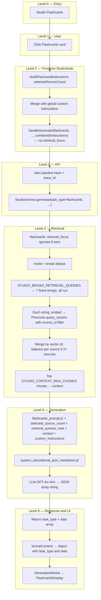

# Studio Flashcards: End-to-End Flow

This document describes **what happens today** when a learner uses **Flashcards** in Studio: from clicking the card through **broad-only** vector retrieval, JSON deck generation, and display in the generation modal. File references point at the current codebase.

**Output shape:** The API returns **`task_type: "flashcards"`** and a **`data`** payload that is a **JSON array** of objects `{ "front": "…", "back": "…" }` (parsed in **`_generate_structured_task`**). The **web app** shows them via **`FlashcardsDisplay`** inside **`GenerationModal`**.

For comparison, see [`STUDIO_QUIZ_FLOW.md`](STUDIO_QUIZ_FLOW.md) (JSON quiz), [`STUDIO_MIND_MAP_FLOW.md`](STUDIO_MIND_MAP_FLOW.md) (Markdown mind map), [`STUDIO_SLIDE_DECK_FLOW.md`](STUDIO_SLIDE_DECK_FLOW.md) (Markdown slides), and [`STUDIO_REPORT_FLOW.md`](STUDIO_REPORT_FLOW.md) (tailored report).

---

## 1. Preconditions

- The user has selected **one or more sources** (unlike Infographic, **no** single-source rule).
- Optional: **Custom instructions** in the Studio panel are **appended** to the structured flashcard scope block from **`buildFlashcardInstructions`**.
- Sources should be **ingested** into Pinecone; empty retrieval yields weak decks or an empty/minimal array per prompt rules.

---

## 2. High-level flow (tree)

---

## 3. Step-by-step: user actions

| Step | When | What happens |
|------|------|----------------|
| 1 | User clicks **Flashcards** | **`handleFlashcardGenerate`** runs (no secondary modal). |
| 2 | — | **`buildFlashcardInstructions(n)`** adds scope: selected sources only, front/back roles, single- vs multi-source deck rules. |
| 3 | — | **`combinedInstructions`** = `[scope block, global custom instructions].filter(Boolean).join('\n\n')`. |
| 4 | API call | **`handleGenerate('flashcards', undefined, combinedInstructions)`** — **no** fourth argument, so **`retrieval_focus`** is never set from the current UI. |

**Global Custom instructions:** merged **after** the scope block.

**Generation modal:** The structured scope block is **not** shown under “Custom Instructions” in the modal header for flashcards (see `StudioSuite` → `GenerationModal`).

**Important:** Even if a client sent **`retrieval_focus`** on `POST /api/v1/studio/generate` for **`task_type: "flashcards"`**, the backend **clears** it and **always** uses **`STUDIO_BROAD_RETRIEVAL_QUERIES`** only ([`studio_service.py`](packages/core/services/studio.py) — flashcards branch before query planning).

---

## 4. Frontend: building the request

**File:** [`apps/web/src/components/studio/StudioSuite.tsx`](apps/web/src/components/studio/StudioSuite.tsx)

1. **`buildFlashcardInstructions(selectedSourceCount)`** — mandatory scope (selected IDs only, grounding, front/back definition; multi-source integrated deck and fair coverage).
2. **`combinedInstructions`** = `[structured block, global custom instructions].filter(Boolean).join('\n\n')`.
3. **`handleGenerate('flashcards', undefined, combinedInstructions)`** — no **`retrieval_focus`**.
4. **`apiClient.generateStudio('flashcards', sourceIds, instructions)`** — [`apps/web/src/lib/api-client.ts`](apps/web/src/lib/api-client.ts) — `POST /api/v1/studio/generate`.

**Retry:** **`lastCustomInstructions`** holds the last combined string; **`lastRetrievalFocus`** is irrelevant for flashcards (retrieval stays broad).

**`determineContentType` / `formatContent`:** Structured JSON; preserves **`data`** for the modal.

---

## 5. API layer

**File:** [`apps/api/routes/studio.py`](apps/api/routes/studio.py)

- Validates **`StudioRequest`** ([`apps/api/schemas/studio.py`](apps/api/schemas/studio.py)).
- **`retrieval_focus`** on the schema notes it is **ignored** for **`flashcards`**.
- Starts trace, calls **`StudioService.generate`**, returns JSON including **`trace_id`** on success.

**Flashcards response shape (typical):** `{ "task_type": "flashcards", "data": [ { "front": "…", "back": "…" }, … ], "trace_id": "..." }`.

---

## 6. Backend: retrieval

**File:** [`packages/core/services/studio_service.py`](packages/core/services/studio_service.py)

| Behavior | Detail |
|----------|--------|
| **`retrieval_focus`** | **Ignored** for `task_type == "flashcards"` (cleared with a log line); **no** **`QueryRewriter`** path. |
| **`meta["mode"]`** | Always **`broad`** for flashcards. |
| **`queries_used`** | Always the full **`STUDIO_BROAD_RETRIEVAL_QUERIES`** tuple (**seven** fixed strings). |
| **Filter** | `{"source_id": {"$in": source_ids}}`. |
| **`STUDIO_RETRIEVAL_TOP_K_PER_QUERY`** | Pinecone `top_k` per query. |
| **`STUDIO_CONTEXT_MAX_CHUNKS`** | Cap after merge. |
| **`merge_studio_match_lists`** | Dedup by vector id; if **`len(source_ids) > 1`**, **`balance_source_ids`** ensures fair chunk share per source before global score fill. |

**`retrieval_queries_note`:** Passed into **`flashcards_prompt.j2`**.

**`selected_source_count`:** Passed into the template for single- vs multi-source instructions.

**Pipeline spans:** **`StudioRetrieval/VectorQuery`**, **`StudioRetrieval`** (no **`StudioRetrieval/QueryRewrite`** for flashcards), then **`StudioGenerate`** with tag **`studio_flashcards`**.

---

## 7. Backend: generation

**Template:** [`packages/core/prompts/templates/studio/flashcards_prompt.j2`](packages/core/prompts/templates/studio/flashcards_prompt.j2)

- **Inputs:** `context`, `custom_instructions`, `retrieval_queries_note`, **`selected_source_count`**.
- **Intent:** JSON **array** only; **front** = question/term/prompt, **back** = answer/explanation; multi-source **integrated** deck; empty context → prefer **`[]`** or minimal honest cards, not hallucinated bulk.

**System prompt:** [`packages/core/prompts/templates/studio/system_educational_json_markdown.j2`](packages/core/prompts/templates/studio/system_educational_json_markdown.j2).

**Model:** **`get_model_for_task("flashcards")`** → **GPT-4o-mini** ([`packages/core/llm/factory.py`](packages/core/llm/factory.py)).

**Path:** **`_generate_structured_task`** — temperature **0.7**; response parsed with **`json.loads`**; optional extraction from embedded `{...}` on failure (same family as quiz).

---

## 8. Frontend: showing the result

**File:** [`apps/web/src/components/studio/GenerationModal.tsx`](apps/web/src/components/studio/GenerationModal.tsx)

- Detects flashcards via **`task_type`** / content shape; renders **`FlashcardsDisplay`**.

**File:** [`apps/web/src/components/studio/FlashcardsDisplay.tsx`](apps/web/src/components/studio/FlashcardsDisplay.tsx)

- Renders the card list / flip UI for **`front` / `back`** (as implemented).

---

## 9. Quick reference: Flashcards vs Quiz vs Mind map

| Aspect | Flashcards | Quiz | Mind map |
|--------|------------|------|----------|
| **Sources** | One or more | One or more | One or more |
| **Customize modal** | No | Yes | No |
| **`retrieval_focus` from UI** | Not sent | Topic field | Not sent |
| **Backend retrieval** | **Broad 7 only** (focus ignored) | Broad or rewrite if focus | Broad or rewrite if focus |
| **Multi-source chunk balance** | **Yes** | No | **Yes** |
| **LLM output** | JSON **array** of cards | JSON **object** (quiz schema) | Markdown |
| **Primary UI** | `FlashcardsDisplay` | `QuizDisplay` | `MindMapDisplay` |

---

## 10. Operational debugging

- Use **`trace_id`** and **Analytics → Pipeline** for spans.
- Weak decks: check **`StudioRetrieval`** **`chunk_count`** and **`queries_used`** (should always list **7** broad strings).
- If multi-source decks skew to one document, verify Pinecone **`source_id`** metadata on chunks.

---

## 11. Related files (index)

| Role | Path |
|------|------|
| Orchestration | `packages/core/services/studio_service.py` |
| Flashcards prompt | `packages/core/prompts/templates/studio/flashcards_prompt.j2` |
| Broad query list | `STUDIO_BROAD_RETRIEVAL_QUERIES` in `packages/core/services/studio_service.py` |
| Merge / balance | `merge_studio_match_lists` in `packages/core/services/studio_service.py` |
| System prompt | `packages/core/prompts/templates/studio/system_educational_json_markdown.j2` |
| Model routing | `packages/core/llm/factory.py` |
| API route | `apps/api/routes/studio.py` |
| Schemas | `apps/api/schemas/studio.py` |
| HTTP client | `apps/web/src/lib/api-client.ts` |
| Studio UI + request | `apps/web/src/components/studio/StudioSuite.tsx` |
| Modal | `apps/web/src/components/studio/GenerationModal.tsx` |
| Card UI | `apps/web/src/components/studio/FlashcardsDisplay.tsx` |
| Pipeline debugger | `apps/web/src/app/analytics/pipeline/page.tsx` |
