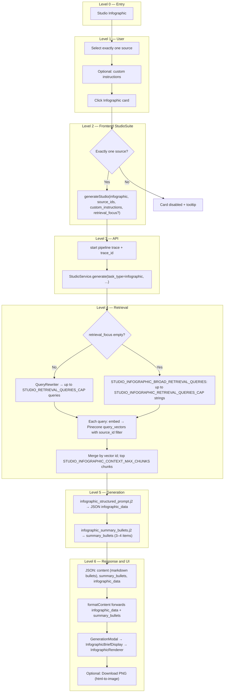

# Studio Infographic: End-to-End Flow

This document describes **what happens today** when a learner uses **Infographic** in Studio: from clicking the card through retrieval, structured JSON generation, and the rendered study sheet in the modal. File references point at the current codebase.

**Important:** The infographic is **not** generated by DALL·E or another pixel image model. The backend produces **structured JSON** (`infographic_data`); the **web app renders** that data as HTML/CSS (readable text, sections, optional comparison table and flow steps). Users can **export a PNG** from the browser via `html-to-image`.

---

## 1. Preconditions

- The user has selected **exactly one source** in the notebook. Infographic is **disabled** in the UI if zero or multiple sources are selected; the API also rejects `len(source_ids) != 1`.
- Optional: **Custom instructions** in the Studio panel are passed through to the structured infographic prompt.
- The selected source should be **ingested** into the vector store (Pinecone); otherwise `context` may be empty and the model may return generic or minimal structure.

---

## 2. High-level flow (tree)

Top-down tree: each row is a deeper **level** in the flow (parent → children).

---

## 3. Step-by-step: user actions

| Step | When | What happens |
|------|------|----------------|
| 1 | User selects sources | **Infographic** requires **one** source. With 0 or 2+ sources, the card is disabled and a tooltip explains the rule. |
| 2 | User optionally edits **Custom instructions** | Same global field as other Studio tools; merged into the structured prompt as “Additional user instructions.” |
| 3 | User optionally sets a **retrieval focus** (if your UI exposes it for this tool) | Same `retrieval_focus` field as quiz: when non-empty, retrieval uses **topic rewrite** instead of the broad infographic query list. |
| 4 | User clicks **Infographic** | `handleGenerate('infographic', …)` runs with the single `source_id`. |

Unlike Quiz, there is **no** separate “customize” modal for infographic-specific knobs (counts, difficulty, etc.)—only global custom instructions and optional retrieval focus.

---

## 4. Frontend: building the request

**File:** [`apps/web/src/components/studio/StudioSuite.tsx`](apps/web/src/components/studio/StudioSuite.tsx)

1. **`handleGenerate`** checks `type === 'infographic' && sourceIds.length !== 1` and returns early if invalid.
2. **`apiClient.generateStudio('infographic', sourceIds, customInstructions, retrievalFocus)`**  
   **File:** [`apps/web/src/lib/api-client.ts`](apps/web/src/lib/api-client.ts)  
   - POST `/api/v1/studio/generate` with `task_type: "infographic"`, `source_ids` (length 1), `custom_instructions`, and optionally `retrieval_focus`.

3. **`formatContent`** preserves the API object for the modal:

   - `content` — markdown bullet list (learner summary)
   - `summary_bullets` — array of short strings
   - `infographic_data` — structured JSON for [`InfographicRenderer`](apps/web/src/components/studio/InfographicRenderer.tsx)

**File:** [`apps/web/src/components/studio/GenerationModal.tsx`](apps/web/src/components/studio/GenerationModal.tsx)

- Detects infographic content and renders [`InfographicBriefDisplay`](apps/web/src/components/studio/InfographicBriefDisplay.tsx) with the full object (not a stringified blob).

---

## 5. API layer

**File:** [`apps/api/routes/studio.py`](apps/api/routes/studio.py)

1. Validates **`StudioRequest`**.  
   **Schema:** [`apps/api/schemas/studio.py`](apps/api/schemas/studio.py) — infographic response is documented as `content`, `infographic_data`, `summary_bullets` (structured rendering path).

2. Creates **`trace_id`**, starts pipeline trace, calls **`StudioService.generate(...)`**.

3. On success, merges **`trace_id`** into the JSON body.

---

## 6. Backend: validation and retrieval

**File:** [`packages/core/services/studio_service.py`](packages/core/services/studio_service.py)

### 6a. Single-source rule

At the start of **`generate`**, if `task_type == "infographic"` and `len(source_ids) != 1`, the service raises **`ValueError`** with a clear message (aligned with the UI).

### 6b. `retrieval_focus` vs empty (same pipeline as other Studio tasks, different defaults for infographic)

Shared mechanics:

- Metadata filter: **`source_id` ∈ selected IDs**
- **`STUDIO_RETRIEVAL_TOP_K_PER_QUERY`** — Pinecone `top_k` per query
- Merge matches by vector **id**, keep best score, sort, cap chunks

**Infographic-specific settings** (see [`config/settings.py`](config/settings.py)):

| Setting | Role |
|---------|------|
| **`STUDIO_INFOGRAPHIC_CONTEXT_MAX_CHUNKS`** | Max chunks concatenated into `context` for infographic (falls back to `STUDIO_CONTEXT_MAX_CHUNKS` if unset). |
| **`STUDIO_INFOGRAPHIC_RETRIEVAL_QUERIES_CAP`** | Max **broad** queries used when `retrieval_focus` is empty (default 14). |

**When `retrieval_focus` is non-empty**

- Mode **`topic_rewrite`**
- **`QueryRewriter.rewrite_query`** (feature tag `studio_query_rewriter`); first **`STUDIO_RETRIEVAL_QUERIES_CAP`** strings used (same cap as quiz broad topic path).

**When `retrieval_focus` is empty**

- Mode **`broad`**
- Fixed list **`STUDIO_INFOGRAPHIC_BROAD_RETRIEVAL_QUERIES`** — longer than the default quiz broad list: overview, themes, data/trends, timelines, comparisons, causes/effects, charts/maps, workflows, glossary, lists, etc. (see tuple at top of `studio_service.py`).

`retrieval_queries_note` is still built for tracing/consistency, but the current **`infographic_structured_prompt.j2`** does **not** inject it into the user prompt (only `context` and `custom_instructions`).

### 6c. Pipeline trace

- Span **`StudioGenerate`** with feature tag **`studio_infographic`** for the main structured JSON call.
- **`StudioRetrieval`** / **`StudioRetrieval/QueryRewrite`** / **`StudioRetrieval/VectorQuery`** follow the same pattern as other Studio tasks.

---

## 7. Backend: prompts and LLM

### 7a. Structured infographic (primary output)

**Template:** [`packages/core/prompts/templates/studio/infographic_structured_prompt.j2`](packages/core/prompts/templates/studio/infographic_structured_prompt.j2)

- Inputs: **`context`** (retrieved excerpt), **`custom_instructions`**
- Asks for **one** `layout`: `comparison` | `process` | `timeline` | `sections`
- Enforces **grounding** in the excerpt; **Lucide icon** names and **`color_theme`** from allowed sets
- Optional **`comparison`** (table) when layout is comparison; optional **`flow_steps`** for process/timeline

**Model:** Routed by **`get_model_for_task("infographic")`**.

**Parsing:** **`_parse_infographic_json`** — strips markdown fences, **`json.loads`**, requires **`title`** and **`sections`**; normalizes unknown `layout` / `color_theme`.

**Failure:** Invalid JSON → **`ValueError`** (“Please try again.”).

### 7b. Learner bullets (“At a glance”)

**Template:** [`packages/core/prompts/templates/studio/infographic_summary_bullets.j2`](packages/core/prompts/templates/studio/infographic_summary_bullets.j2)

- Runs **after** structured JSON succeeds, in **`_infographic_learner_bullets`**
- Model task **`flashcards`** (small/fast model); OpenAI path uses **`response_format: json_object`**
- Returns 3–4 short bullets; merged into **`content`** as markdown **and** **`summary_bullets`** array

---

## 8. Response shape (wire)

Typical successful payload:

| Field | Purpose |
|-------|---------|
| **`task_type`** | `"infographic"` |
| **`content`** | Markdown list (`- …`) derived from **`summary_bullets`** |
| **`summary_bullets`** | `string[]` (up to 4) for UI list |
| **`infographic_data`** | `object` — title, subtitle, layout, sections, optional comparison / flow_steps / key_takeaway |

There is **no** `image_url` from the server for this path; the visual is **DOM-rendered**.

---

## 9. Frontend: showing the result and export

**File:** [`apps/web/src/components/studio/InfographicBriefDisplay.tsx`](apps/web/src/components/studio/InfographicBriefDisplay.tsx)

1. Parses **`infographic_data`** and **`summary_bullets`** from the modal payload object.
2. Renders **`InfographicRenderer`** with a ref for export.
3. **Download PNG:** [`html-to-image`](https://www.npmjs.com/package/html-to-image) **`toPng`** on the renderer root (pixel ratio 2, white background).

**File:** [`apps/web/src/components/studio/InfographicRenderer.tsx`](apps/web/src/components/studio/InfographicRenderer.tsx)

- Maps **`icon`** strings to **Lucide** components
- Applies **`color_theme`** (blue, green, purple, teal, orange) for header, cards, table, flow connectors, takeaway strip
- **Comparison:** two-column section grid + optional HTML table
- **Process / timeline:** numbered **flow_steps** with vertical connector
- **Sections:** topic cards with labeled points

---

## 10. Quick reference: infographic vs quiz retrieval

| Aspect | Quiz | Infographic |
|--------|------|-------------|
| **Sources** | One or more | **Exactly one** |
| **Broad queries (no focus)** | `STUDIO_BROAD_RETRIEVAL_QUERIES` (4 strings) | `STUDIO_INFOGRAPHIC_BROAD_RETRIEVAL_QUERIES` (14 strings, capped by setting) |
| **Chunk cap** | `STUDIO_CONTEXT_MAX_CHUNKS` | `STUDIO_INFOGRAPHIC_CONTEXT_MAX_CHUNKS` (or same default) |
| **Output** | JSON quiz `data` | JSON **`infographic_data`** + bullets |
| **Visual** | `QuizDisplay` | `InfographicRenderer` (HTML/CSS, optional PNG export) |

---

## 11. Operational debugging

- **Response JSON** includes **`trace_id`** on success — use **Analytics → Pipeline** (or your trace viewer) for spans.
- **Empty or generic infographics** often correlate with **empty retrieval** (ingestion, Pinecone, wrong `source_id`).
- **“Invalid JSON” errors** — check main LLM provider logs; for non-OpenAI providers, `response_format: json_object` may not apply—verify `get_llm_client` behavior for **`infographic`** and **`flashcards`** tasks.
- **Legacy:** [`packages/core/prompts/templates/studio/infographic_prompt.j2`](packages/core/prompts/templates/studio/infographic_prompt.j2) was used for the old DALL·E prompt path; the live flow uses **`infographic_structured_prompt.j2`** only.

---

## 12. Related files (index)

| Role | Path |
|------|------|
| Service orchestration | `packages/core/services/studio_service.py` |
| Structured prompt | `packages/core/prompts/templates/studio/infographic_structured_prompt.j2` |
| Summary bullets prompt | `packages/core/prompts/templates/studio/infographic_summary_bullets.j2` |
| API route | `apps/api/routes/studio.py` |
| Schemas | `apps/api/schemas/studio.py` |
| HTTP client | `apps/web/src/lib/api-client.ts` |
| Studio grid + request | `apps/web/src/components/studio/StudioSuite.tsx` |
| Modal routing | `apps/web/src/components/studio/GenerationModal.tsx` |
| Infographic UI | `apps/web/src/components/studio/InfographicBriefDisplay.tsx`, `InfographicRenderer.tsx` |
