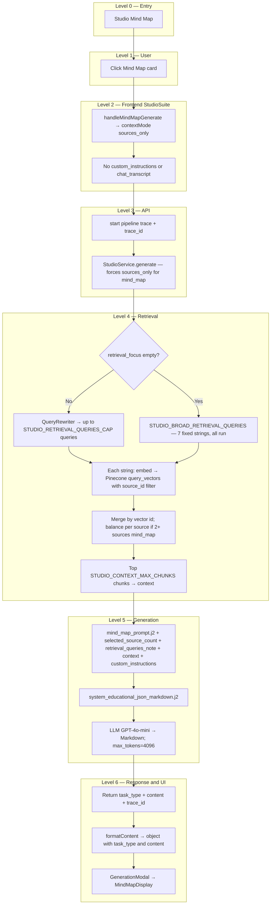

# Studio Mind Map: End-to-End Flow

This document describes **what happens today** when a learner uses **Mind Map** in Studio: from clicking the card through vector retrieval, Markdown hub-and-spoke generation, and interactive display in the generation modal. File references point at the current codebase.

**Output shape:** The API returns **`task_type: "mind_map"`** and a **`content`** string: **Markdown** with **`#`** hub, **`##`** branches, **`###`** / bullets for detail (see prompt). The **web app** renders it via **`MindMapDisplay`** inside **`GenerationModal`**.

For comparison, see [`STUDIO_FLASHCARDS_FLOW.md`](STUDIO_FLASHCARDS_FLOW.md) (JSON flashcards), [`STUDIO_SLIDE_DECK_FLOW.md`](STUDIO_SLIDE_DECK_FLOW.md) (Markdown slides), [`STUDIO_QUIZ_FLOW.md`](STUDIO_QUIZ_FLOW.md) (JSON quiz), and [`STUDIO_REPORT_FLOW.md`](STUDIO_REPORT_FLOW.md) (tailored report).

---

## 1. Preconditions

- The user has selected **one or more sources** (unlike Infographic, **no** single-source rule).
- **Mind map is source-only (NotebookLM parity):** chat history and highlighted chat text **never** feed generation. The same selected sources produce the same grounding regardless of chat activity.
- **Custom instructions** are **not** sent for mind map from the web UI (prompt rules live in **`mind_map_prompt.j2`** only).
- Sources should be **ingested** into Pinecone; empty retrieval yields minimal maps per prompt rules.
- Mind map is **not** available from chat text selection popovers (quiz, flashcards, slide deck only).

---

## 2. High-level flow (tree)

---

## 3. Step-by-step: user actions

| Step | When | What happens |
|------|------|----------------|
| 1 | User clicks **Mind Map** | **`handleMindMapGenerate`** runs (no secondary modal). |
| 2 | — | **`generate({ taskType: 'mind_map', contextMode: 'sources_only' })`** — no custom instructions. |
| 3 | API call | Frontend and backend both force **`sources_only`** even if chat is active. |

**Chat:** Ignored for mind map. Other Studio tools may still use **`chat_hybrid`** when chat + sources are present.

**Selection-only:** Mind map is **not** offered when highlighting text in chat.

**API note:** If a client sends **`retrieval_focus`** for **`mind_map`**, the backend can use **`QueryRewriter`** (topic mode)—the **web app** today does not send it.

---

## 4. Frontend: building the request

**File:** [`apps/web/src/components/studio/StudioSuite.tsx`](apps/web/src/components/studio/StudioSuite.tsx)

1. **`handleMindMapGenerate()`** → **`generate({ taskType: 'mind_map', contextMode: 'sources_only' })`**.
2. **`StudioGenerationContext`** also forces **`sources_only`** for mind map and omits **`custom_instructions`** on the API call.
3. **`apiClient.generateStudio(...)`** — [`apps/web/src/lib/api-client.ts`](apps/web/src/lib/api-client.ts).

**Retry:** Same parameters (sources-only, no instructions).

**`determineContentType` / `formatContent`:** Markdown **`content`**; preserves `{ task_type, content }`.

---

## 5. API layer

**File:** [`apps/api/routes/studio.py`](apps/api/routes/studio.py)

- Validates **`StudioRequest`**, starts trace, calls **`StudioService.generate`**, returns **`trace_id`**.

**Mind map response shape (typical):** `{ "task_type": "mind_map", "content": "<markdown>", "trace_id": "..." }`.

---

## 6. Backend: retrieval

**File:** [`packages/core/services/studio_service.py`](packages/core/services/studio_service.py)

| Setting / behavior | Detail |
|--------------------|--------|
| **Context mode** | **`mind_map` always `sources_only`** — `chat_transcript` and `selection_text` cleared; overrides client `chat_hybrid` / `selection_only`. |
| **`retrieval_focus`** | If **non-empty** → **`topic_rewrite`** + **`QueryRewriter`**, up to **`STUDIO_RETRIEVAL_QUERIES_CAP`** queries. If **empty** (current UI) → **`STUDIO_BROAD_RETRIEVAL_QUERIES`** (all **seven**). |
| **Filter** | `{"source_id": {"$in": source_ids}}`. |
| **`merge_studio_match_lists`** | If **`len(source_ids) > 1`** and **`task_type == "mind_map"`**, **`balance_source_ids`** for fair multi-source context. |
| **`selected_source_count`** | Passed into **`mind_map_prompt.j2`**. |
| **Broad retrieval perf** | Batch-embeds all broad queries in one API call; Pinecone lookups run in parallel via **`asyncio.gather`** + **`to_thread`**. |
| **Client timeout** | Web app waits up to **180s** for mind map (`STUDIO_GENERATION_TIMEOUT_MS` in `api-client.ts`). |

**Pipeline spans:** **`StudioRetrieval/QueryRewrite`** when focus is set; **`StudioRetrieval/VectorQuery`**; **`StudioRetrieval`**; **`StudioGenerate`** with **`studio_mind_map`**.

---

## 7. Backend: generation

**Template:** [`packages/core/prompts/templates/studio/mind_map_prompt.j2`](packages/core/prompts/templates/studio/mind_map_prompt.j2)

- **Inputs:** `context`, `custom_instructions`, `retrieval_queries_note`, **`selected_source_count`**.
- **Intent:** One **`#`** hub, **`##`** branches, detail under **`###`** / bullets; multi-source **single integrated** map (themes, contrasts, fair coverage).

**System prompt:** [`packages/core/prompts/templates/studio/system_educational_json_markdown.j2`](packages/core/prompts/templates/studio/system_educational_json_markdown.j2).

**Model:** **`get_model_for_task("mind_map")`** → **GPT-4o-mini**.

**Parameters:** Temperature **0.7**; **`max_tokens=4096`** in **`_generate_structured_task`** for **`mind_map`**.

**Post-processing:** **`_clean_markdown_code_blocks`**; returns **`{"task_type": "mind_map", "content": markdown}`** (not JSON).

---

## 8. Frontend: showing the result

**File:** [`apps/web/src/components/studio/GenerationModal.tsx`](apps/web/src/components/studio/GenerationModal.tsx)

- Detects mind map via **`task_type`** and Markdown heuristics; renders **`MindMapDisplay`**.

**File:** [`apps/web/src/components/studio/MindMapDisplay.tsx`](apps/web/src/components/studio/MindMapDisplay.tsx)

- Parses / lays out the hierarchical mind map (interactive disclosure, export hooks, etc.).
- **Default view:** level-1 branches (direct children of root) are **expanded on load**; deeper nodes remain collapsible.

---

## 9. Context modes (mind map vs other Studio tools)

| Mode | Mind map | Quiz / flashcards / slide deck |
|------|----------|--------------------------------|
| **`sources_only`** | **Always** (forced) | When chat is empty |
| **`chat_hybrid`** | **Never** | When chat + sources present |
| **`selection_only`** | **Not offered** | Chat highlight → toolbar (except mind map) |

See also: [`NCERT_Class_9_10_PDFs/notebooklm-vs-scholarsync-mindmap.html`](../NCERT_Class_9_10_PDFs/notebooklm-vs-scholarsync-mindmap.html) for NotebookLM alignment rationale.

---

## 10. Quick reference: Mind map vs Flashcards vs Slide deck

| Aspect | Mind map | Flashcards | Slide deck |
|--------|----------|------------|------------|
| **Sources** | One or more | One or more | One or more |
| **Customize modal** | No | No | Yes |
| **`retrieval_focus` from UI** | Not sent | Not sent | Optional objective |
| **Broad-only retrieval** | No (broad if no focus) | **Yes (always)** | No |
| **Multi-source chunk balance** | **Yes** | **Yes** | No |
| **LLM output** | Markdown | JSON array | Markdown |
| **max_tokens** | **4096** | Default | **4096** |
| **Primary UI** | `MindMapDisplay` | `FlashcardsDisplay` | `SlideDeckDisplay` |

---

## 11. Operational debugging

- Use **`trace_id`** and **Analytics → Pipeline**.
- Single-source dominance with multiple notebooks selected: confirm **`balance_source_ids`** path and chunk **`source_id`** metadata.
- Sparse maps: check **`chunk_count`** and whether mode was **broad** vs **topic_rewrite**.

---

## 12. Related files (index)

| Role | Path |
|------|------|
| Orchestration | `packages/core/services/studio_service.py` |
| Mind map prompt | `packages/core/prompts/templates/studio/mind_map_prompt.j2` |
| Broad query list | `STUDIO_BROAD_RETRIEVAL_QUERIES` in `packages/core/services/studio_service.py` |
| Query rewriter | `packages/core/rag/agents/query_rewriter.py` (when `retrieval_focus` set) |
| Merge / balance | `merge_studio_match_lists` in `packages/core/services/studio_service.py` |
| System prompt | `packages/core/prompts/templates/studio/system_educational_json_markdown.j2` |
| Model routing | `packages/core/llm/factory.py` |
| API route | `apps/api/routes/studio.py` |
| Schemas | `apps/api/schemas/studio.py` |
| HTTP client | `apps/web/src/lib/api-client.ts` |
| Studio UI + request | `apps/web/src/components/studio/StudioSuite.tsx` |
| Modal | `apps/web/src/components/studio/GenerationModal.tsx` |
| Map UI | `apps/web/src/components/studio/MindMapDisplay.tsx` |
| Pipeline debugger | `apps/web/src/app/analytics/pipeline/page.tsx` |
