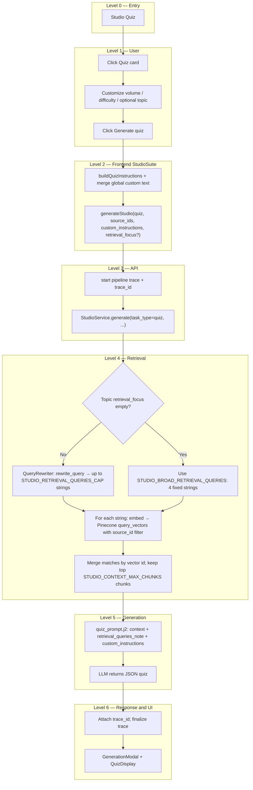

# Studio Quiz: End-to-End Flow

This document describes **what happens today** when a learner uses **Quiz** in Studio: from clicking the card through retrieval, prompting, and the result modal. File references point at the current codebase.

---

## 1. Preconditions

- The user has **selected one or more sources** in the notebook (these become `source_ids`).
- Optional: **Custom instructions** in the Studio panel (global text area) apply to generation in addition to quiz-specific settings.
- The selected sources should be **ingested** into the vector store (Pinecone); otherwise context may be empty and the model falls back to generic quizzing.

---

## 2. High-level flow (tree)

Top-down tree: each row is a deeper **level** in the flow (parent → children).

---

## 3. Step-by-step: user actions

| Step | When | What happens |
|------|------|----------------|
| 1 | User clicks **Quiz** in the Studio grid | Unlike flashcards or mind map, quiz does **not** call the API immediately. The **Customize Quiz** modal opens. |
| 2 | User chooses **How many questions** (fewer / standard / more) | Maps to a numeric range in structured instructions (e.g. 5–7 for “Standard”). |
| 3 | User chooses **Difficulty** (easy / medium / hard) | Appended as rules in structured instructions (wording, distractors, reasoning depth). |
| 4 | User optionally types **Topic** | If non-empty: used as **`retrieval_focus`** for vector search **and** as a “topic focus” line inside **`custom_instructions`**. If empty: backend uses **broad multi-query** retrieval and instructions ask for **full breadth** across retrieved material. |
| 5 | User clicks **Generate quiz** | Modal closes; `handleQuizGenerate` runs (see §4). |

**Global Custom instructions** (collapsible area above the grid): merged **below** the structured quiz block in the single `custom_instructions` string sent to the API.

---

## 4. Frontend: building the request

**File:** [`apps/web/src/components/studio/StudioSuite.tsx`](apps/web/src/components/studio/StudioSuite.tsx)

1. **`buildQuizInstructions(quizSpec)`** builds the structured block (counts, difficulty, topic vs full-breadth scope, JSON format rules).
2. **`combinedInstructions`** = `[structured block, global custom instructions].filter(Boolean).join('\n\n')`.
3. **`handleGenerate('quiz', undefined, combinedInstructions, quizSpec.topicFocus.trim() || undefined)`**:
   - Resolves `source_ids` from the current **selected sources**.
   - **`retrievalForApi`**: only set if the topic field has text after trim (this becomes `retrieval_focus` on the wire).
4. **`apiClient.generateStudio('quiz', sourceIds, instructions, retrievalForApi)`**  
   **File:** [`apps/web/src/lib/api-client.ts`](apps/web/src/lib/api-client.ts)  
   - POST `/api/v1/studio/generate` with `task_type`, `source_ids`, `custom_instructions`, and optionally `retrieval_focus`.

**Retry:** The last quiz run stores `lastCustomInstructions` and `lastRetrievalFocus` so **Retry** in the result modal repeats the same parameters.

**UI while loading:** The generation modal shows a quiz-specific “creating your quiz” state and does **not** expose raw internal instructions to the student.

---

## 5. API layer

**File:** [`apps/api/routes/studio.py`](apps/api/routes/studio.py)

1. Validates **`StudioRequest`** (includes optional `retrieval_focus`).  
   **Schema:** [`apps/api/schemas/studio.py`](apps/api/schemas/studio.py)
2. Creates a **`trace_id`**, calls **`PipelineTraceStore.start_trace`**, then **`StudioService.generate(...)`**.
3. On success, merges **`trace_id`** into the JSON body (for **Analytics → Pipeline** debugging).
4. **`finalize_trace`** runs in a `finally` block (success or failure).

---

## 6. Backend: retrieval (`retrieval_focus` vs empty)

**File:** [`packages/core/services/studio_service.py`](packages/core/services/studio_service.py)

Settings (see [`config/settings.py`](config/settings.py)) that matter for quiz:

- **`STUDIO_RETRIEVAL_QUERIES_CAP`** — max number of **rewritten** queries used when a topic is provided (default 3).
- **`STUDIO_RETRIEVAL_TOP_K_PER_QUERY`** — Pinecone `top_k` per vector query (default 10).
- **`STUDIO_CONTEXT_MAX_CHUNKS`** — after merging, max chunks concatenated into `context` (default 28).

### 6a. Topic provided (`retrieval_focus` non-empty)

1. Mode **`topic_rewrite`**.
2. **`QueryRewriter.rewrite_query`** (feature tag `studio_query_rewriter`) returns several search-oriented strings; the first **up to `STUDIO_RETRIEVAL_QUERIES_CAP`** are used.
3. For **each** of those strings: embed → **`query_vectors`** with metadata filter **`source_id` ∈ selected IDs**.
4. **Merge** all result lists: same Pinecone vector **`id`** appears once, keeping the **highest similarity score**; sort by score; take top **`STUDIO_CONTEXT_MAX_CHUNKS`**; join chunk texts with blank lines.

So the model receives **chunks that are semantically related to the (rewritten) topic**, still restricted to selected sources.

### 6b. Topic empty

1. Mode **`broad`** — **no** query rewriter.
2. A **fixed list** of broad English queries (`STUDIO_BROAD_RETRIEVAL_QUERIES`: overview, themes/definitions, examples, structure/summary) runs the same **embed → query → merge** pipeline.

So the model receives a **diverse sample** of chunks from the selected sources, **not** the full text of every file (large PDFs do not fit in context).

### 6c. Pipeline trace spans (when tracing is enabled)

Typical span names for a quiz request:

- **`StudioRetrieval/QueryRewrite`** — only if topic path.
- **`StudioRetrieval/VectorQuery`** — aggregate embedding + Pinecone calls.
- **`StudioRetrieval`** — overall retrieval summary.
- **`StudioGenerate`** — main quiz LLM call.

Feature tag on spans: **`studio_quiz`**.

---

## 7. Backend: prompt and LLM

1. **`retrieval_queries_note`** — numbered list of the **queries actually used for search** (truncated for length). Injected into the task template so the generator knows **which retrieval intent** produced the context.
2. **`context`** — concatenated chunk text from §6.
3. **`custom_instructions`** — structured quiz requirements + optional global custom text from the UI.

**Template:** [`packages/core/prompts/templates/studio/quiz_prompt.j2`](packages/core/prompts/templates/studio/quiz_prompt.j2)

- Enforces **JSON-only** output with `title` and `questions[]` (four options, one `correct_answer`, `explanation`).
- Applies count/difficulty/topic rules from **Additional user instructions**.
- Includes the **retrieval queries** block when `retrieval_queries_note` is non-empty.

**Model routing:** Quiz is a structured JSON task; the service uses the configured model for **`quiz`** via **`get_model_for_task`**.

**Parsing:** Response is parsed as JSON; result shape **`{ "task_type": "quiz", "data": { ... } }`** for the client.

---

## 8. Frontend: showing the result

1. **`determineContentType` / `formatContent`** treat quiz as **JSON** / structured object.
2. **`GenerationModal`** + **`QuizDisplay`** render questions and options.
3. Students do **not** see the internal **Custom instructions** block for quiz in the same way as other tools; loading state is a dedicated quiz “generating” experience.

---

## 9. Quick reference: two parallel “topic” channels

| Channel | Purpose |
|---------|---------|
| **`retrieval_focus`** (API field) | Drives **which chunks** are pulled from Pinecone (rewritten queries when non-empty). |
| **`custom_instructions`** (includes topic line from `buildQuizInstructions`) | Tells the **LLM** how many questions, difficulty, and whether to emphasize a topic or full breadth **in the text it writes**. |

Both are used together for the best case: **evidence** matches the topic, and **wording** of the quiz follows the same intent.

---

## 10. Operational debugging

- **Response JSON** includes **`trace_id`** on success.
- Open **Analytics → Pipeline** (or append `?trace_id=...` if your app supports it) to inspect spans for that request.
- Empty or weak quizzes often correlate with **empty retrieval** (ingestion/Pinecone/source IDs) — check logs and `StudioRetrieval` span output.
