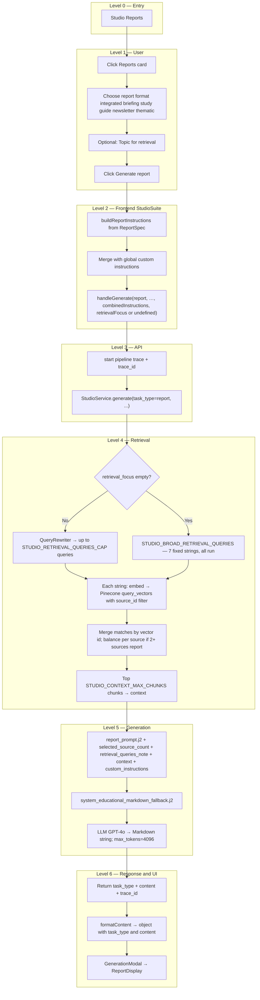

# Studio Report: End-to-End Flow

This document describes **what happens today** when a learner uses **Reports** (tailored report) in Studio: from opening the customize modal through retrieval, Markdown generation, and display in the generation modal. File references point at the current codebase.

**Output shape:** The API returns **`task_type: "report"`** and a single **`content`** string: **Markdown** with required sections (`## Executive Summary`, `## Key Points`, `## Detailed Analysis`, `## Conclusions`). The **web app** renders it via **`ReportDisplay`** inside **`GenerationModal`**.

For comparison, see [`STUDIO_SLIDE_DECK_FLOW.md`](STUDIO_SLIDE_DECK_FLOW.md) (Markdown slides), [`STUDIO_FLASHCARDS_FLOW.md`](STUDIO_FLASHCARDS_FLOW.md) (JSON flashcards), [`STUDIO_MIND_MAP_FLOW.md`](STUDIO_MIND_MAP_FLOW.md) (Markdown mind map), [`STUDIO_QUIZ_FLOW.md`](STUDIO_QUIZ_FLOW.md) (JSON quiz), and [`STUDIO_INFOGRAPHIC_FLOW.md`](STUDIO_INFOGRAPHIC_FLOW.md) (structured JSON + React renderer).

---

## 1. Preconditions

- The user has selected **one or more sources** (same as Quiz and Slide Deck; unlike Infographic, **no** single-source rule).
- Optional: **Custom instructions** in the Studio panel (global collapsible area) are **appended** to the structured report instruction block from the customize modal.
- Sources should be **ingested** into Pinecone; empty retrieval yields weak or generic reports.

---

## 2. High-level flow (tree)

---

## 3. Step-by-step: user actions

| Step | When | What happens |
|------|------|----------------|
| 1 | User clicks **Reports** | **Tailored report** modal opens (no API call yet). |
| 2 | **Report format** | **Integrated synthesis**, **Executive briefing**, **Study guide**, **Newsletter style**, or **Thematic summary** — encoded in `buildReportInstructions` (voice/structure hints; the four `##` section headings stay fixed in the prompt). |
| 3 | **Topic for retrieval** | Maps to **`retrieval_focus`** on the API when non-empty after trim. Backend runs **`QueryRewriter`** (same path as Quiz / Slide Deck). When **empty**, backend uses **broad** retrieval with **`STUDIO_BROAD_RETRIEVAL_QUERIES`**. |
| 4 | **Generate report** | `handleReportGenerate` closes the modal and calls `handleGenerate` with the combined instructions and optional focus. |

**Global Custom instructions:** merged **after** the structured report block in one `custom_instructions` string.

**Generation modal:** The long structured + scope block is **not** shown under “Custom Instructions” in the modal header for report (same pattern as quiz and mind map)—see `StudioSuite` → `GenerationModal` `customInstructions` prop.

---

## 4. Frontend: building the request

**File:** [`apps/web/src/components/studio/StudioSuite.tsx`](apps/web/src/components/studio/StudioSuite.tsx)

1. **`ReportSpec`** — `format` (`integrated` \| `briefing` \| `study_guide` \| `newsletter` \| `thematic_summary`), **`retrievalFocus`** (optional).
2. **`buildReportInstructions(spec, selectedSourceCount)`** — scope (selected sources only, grounding), chosen format description, and **multi-source** synthesis rules when `selectedSourceCount > 1`.
3. **`combinedInstructions`** = `[structured block, global custom instructions].filter(Boolean).join('\n\n')`.
4. **`handleGenerate('report', undefined, combinedInstructions, reportSpec.retrievalFocus.trim() || undefined, reportSpec.format)`**  
   - Fourth argument becomes **`retrieval_focus`** when the topic field is non-empty.  
   - Fifth argument is **`report_format`** (`integrated` \| `briefing` \| `study_guide` \| `newsletter` \| `thematic_summary`) — must match the Tailored report modal and drives **`report_prompt.j2`** format blocks.
5. **`apiClient.generateStudio(..., reportFormat?)`** — [`apps/web/src/lib/api-client.ts`](apps/web/src/lib/api-client.ts) — `POST /api/v1/studio/generate` with optional **`report_format`** in the JSON body for `task_type === 'report'`.

**Retry:** **`lastRetrievalFocus`**, **`lastReportFormat`**, and **`lastCustomInstructions`** store the last run so Retry repeats retrieval + format + generation parameters.

**`determineContentType` / `formatContent`:** Treats report like other Markdown **`content`** tasks; preserves `{ task_type, content }` for the modal.

---

## 5. API layer

**File:** [`apps/api/routes/studio.py`](apps/api/routes/studio.py)

- Validates **`StudioRequest`** ([`apps/api/schemas/studio.py`](apps/api/schemas/studio.py)).
- Starts trace, calls **`StudioService.generate`**, returns JSON including **`trace_id`** on success.

**Request (report):** Optional **`report_format`** on [`StudioRequest`](apps/api/schemas/studio.py) (same enum as the UI). Defaults server-side to **`integrated`** if omitted or invalid.

**Report response shape (typical):** `{ "task_type": "report", "content": "<markdown>", "trace_id": "..." }`.

---

## 6. Backend: retrieval

**File:** [`packages/core/services/studio_service.py`](packages/core/services/studio_service.py)

Shared settings with Quiz / Slide Deck / Mind Map **except** Infographic’s special lists and caps:

| Setting | Role |
|---------|------|
| **`STUDIO_RETRIEVAL_TOP_K_PER_QUERY`** | Pinecone `top_k` per query. |
| **`STUDIO_RETRIEVAL_QUERIES_CAP`** | When **`retrieval_focus` is set** — max rewritten queries from **`QueryRewriter`**. |
| **`STUDIO_CONTEXT_MAX_CHUNKS`** | After merge, max chunks in **`context`**. |
| **`STUDIO_BROAD_RETRIEVAL_QUERIES`** | **Seven** fixed broad strings. When focus is **empty**, **all seven** are run. |
| **`merge_studio_match_lists`** | Deduplicates by vector id (best score per id). |
| **`balance_source_ids`** | When **`task_type == "report"`** and **`len(source_ids) > 1`**, merge reserves a **minimum share of chunks per `source_id`** before filling by global score—so multi-source reports are not dominated by one high-scoring document (same mechanism as mind map). |

**`retrieval_queries_note`:** Numbered list of queries used, passed into **`report_prompt.j2`** alongside chunk text.

**`selected_source_count`:** Passed into **`report_prompt.j2`** as **`{{ selected_source_count }}`** for single- vs multi-source synthesis instructions.

**Pipeline spans:** **`StudioRetrieval/QueryRewrite`** (if focus), **`StudioRetrieval/VectorQuery`**, aggregate **`StudioRetrieval`**, then **`StudioGenerate`** with feature tag **`studio_report`**.

---

## 7. Backend: generation

**Template:** [`packages/core/prompts/templates/studio/report_prompt.j2`](packages/core/prompts/templates/studio/report_prompt.j2)

- **Inputs:** `context`, `custom_instructions`, `retrieval_queries_note`, **`selected_source_count`**, **`report_format`** (normalized in [`studio_service.py`](packages/core/services/studio_service.py) via `_normalize_report_format`).
- **Intent:** One **cohesive** tailored report from **selected sources only**; multi-source **cross-reference**, themes, fair coverage; fixed four `##` sections. The template contains a **REPORT FORMAT SPECIFICATION** block per format (`integrated`, `briefing`, `study_guide`, `newsletter`, `thematic_summary`) so each UI option has explicit generation rules.

**System prompt:** [`packages/core/prompts/templates/studio/system_educational_markdown_fallback.j2`](packages/core/prompts/templates/studio/system_educational_markdown_fallback.j2) — Markdown-only, accuracy, synthesis across excerpts.

**Model:** **`get_model_for_task("report")`** → in [`packages/core/llm/factory.py`](packages/core/llm/factory.py) **GPT-4o** (OpenAI).

**Parameters:** Temperature **0.5**; **`max_tokens=4096`** in **`_generate_report`**.

**Post-processing:** **`_clean_markdown_code_blocks`** strips accidental fences; returns **`{"task_type": "report", "content": markdown}`** (not JSON).

---

## 8. Frontend: showing the result

**File:** [`apps/web/src/components/studio/GenerationModal.tsx`](apps/web/src/components/studio/GenerationModal.tsx)

- Detects report via **`task_type`** and content heuristics; renders **`ReportDisplay`**.

**File:** [`apps/web/src/components/studio/ReportDisplay.tsx`](apps/web/src/components/studio/ReportDisplay.tsx)

- Renders the Markdown report content (export / layout as implemented there).

---

## 9. Quick reference: Report vs Slide deck vs Quiz vs Infographic

| Aspect | Report | Slide deck | Quiz | Infographic |
|--------|--------|------------|------|-------------|
| **Sources** | One or more | One or more | One or more | **Exactly one** |
| **Customize modal** | Yes (format + optional retrieval topic) | Yes | Yes | No |
| **Focus → `retrieval_focus`** | Topic for retrieval field | Objective field | Topic field | Only if UI passes it |
| **Multi-source chunk balance** | **Yes** (`report` + 2+ sources) | No | No | N/A (one source) |
| **Broad retrieval** | `STUDIO_BROAD_RETRIEVAL_QUERIES` (7) | Same | Same | Infographic-specific list + caps |
| **System prompt file** | `system_educational_markdown_fallback.j2` | `system_educational_json_markdown.j2` | Same as slide deck | Inline / other |
| **LLM output** | Markdown | Markdown | JSON | JSON **`infographic_data`** + bullets |
| **Primary UI** | `ReportDisplay` | `SlideDeckDisplay` | `QuizDisplay` | `InfographicRenderer` |

---

## 10. Operational debugging

- Use **`trace_id`** from the response and **Analytics → Pipeline** to inspect spans.
- Weak reports often correlate with **empty or tiny `context`** — check ingestion and `StudioRetrieval` output summaries.
- For **multi-source** reports, if one document still dominates, verify Pinecone metadata **`source_id`** on chunks matches selected IDs (balancing keys off that field).

---

## 11. Related files (index)

| Role | Path |
|------|------|
| Orchestration | `packages/core/services/studio_service.py` |
| Report prompt | `packages/core/prompts/templates/studio/report_prompt.j2` |
| System prompt | `packages/core/prompts/templates/studio/system_educational_markdown_fallback.j2` |
| Merge / multi-source balance | `merge_studio_match_lists` in `packages/core/services/studio_service.py` |
| Model routing | `packages/core/llm/factory.py` |
| API route | `apps/api/routes/studio.py` |
| Schemas | `apps/api/schemas/studio.py` |
| HTTP client | `apps/web/src/lib/api-client.ts` |
| Studio UI + request | `apps/web/src/components/studio/StudioSuite.tsx` |
| Modal | `apps/web/src/components/studio/GenerationModal.tsx` |
| Report viewer | `apps/web/src/components/studio/ReportDisplay.tsx` |
| Pipeline debugger | `apps/web/src/app/analytics/pipeline/page.tsx` |
