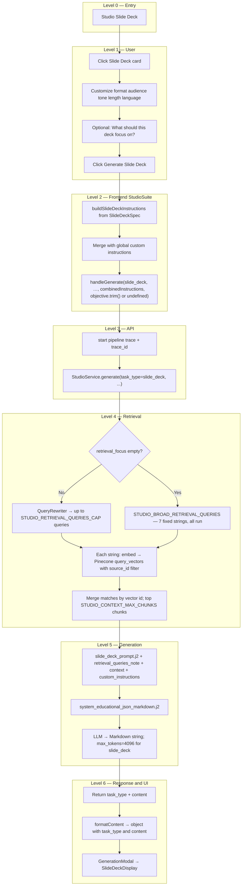

# Studio Slide Deck: End-to-End Flow

This document describes **what happens today** when a learner uses **Slide Deck** in Studio: from opening the customize modal through retrieval, Markdown generation, and the slide viewer in the modal. File references point at the current codebase.

**Output shape:** The API returns **`task_type: "slide_deck"`** and a single **`content`** string: a **Markdown** outline (`# Slide N: …` headings with bullets). The **web app** parses that Markdown in **`SlideDeckDisplay`** for step-through navigation—there is **no** PowerPoint/PPTX export in this path.

For comparison, see [`STUDIO_QUIZ_FLOW.md`](STUDIO_QUIZ_FLOW.md) (JSON quiz), [`STUDIO_FLASHCARDS_FLOW.md`](STUDIO_FLASHCARDS_FLOW.md) (JSON flashcards), [`STUDIO_MIND_MAP_FLOW.md`](STUDIO_MIND_MAP_FLOW.md) (Markdown mind map), [`STUDIO_REPORT_FLOW.md`](STUDIO_REPORT_FLOW.md) (tailored report), and [`STUDIO_INFOGRAPHIC_FLOW.md`](STUDIO_INFOGRAPHIC_FLOW.md) (structured JSON + React renderer).

---

## 1. Preconditions

- The user has selected **one or more sources** (same as Quiz; unlike Infographic, **no** single-source rule).
- Optional: **Custom instructions** in the Studio panel (global collapsible area) are **appended** to the structured slide-deck instruction block.
- Sources should be **ingested** into Pinecone; empty retrieval yields weak or generic outlines.

---

## 2. High-level flow (tree)

---

## 3. Step-by-step: user actions

| Step | When | What happens |
|------|------|----------------|
| 1 | User clicks **Slide Deck** | **Customize Slide Deck** modal opens (no API call yet). |
| 2 | **Deck type** | **Detailed** vs **Presenter** — affects wording in `buildSlideDeckInstructions`. |
| 3 | **Audience / Tone / Length / Language** | Encoded into the structured instruction block (e.g. short ≈ 6–8 slides, medium ≈ 10–12, long ≈ 14–16). |
| 4 | **What should this deck focus on?** | Maps to **`retrieval_focus`** on the API when non-empty after trim. Backend runs **`QueryRewriter`** (same path as Quiz topic). When **empty**, backend uses **broad** retrieval with **`STUDIO_BROAD_RETRIEVAL_QUERIES`**. |
| 5 | **Generate Slide Deck** | `handleSlideDeckGenerate` closes the modal and calls `handleGenerate` with the combined instructions and optional focus. |

**Global Custom instructions:** merged **after** the structured slide block in one `custom_instructions` string.

---

## 4. Frontend: building the request

**File:** [`apps/web/src/components/studio/StudioSuite.tsx`](apps/web/src/components/studio/StudioSuite.tsx)

1. **`SlideDeckSpec`** — `format`, `audience`, `tone`, `length`, `language`, **`objective`** (focus field).
2. **`buildSlideDeckInstructions(spec)`** — builds the pedagogical and format rules (story arc, show-don’t-tell, 1–7 bullets per slide, conclusion slide, bold hierarchy, etc.).
3. **`combinedInstructions`** = `[structured block, global custom instructions].filter(Boolean).join('\n\n')`.
4. **`handleGenerate('slide_deck', undefined, combinedInstructions, slideDeckSpec.objective.trim() || undefined)`**  
   - Fourth argument becomes **`retrieval_focus`** when the focus textarea is non-empty.
5. **`apiClient.generateStudio(...)`** — [`apps/web/src/lib/api-client.ts`](apps/web/src/lib/api-client.ts) — `POST /api/v1/studio/generate`.

**Retry:** Same as Quiz—**`lastRetrievalFocus`** stores the last focus string, so Retry repeats retrieval + generation parameters.

**`determineContentType` / `formatContent`:** Treats slide deck like other Markdown **`content`** tasks; preserves `{ task_type, content }` for the modal.

---

## 5. API layer

**File:** [`apps/api/routes/studio.py`](apps/api/routes/studio.py)

- Validates **`StudioRequest`** ([`apps/api/schemas/studio.py`](apps/api/schemas/studio.py)).
- Starts trace, calls **`StudioService.generate`**, returns JSON including **`trace_id`** on success.

**Slide deck response shape (typical):** `{ "task_type": "slide_deck", "content": "<markdown>" }`.

---

## 6. Backend: retrieval (same engine as Quiz / mind map)

**File:** [`packages/core/services/studio_service.py`](packages/core/services/studio_service.py)

Shared with other Studio tasks **except** Infographic’s special chunk cap and broad list:

| Setting | Role |
|---------|------|
| **`STUDIO_RETRIEVAL_TOP_K_PER_QUERY`** | Pinecone `top_k` per query. |
| **`STUDIO_RETRIEVAL_QUERIES_CAP`** | Used when **`retrieval_focus` is set** — max rewritten queries from **`QueryRewriter`**. |
| **`STUDIO_CONTEXT_MAX_CHUNKS`** | After merge by vector id, max chunks in **`context`**. |
| **`STUDIO_BROAD_RETRIEVAL_QUERIES`** | **Seven** fixed broad strings (overview, themes, examples, structure, causes/effects, processes, comparisons). When focus is **empty**, **all seven** are run (no cap on this list—unlike topic rewrite). |
| **`matches_total` / merge** | Raw hits are summed across queries; **`merge_studio_match_lists`** deduplicates by vector id before building `context`. |

**`retrieval_queries_note`:** Numbered list of queries used, passed into **`slide_deck_prompt.j2`** so the model knows retrieval intent alongside chunk text.

**Pipeline spans:** **`StudioRetrieval/QueryRewrite`** (if focus), **`StudioRetrieval/VectorQuery`**, aggregate **`StudioRetrieval`** (parent may be hidden in the Analytics UI when children exist—see pipeline page). Then **`StudioGenerate`** with feature tag **`studio_slide_deck`**.

---

## 7. Backend: generation

**Template:** [`packages/core/prompts/templates/studio/slide_deck_prompt.j2`](packages/core/prompts/templates/studio/slide_deck_prompt.j2)

- **Inputs:** `context`, `custom_instructions`, `retrieval_queries_note` (when present).
- **Intent:** Markdown-only deck; **story arc**; **show don’t tell**; **1–7** bullets per slide (variable count); **bold** for emphasis; **required conclusion** slide; grounding in source; engagement hooks.

**System prompt:** [`packages/core/prompts/templates/studio/system_educational_json_markdown.j2`](packages/core/prompts/templates/studio/system_educational_json_markdown.j2) — generic “follow format; Markdown = clean Markdown only.”

**Model:** **`get_model_for_task("slide_deck")`** → in [`packages/core/llm/factory.py`](packages/core/llm/factory.py) typically **GPT-4o-mini** (OpenAI).

**Parameters:** Temperature **0.7**; **`max_tokens=4096`** only for **`slide_deck`** inside **`_generate_structured_task`**.

**Post-processing:** **`_clean_markdown_code_blocks`** strips accidental fences; response is **not** parsed as JSON (unlike quiz)—returns **`{"task_type": "slide_deck", "content": markdown}`**.

---

## 8. Frontend: showing the result

**File:** [`apps/web/src/components/studio/GenerationModal.tsx`](apps/web/src/components/studio/GenerationModal.tsx)

- Detects slide deck via **`task_type`** and Markdown heuristics; renders **`SlideDeckDisplay`**.

**File:** [`apps/web/src/components/studio/SlideDeckDisplay.tsx`](apps/web/src/components/studio/SlideDeckDisplay.tsx)

- Extracts **`content`** from string or object.
- Splits Markdown on **`#` / `##`** headings into slides; **ReactMarkdown** renders body (supports **`**bold**`**).
- Previous / next navigation and slide index.

---

## 9. Quick reference: Slide deck vs Quiz vs Infographic

| Aspect | Quiz | Slide deck | Infographic |
|--------|------|------------|-------------|
| **Sources** | One or more | One or more | **Exactly one** |
| **Customize modal** | Yes | Yes | No |
| **Focus → `retrieval_focus`** | Topic field | “What should this deck focus on?” | Only if UI passes it (card has no focus field) |
| **Broad retrieval** | `STUDIO_BROAD_RETRIEVAL_QUERIES` (7) | Same | `STUDIO_INFOGRAPHIC_BROAD_RETRIEVAL_QUERIES` + higher cap |
| **LLM output** | JSON | Markdown | JSON **`infographic_data`** + bullet summary |
| **Primary UI** | `QuizDisplay` | `SlideDeckDisplay` | `InfographicRenderer` + PNG export |

---

## 10. Operational debugging

- Use **`trace_id`** from the response and **Analytics → Pipeline** to inspect spans.
- Weak decks often correlate with **empty or tiny `context`**—check ingestion and `StudioRetrieval` output summaries.
- **`packages/core/skills/slidedeck_skill.py`** is a **TODO stub** and is **not** used by the Studio slide deck flow.

---

## 11. Related files (index)

| Role | Path |
|------|------|
| Orchestration | `packages/core/services/studio_service.py` |
| Slide prompt | `packages/core/prompts/templates/studio/slide_deck_prompt.j2` |
| System prompt | `packages/core/prompts/templates/studio/system_educational_json_markdown.j2` |
| Model routing | `packages/core/llm/factory.py` |
| API route | `apps/api/routes/studio.py` |
| Schemas | `apps/api/schemas/studio.py` |
| HTTP client | `apps/web/src/lib/api-client.ts` |
| Studio UI + request | `apps/web/src/components/studio/StudioSuite.tsx` |
| Modal | `apps/web/src/components/studio/GenerationModal.tsx` |
| Slide viewer | `apps/web/src/components/studio/SlideDeckDisplay.tsx` |
| Pipeline debugger | `apps/web/src/app/analytics/pipeline/page.tsx` |
