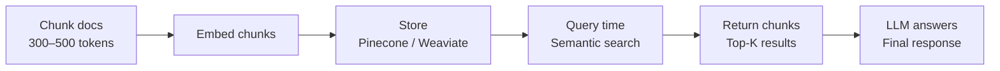
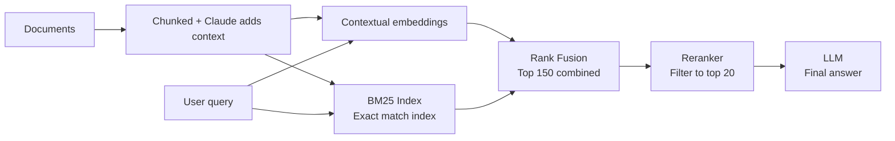

# Contextual Retrieval: A Complete Guide to Anthropic's Advanced RAG Technique

**How to reduce retrieval failures by up to 67% in AI knowledge systems**

Published by Anthropic · September 2024

---

# What is Contextual Retrieval?

Contextual Retrieval is an improved technique for building AI systems that search large knowledge bases — like customer support docs, legal databases, or financial filings — and find the right information before answering a question.

It was published by Anthropic in September 2024.

> **Key Result:** Contextual Retrieval can reduce retrieval failures by 49% (embeddings + BM25) and up to 67% when combined with reranking — directly translating to better AI responses.

---

# The Problem with Traditional RAG

Traditional RAG (Retrieval-Augmented Generation) works by:

1. Breaking documents into small chunks
2. Converting them into vector embeddings
3. Storing them in a vector database
4. Retrieving the most relevant chunks at query time
5. Passing those chunks to the LLM
6. Generating the final answer

## How Standard RAG Works



*Standard RAG pipeline — 6-step process from document to answer.*

---

# The Core Problem: Loss of Context

When documents are split into chunks, each chunk loses its surrounding context. This is the **context conundrum** — and it causes retrievals to fail silently.

| WITHOUT context (Normal RAG) | WITH context (Contextual Retrieval) |
|---|---|
| “The company's revenue grew by 3% over the previous quarter.” | “This chunk is from an SEC filing on ACME Corp's Q2 2023 performance; previous quarter revenue was $314M. The company's revenue grew by 3% over the previous quarter.” |
| ❌ No company name. No date. Query for `ACME Corp Q2 2023` fails to retrieve this. | ✅ Now contains ACME Corp and Q2 2023. Query succeeds — chunk is retrieved correctly. |

*The same chunk — one fails retrieval, one succeeds. The only difference is context.*

---

# Flow Diagram: Normal RAG vs Contextual Retrieval

```mermaid
flowchart LR
    subgraph N[Normal RAG]
        A1[Full document<br/>SEC filing, legal doc, etc.] --> B1[Chunk: "revenue grew 3%"<br/>No company name, no date]
        B1 --> C1[Vector embedding<br/>Stored as-is in DB]
        D1[Query: "ACME Q2 2023 revenue?"] --> C1
        C1 --> E1[Retrieval fails<br/>Chunk had no ACME/date info]
    end

    subgraph C[Contextual Retrieval]
        A2[Full document<br/>SEC filing, legal doc, etc.] --> B2[Claude adds context<br/>"ACME Corp, Q2 2023 SEC filing... Revenue grew 3% over prev quarter."]
        B2 --> C2[Embeddings + BM25<br/>Semantic + exact match index]
        D2[Query: "ACME Q2 2023 revenue?"] --> C2
        C2 --> E2[Retrieval succeeds<br/>Chunk matched on ACME + date]
    end
```

### Failure Rate Reduction with Contextual Retrieval

| Method | Improvement |
|---|---|
| Contextual Embeddings alone | ↓ 35% fewer failures |
| + Contextual BM25 | ↓ 49% fewer failures |
| + Reranking on top | ↓ 67% fewer failures |

*Normal RAG loses context during chunking, causing retrieval to fail. Contextual Retrieval adds Claude-generated context before embedding, enabling successful retrieval.*

---

# The Two Core Techniques

## Technique 1: Contextual Embeddings

Before storing each chunk, Claude reads the entire document and writes a 50–100 token context summary specifically for that chunk.

This context is prepended to the chunk before it is embedded and stored.


*Contextual Embeddings preprocessing pipeline.*

---

## Technique 2: Contextual BM25

BM25 (Best Matching 25) is a lexical ranking function that finds exact word or phrase matches.

While embedding models excel at semantic similarity, they can miss exact technical terms. BM25 fills this gap perfectly.

| Query Type | Embeddings | BM25 |
|---|---|---|
| Semantic: “how plants make food” | ✓ Finds photosynthesis content | May miss if exact words differ |
| Exact: “Error code TS-999” | Finds general error content | ✓ Finds exact string `TS-999` |
| Technical: “ATP synthesis Class 10” | ✓ Finds related biology | ✓ Finds exact chapter match |
| Mixed query | Partial match | ✓ Combined: best of both |

*Embeddings and BM25 complement each other.*

---

# The Full Pipeline: Contextual Retrieval + Reranking

For maximum performance, combine:

- Contextual Embeddings
- Contextual BM25
- A Reranker

Each layer adds an incremental improvement, and all benefits stack.



*Full Contextual Retrieval pipeline with reranking.*

---

# Flow Diagram: The Full Pipeline (with Reranking)

```mermaid
flowchart LR
    subgraph P[Preprocessing (one-time)]
        A[Documents<br/>Chunked + Claude adds context]
        B[Contextual Embeddings<br/>semantic]
        C[Contextual BM25<br/>exact word match]
        A --> B
        A --> C
    end

    subgraph Q[At query time]
        D[Rank fusion<br/>Top 150 combined results]
        E[Reranker<br/>Scores & filters to top 20 chunks]
        F[LLM generates final answer<br/>Top 20 relevant chunks passed as context]
        D --> E --> F
    end

    B --> D
    C --> D

    G[User query<br/>"ACME Q2 2023 revenue?"] --> B
    G --> C
```

*Documents are preprocessed into Contextual Embeddings and Contextual BM25 indexes. At query time, results are combined via rank fusion, filtered by a reranker, then passed to the LLM.*

---

# Performance Results

| Method | Failure Rate | Improvement |
|---|---|---|
| Traditional RAG (baseline) | 5.7% | — |
| + Contextual Embeddings | 3.7% | ↓ 35% fewer failures |
| + Contextual Embeddings + BM25 | 2.9% | ↓ 49% fewer failures |
| + Contextual Embeddings + BM25 + Reranking | 1.9% | ↓ 67% fewer failures |

*All improvements measured using top-20-chunk retrieval failure rate (`1 - recall@20`).*

---

# The Contextualization Prompt

Anthropic uses Claude to automatically generate context for each chunk.

The following prompt is run for every chunk during preprocessing:

```
{{WHOLE_DOCUMENT}}

Here is the chunk we want to situate within the whole document:

{{CHUNK_CONTENT}}

Please give a short succinct context to situate this chunk within the overall document for the purposes of improving search retrieval of the chunk.

Answer only with the succinct context and nothing else.
```

The resulting context is 50–100 tokens and is prepended to the chunk before embedding.

With prompt caching, the full document is loaded into Claude's cache once and reused across all chunks — making this extremely cost-efficient.

---

# Normal RAG vs Contextual Retrieval — Side by Side

| Aspect | Normal RAG | Contextual Retrieval |
|---|---|---|
| Approach | Traditional approach | Anthropic's approach |
| Chunks | Raw text, no context | Claude prepends 50–100 token context |
| Search method | Embeddings only (semantic) | Embeddings + BM25 (semantic + exact) |
| Filtering | None at retrieval time | Optional reranker (Cohere / Voyage) |
| Failure rate | Baseline (5.7%) | Up to 67% fewer failures (1.9%) |
| Attribution | Hard — chunk lacks identity | Easy — chunk carries source info |
| Upfront cost | Lower | Small one-time preprocessing cost |
| Recurring cost | Query cost only | Same query cost as normal RAG |
| Best for | Small, simple knowledge bases | Any production knowledge system |

---

# Why Contextual Retrieval Matters

| Use Case | Why Contextual Retrieval Helps |
|---|---|
| Customer support bots | Product manuals, policy docs, FAQs — precise answers from exact policies |
| Legal AI tools | Case law, contracts, SEC filings — exact clause and case retrieval |
| Financial analysts | Earnings reports, 10-K filings — company + date specific retrieval |
| Medical / Scientific | Research papers, clinical guidelines — precise fact retrieval |
| Education (NCERT etc.) | Textbooks, class-specific content — subject + chapter aware retrieval |
| Code assistants | Large codebases — function, module, and file-level context |

The method was tested across multiple knowledge domains — codebases, fiction, ArXiv papers, and science papers — and contextualizing improved performance in every single combination tested.

---

# Cost Breakdown

| Component | Cost | Notes |
|---|---|---|
| Claude API (context generation) | ~$1.02 / million tokens | One-time with prompt caching |
| BM25 index (`rank_bm25` library) | Free | Runs locally, no API |
| Pinecone | Existing plan | No change needed |
| Embeddings | Same as current | No change |
| Reranker (Cohere Rerank) | ~$1 / 1000 queries | Optional, at query time |
| 50M token NCERT corpus | ~$50–60 one-time | Never pay again after this |
| Per user upload (~50 pages) | ~$0.025–$0.05 | Very affordable at scale |

---

# Key Takeaways

1. **Embeddings + BM25 together outperform embeddings alone**  
   Semantic + exact-match retrieval covers more query types.

2. **Context-enriched chunks are dramatically easier to retrieve**  
   A chunk that knows where it came from will always be found more reliably.

3. **Reranking on top adds the biggest single jump**  
   67% failure reduction vs baseline — worth the small latency cost.

4. **Prompt caching makes this affordable**  
   Load the document once; generate context for all chunks at ~$1/M tokens.

5. **Improvements stack and work across all domains**  
   Tested on code, fiction, papers, and science — universally better.

6. **Pass top-20 chunks to the model, not top-5**  
   More context = better answer, up to a point — 20 was optimal in tests.

---

# Source

Anthropic Engineering Blog — *Introducing Contextual Retrieval* (September 2024)

- anthropic.com/engineering/contextual-retrieval
- platform.claude.com/cookbook

