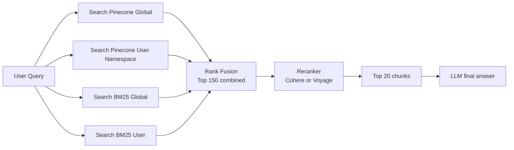

# Applying Contextual Retrieval to Your NCERT + User-Docs RAG System

*A complete implementation guide for your NotebookLM-style AI*  
*How to upgrade both NCERT global data and user-uploaded docs*  
*Based on Anthropic's Contextual Retrieval technique · March 2026*

---

# Section 1 — Your Current Architecture

## Your Current System (as Built)

Your RAG system has two data sources stored in Pinecone — a global NCERT namespace pre-loaded with books from Classes 6–10, and a per-user namespace where users upload their own documents. Both are queried together at runtime to answer user questions.

### Diagram — Current Architecture

```mermaid
flowchart TD
    A[NCERT Books\nAll subjects, all classes] --> B[Pinecone\nGlobal namespace]
    C[User uploaded docs\nPDFs, notes, custom files] --> D[Pinecone\nUser namespace]

    B --> E[User query\n"Explain photosynthesis"]
    D --> E

    E --> F[LLM generates answer\nBest chunks from both sources]

    G[Problem: chunks lose context] -.-> B
```

*NCERT books and user docs are stored in separate Pinecone namespaces. Both are searched at query time, but chunks currently lack contextual identity.*

## The Problem in Your System

Because chunks are stored without context, retrieval can fail silently.

| Data Source | Raw Chunk (what you store now) | The Problem |
|---|---|---|
| NCERT Global | “The rate of reaction doubles with every 10°C rise in temperature.” | No subject, no class, no chapter → Class 10 student's query misses it |
| User Upload | “Activation energy is reduced by the catalyst.” | No document context → vague chunk from messy notes is never retrieved |

---

# Section 2 — Where Contextual Retrieval Applies

## Two Places to Apply Contextual Retrieval

Your system has two distinct data pipelines, and Contextual Retrieval improves both — but they work differently in terms of when and how you run the contextualization.

| Data Source | When to Run | Cost | Recurring? |
|---|---|---|---|
| NCERT Global Data | Once — run now, never again | ~$50–60 total | No |
| User Uploaded Docs | Per upload — each time a user uploads | ~$0.03–0.05 per doc | Yes, per upload |

## Place 1: NCERT Global Data — One-Time, Done Once

This is the best place to start. You process all NCERT books once, store them with context, and never do it again. The investment is small; the benefit is permanent.

### Before and After — NCERT Chunk Example

| Before (what you store now) | After Contextual Retrieval |
|---|---|
| “The rate of reaction doubles with every 10 degrees rise in temperature.” | “Context: This chunk is from NCERT Class 10 Science, Chapter 1 — Chemical Reactions and Equations. It explains the effect of temperature on reaction rate. Original: The rate of reaction doubles with every 10 degrees rise in temperature.” |
| Query `temperature chemical reactions Class 10` → MISSES this chunk | Same query → FINDS this chunk perfectly because it carries class, subject, and chapter |

## Place 2: User Uploaded Docs — Per Upload, Per User

When a user uploads their own notes or textbook, run the same process — Claude reads their document and adds context to each chunk before storing it in their personal Pinecone namespace.

### Before and After — User Upload Chunk Example

| Before (raw user chunk) | After Contextual Retrieval |
|---|---|
| “Activation energy is reduced by the catalyst.” | “Context: From the user's uploaded document on catalysis in organic chemistry. This chunk discusses how catalysts work by lowering activation energy. Original: Activation energy is reduced by the catalyst.” |
| Vague chunk from messy notes → never retrieved reliably | Now carries full document context → retrieved accurately every time |

---

# Section 3 — Your Upgraded System Architecture

## The Upgraded Architecture with Contextual Retrieval

Below is exactly how your system looks after applying Contextual Retrieval to both pipelines. Both NCERT and user-doc flows now run through Claude before storing in Pinecone, and both feed into a reranker at query time for maximum accuracy.

```mermaid
flowchart TD

    subgraph A[NCERT pipeline - one-time setup]
        A1[All NCERT books\nClass 1-12, all subjects]
        A2[Claude adds context\n"Class 10 Science, Ch.1 - Chemical Reactions..."]
        A3[Embeddings\nSemantic search]
        A4[BM25 index\nExact match]
        A5[Pinecone - global namespace]

        A1 --> A2
        A2 --> A3
        A2 --> A4
        A3 --> A5
    end

    subgraph B[User doc pipeline - per upload]
        B1[User uploads PDF/doc\nPersonal notes, textbooks]
        B2[Claude adds context\n"User's chemistry notes on catalysis..."]
        B3[Embeddings\nSemantic search]
        B4[BM25 index\nExact match]
        B5[Pinecone - user namespace]

        B1 --> B2
        B2 --> B3
        B2 --> B4
        B3 --> B5
    end

    Q[User query\n"Explain photosynthesis"]

    A5 --> Q
    B5 --> Q
    A4 --> Q
    B4 --> Q

    Q --> R[Reranker (Cohere/Voyage)\nTop 20 best chunks from both sources]
    R --> L[LLM generates final answer\nWith full source attribution]
```

*Both NCERT and user-doc pipelines now pass through Claude context generation + Embeddings + BM25 indexing before Pinecone storage. At query time, a reranker (Cohere/Voyage) selects the top 20 chunks from both sources before the LLM generates the final answer with source attribution.*

---

# Section 4 — The Implementation Prompt

## The Claude Prompt to Use (Same for Both Pipelines)

For both NCERT and user docs, the Claude prompt is identical — you only change what you pass as `WHOLE_DOCUMENT` and `CHUNK_CONTENT`. The model returns 2–3 sentences of context that are prepended to the chunk before embedding.

```python
CONTEXT_PROMPT = """
<document>
{WHOLE_DOCUMENT}
</document>

Here is the chunk we want to situate within the whole document:

<chunk>
{CHUNK_CONTENT}
</chunk>

Please give a short succinct context (2-3 sentences) to situate
this chunk within the overall document for improving search retrieval.

Answer only with the context and nothing else.
"""
```

| Parameter | For NCERT Data | For User Uploads |
|---|---|---|
| `WHOLE_DOCUMENT` | Full chapter text (not whole book) | Full uploaded PDF text |
| `CHUNK_CONTENT` | 300–500 token paragraph from chapter | Each chunk from the user's file |
| Claude model | `claude-haiku` (cheapest, fast enough) | `claude-haiku` (cheapest, fast enough) |
| Caching | Cache chapter text — reuse per chunk | Cache full PDF — reuse per chunk |
| Output | 50–100 token context prefix | 50–100 token context prefix |

---

# Section 5 — Cost Breakdown

## What Does It Cost?

| Component | Cost | Notes |
|---|---|---|
| Claude API (context generation) | ~$1.02 / million tokens | One-time with prompt caching |
| BM25 index (`rank_bm25` library) | Free | Runs locally, no API needed |
| Pinecone storage | Your existing plan | No change — just richer text |
| Embeddings | Same as now | No change at all |
| Reranker — Cohere Rerank | ~$1 / 1,000 queries | Optional; at query time only |
| All NCERT books (~50M tokens) | ~$50–60 one-time | Never pay this cost again |
| Per user PDF upload (~50 pages) | ~$0.025–$0.05 per doc | Affordable even at scale |

**Key insight:** The NCERT contextualization is a one-time cost of ~$50–60 for all 5 classes. After that, you only pay per user upload (~$0.03) and optionally per query for reranking.

Prompt caching is what makes this so affordable — the full document is loaded once and reused for every chunk in that document.

---

# Section 6 — Summary: What to Actually Do

## Step-by-Step Implementation Plan

### 1. Process all NCERT data once

Run contextual chunking on all books (Classes 6–10). Store contextualized chunks in the Pinecone global namespace. Also build a BM25 index over the same chunks.

This is your biggest upfront effort — but it's a one-time job that you never repeat.

### 2. Update your user upload pipeline

When a user uploads a document:

- Run each chunk through Claude
- Use the full document with prompt caching
- Generate the context prefix
- Embed the contextualized text
- Store it in the user's namespace
- Add that document’s chunks to a per-user BM25 index

### 3. Update your query pipeline

At query time:

1. Search both Pinecone namespaces
2. Search both BM25 indexes
3. Merge results with rank fusion (top 150 combined)
4. Pass them through a reranker (Cohere or Voyage)
5. Keep only the top 20 chunks
6. Send those top 20 chunks to your LLM

### Query-Time Flow Diagram



### 4. Add source attribution (like NotebookLM)

Since each chunk now carries its source:

- `NCERT Class 10 Science, Ch.3`
- `User's chemistry notes on catalysis`

You can show the user exactly where the answer came from — just like NotebookLM does with source citations.

This approach is a very natural fit for your system. The NCERT global data benefits enormously because those books have highly structured content where class/subject/chapter context makes retrieval dramatically more accurate — turning what is currently guesswork into precise matching.

---

*Based on Anthropic's Contextual Retrieval technique (September 2024)*  
Full article: `anthropic.com/engineering/contextual-retrieval`  
Implementation cookbook: `platform.claude.com/cookbook`

