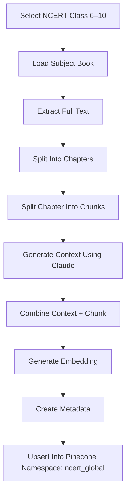

# NCERT Pinecone Storage & Retrieval
## Architecture Guide — Contextual Retrieval with Pinecone

---

# 1. First, Let's Understand What You're Dealing With

You are working with approximately 30 NCERT books spanning Classes 6–10, each with ~6 subjects:

- Maths
- Science
- Social Science
- English
- Hindi
- Sanskrit

This yields roughly **50,000–80,000 chunks** in total.

Without rich metadata, a query like `photosynthesis` returns chunks from Class 6, 8, and 10 mixed randomly — no way to filter, rank by relevance, or attribute the source.

## Fig 1 — NCERT Scope and Retrieval Problem

```mermaid
flowchart TB
    A[Class 6<br/>~6 subjects]
    B[Class 7<br/>~6 subjects]
    C[Class 8<br/>~6 subjects]
    D[Class 9<br/>~6 subjects]
    E[Class 10<br/>~6 subjects]

    F[Maths]
    G[Science]
    H[Social Science]
    I[English]
    J[Hindi]
    K[Sanskrit]

    L[~30 books total<br/>~50K–80K chunks]

    A --> F
    B --> G
    C --> H
    D --> I
    E --> J
    E --> K

    F --> L
    G --> L
    H --> L
    I --> L
    J --> L
    K --> L

    L --> M[If stored flat with no metadata]
    M --> N[Query: "photosynthesis"]
    N --> O[Returns chunks from Class 6, 8, 10 mixed randomly]
```

> Fig 1 — NCERT scope: ~30 books across 5 classes and 6 subjects, totalling 50K–80K chunks. Flat storage without metadata makes retrieval random and unattributable.

## The Retrieval Problem Without Good Storage Structure

If all 50K–80K chunks are stored flat with no metadata:

```text
query "photosynthesis"
→ returns chunks from Class 6, 8, 10 mixed randomly
→ no way to filter
→ no way to rank by relevance
→ no way to attribute the source
```

---

# 2. The Golden Rule: Rich Metadata is Everything

> Golden Rule: How you store = how well you retrieve.

In Pinecone, every vector has two parts:

1. The embedding (vector)
2. The metadata (JSON object)

Most people only focus on embeddings. But metadata is what makes filtering fast and retrieval precise.

## Best Metadata Structure for Each Chunk

```json
{
  "id": "ncert_class10_science_ch1_chunk_042",
  "values": [0.023, -0.14, 0.87, ...],
  "metadata": {
    "source": "ncert",
    "class": 10,
    "subject": "science",
    "chapter_no": 1,
    "chapter_name": "Chemical Reactions and Equations",
    "topic": "Types of Chemical Reactions",

    "text": "The full contextualized chunk text goes here...",
    "page_no": 14,
    "chunk_index": 42,

    "display_source": "NCERT Class 10 Science — Ch.1: Chemical Reactions",

    "keywords": [
      "chemical reaction",
      "reactants",
      "products",
      "equation"
    ]
  }
}
```

---

# 3. Namespace Strategy — How to Split in Pinecone

This is the most important architectural decision.

You have three options.

## Fig 2 — Namespace Strategy Comparison

```mermaid
flowchart TB
    A[Option 1 — Flat]
    A --> A1[namespace: "ncert"]
    A1 --> A2[All 50K–80K chunks dumped together]
    A2 --> A3[Slow retrieval]
    A2 --> A4[No namespace filtering]

    B[Option 2 — By Class]
    B --> B1[ncert_class6]
    B --> B2[ncert_class7]
    B --> B3[ncert_class8]
    B --> B4[ncert_class9]
    B --> B5[ncert_class10]
    B5 --> B6[Subjects still mixed]
    B6 --> B7[Cannot filter by subject at namespace level]

    C[Option 3 — Best]
    C --> C1[Single namespace: "ncert_global"]
    C1 --> C2[All chunks stored here]
    C2 --> C3[Metadata drives all filtering]

    C3 --> D1[Filter: {"subject": "science"}]
    C3 --> D2[Filter: {"class": 10, "subject": "science"}]
    C3 --> D3[Filter: {"class": 10, "chapter_no": 1}]
```

> Fig 2 — Option 3 (single namespace + rich metadata filters) is the recommended approach because it is flexible, scalable, and avoids namespace explosion.

## Option 1 — Flat (Avoid This)

```text
namespace: "ncert"
```

All 50K–80K chunks are dumped together.

Problems:

- Slow
- No filter possible at namespace level
- Hard to manage

## Option 2 — By Class (Okay, But Not Ideal)

```text
ncert_class6
ncert_class7
...
ncert_class10
```

Problems:

- Subjects are still mixed inside each namespace
- Cannot filter Science vs Maths at namespace level

## Option 3 — One Namespace + Rich Metadata Filters (Best)

```text
namespace: "ncert_global"
```

All chunks are stored in a single namespace. Filtering is done using metadata.

Advantages:

- Fast
- Flexible
- Scalable
- No namespace explosion

## Query-Time Filters Enabled by Option 3

| Filter Type | Filter JSON | Effect |
|---|---|---|
| Subject filter | `{"subject": "science"}` | Only science chunks returned |
| Class + subject | `{"class": 10, "subject": "science"}` | Only Class 10 Science chunks |
| Chapter filter | `{"class": 10, "chapter_no": 1}` | Only a specific chapter |

---

# 4. The Complete Storage Code

## Step 1 — Claude Adds Context to Each Chunk

Claude Haiku uses prompt caching to contextualize every chunk cheaply.

The full document is cached and reused for every chunk.

```python
import anthropic
from pinecone import Pinecone

client = anthropic.Anthropic()
pc = Pinecone(api_key="YOUR_KEY")
index = pc.Index("ncert-index")


def add_context_to_chunk(whole_document: str, chunk: str) -> str:
    """Uses Claude + prompt caching to contextualize each chunk."""

    response = client.messages.create(
        model="claude-haiku-4-5-20251001",
        max_tokens=200,
        messages=[{
            "role": "user",
            "content": [
                {
                    "type": "text",
                    "text": "<document>",
                    "cache_control": {"type": "ephemeral"}
                },
                {"type": "text", "text": whole_document},
                {"type": "text", "text": "</document>"},
                {
                    "type": "text",
                    "text": f"""
Here is the chunk to situate:
<chunk>{chunk}</chunk>

Give a 2–3 sentence context explaining what this chunk covers,
which class/subject/chapter it belongs to, and how it fits
in the document. Answer only with the context.
"""
                }
            ]
        }]
    )

    return response.content[0].text
```

## Step 2 — Build a Human-Readable Vector ID

```python
def make_vector_id(class_no, subject, chapter_no, chunk_index):
    return (
        f"ncert_class{class_no}_{subject}_"
        f"ch{chapter_no:02d}_chunk{chunk_index:04d}"
    )
```

Example:

```text
ncert_class10_science_ch01_chunk0042
```

## Step 3 — Store One Chunk into Pinecone

```python
def store_chunk(
    embedding_model,
    chunk_text: str,
    context_text: str,
    class_no: int,
    subject: str,
    chapter_no: int,
    chapter_name: str,
    topic: str,
    page_no: int,
    chunk_index: int
):
    full_text = f"{context_text}\n\n{chunk_text}"

    vector = embedding_model.embed(full_text)

    vector_id = make_vector_id(
        class_no,
        subject,
        chapter_no,
        chunk_index
    )

    index.upsert(
        vectors=[{
            "id": vector_id,
            "values": vector,
            "metadata": {
                "source": "ncert",
                "class": class_no,
                "subject": subject.lower(),
                "chapter_no": chapter_no,
                "chapter_name": chapter_name,
                "topic": topic,
                "page_no": page_no,
                "chunk_index": chunk_index,

                "text": full_text,
                "original_text": chunk_text,
                "context": context_text,

                "display_source": (
                    f"NCERT Class {class_no} {subject.title()}"
                    f" — Ch.{chapter_no}: {chapter_name}"
                )
            }
        }],
        namespace="ncert_global"
    )
```

---

# 5. How Querying Works With Filters

At query time, rich metadata enables dynamic filtering.

```python
def query_ncert(
    query_text: str,
    embedding_model,
    class_no: int = None,
    subject: str = None,
    chapter_no: int = None,
    top_k: int = 20
):
    query_vector = embedding_model.embed(query_text)

    metadata_filter = {
        "source": {"$eq": "ncert"}
    }

    if class_no:
        metadata_filter["class"] = {"$eq": class_no}

    if subject:
        metadata_filter["subject"] = {"$eq": subject.lower()}

    if chapter_no:
        metadata_filter["chapter_no"] = {"$eq": chapter_no}

    results = index.query(
        vector=query_vector,
        top_k=top_k,
        namespace="ncert_global",
        filter=metadata_filter,
        include_metadata=True
    )

    return results
```

## Example Queries

```python
query_ncert("what is photosynthesis", top_k=20)

query_ncert("photosynthesis", class_no=10, top_k=20)

query_ncert(
    "photosynthesis",
    class_no=10,
    subject="science",
    top_k=20
)

query_ncert(
    "heredity",
    class_no=10,
    subject="science",
    chapter_no=9,
    top_k=10
)
```

---

# 6. The Full Storage Pipeline (One-Time Ingestion Job)

```python
for class_no in [6, 7, 8, 9, 10]:
    for subject, book_path in get_ncert_books(class_no):

        whole_document = extract_text(book_path)
        chapters = split_into_chapters(whole_document)

        for chapter_no, chapter in enumerate(chapters, 1):
            chunks = split_into_chunks(
                chapter.text,
                chunk_size=400
            )

            for chunk_index, chunk in enumerate(chunks):

                context = add_context_to_chunk(
                    whole_document=chapter.text,
                    chunk=chunk
                )

                store_chunk(
                    embedding_model=your_embedder,
                    chunk_text=chunk,
                    context_text=context,
                    class_no=class_no,
                    subject=subject,
                    chapter_no=chapter_no,
                    chapter_name=chapter.name,
                    topic=chapter.current_topic,
                    page_no=chunk.page_no,
                    chunk_index=chunk_index
                )
```

## Ingestion Flow Diagram



---

# 7. Smart Chunking Rules for NCERT Specifically

| Rule | Why |
|---|---|
| Chunk size: 300–500 tokens | NCERT content is dense. Smaller chunks improve precision. |
| Never split mid-paragraph | A paragraph usually represents one complete idea. |
| Keep diagrams/formulas with explanation | Do not separate a formula from the text explaining it. |
| Pass chapter text (not full book) to Claude | Chapter-level context is more useful and cheaper. |
| Include section headings in chunks | Example: include `4.3 Respiration in Plants` at the top of the chunk. |

---

# Final Result

This storage design makes retrieval:

- Fast
- Attributable
- Filterable by class, subject, and chapter
- Similar to NotebookLM source citations
- Optimized specifically for NCERT books

Example attribution shown to the user:

```text
Source: NCERT Class 10 Science — Ch.1: Chemical Reactions
```

---

# End of Guide

NCERT Pinecone Storage & Contextual Retrieval Architecture

