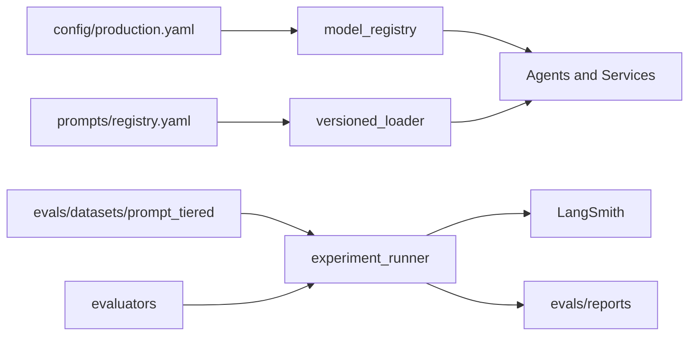

# ScholarSync Evaluation Framework

Production-grade prompt/model optimization using LangSmith, tiered datasets, and weighted evaluators.

## Quick Start

```powershell
# 1. Enable LangSmith
# .env: LANGSMITH_TRACING_ENABLED=true, LANGSMITH_API_KEY=..., LANGSMITH_PROJECT=notebooklm-dev

# 2. Verify tracing
python scripts/verify_langsmith_setup.py

# 3. Agent-level experiment
python eval.py --agent intent_classifier --prompts v1 --models gpt-4o-mini --limit 10

# 4. Two-phase optimization (prompts then models)
python eval.py --agent intent_classifier --two-phase --limit 15

# 5. End-to-end workflow eval
python eval_e2e.py --limit 10

# 6. Upload datasets to LangSmith
python scripts/upload_prompt_tiered_to_langsmith.py --agent intent_classifier
```

## Architecture



## Components

| Module | Path | Purpose |
|--------|------|---------|
| Model registry | `packages/core/config/model_registry.py` | `get_model()`, `get_prompt_version()` |
| Versioned prompts | `packages/core/prompts/versioned_loader.py` | `load_versioned_prompt(agent, version)` |
| Observability | `packages/core/observability/langsmith.py` | Trace metadata, eval feedback |
| Datasets | `packages/core/evaluation/datasets/` | Load tiered JSON datasets |
| Evaluators | `packages/core/evaluation/evaluators/` | Weighted 0-100 scoring |
| Experiments | `packages/core/evaluation/experiments/` | Prompt x model matrix |
| E2E | `packages/core/evaluation/e2e/` | Full workflow score |

## Dataset Format

Each item in `evals/datasets/prompt_tiered/{category}/{agent}.json`:

```json
{
  "id": "intent_classifier-001",
  "variation": "security",
  "inputs": { "query": "..." },
  "reference_outputs": { "intent": "security_block", "confidence": 0.95 },
  "tags": ["guardrail"]
}
```

JSONL export uses `input` / `expected_output` aliases (loader normalizes both).

## Scoring Methodology

Every evaluator returns:

```json
{ "score": 0-100, "passed": true, "metrics": {} }
```

**Winner selection** (above threshold):

```
final = quality*0.60 + reliability*0.20 + latency*0.10 + cost_efficiency*0.10
```

Pick cheapest config above agent threshold; tie-break with composite score.

**E2E workflow score:**

```
workflow = quality*0.50 + reliability*0.20 + retrieval*0.15 + latency*0.10 + cost*0.05
```

Threshold: **90**.

## Evaluator Thresholds

| Evaluator | Threshold |
|-----------|-----------|
| router | 95 |
| query_rewriter | 90 |
| retriever | 90 |
| answer_generator | 90 |
| verifier | 95 |
| formatter | 98 |
| hint_agent | 90 |

## Production Freeze

1. Run `python eval.py --agent <id> --two-phase`
2. Review leaderboard in `evals/reports/experiment_<id>.json`
3. Update `config/production.yaml` with winning `prompt` + `model`
4. Set `EVAL_USE_PRODUCTION_CONFIG=true` or deploy with `ENVIRONMENT=production`

## CI/CD

Workflow: `.github/workflows/eval-regression.yml`

- **Soft-fail** (default): reports regressions, does not block merge
- **Hard gate**: set `EVAL_GATE_MODE=hard` to block >3% score drop

## Human Review

See `evaluation/human_review.yaml` for LangSmith review queues and annotation fields.

## Excluded Agent

#7 RAG Chat Response Generator — see `evals/datasets/prompt_tiered/EXCLUDED_AGENTS.md`

## Further Reading

- [current_architecture.md](current_architecture.md)
- [migration_guide.md](migration_guide.md)
