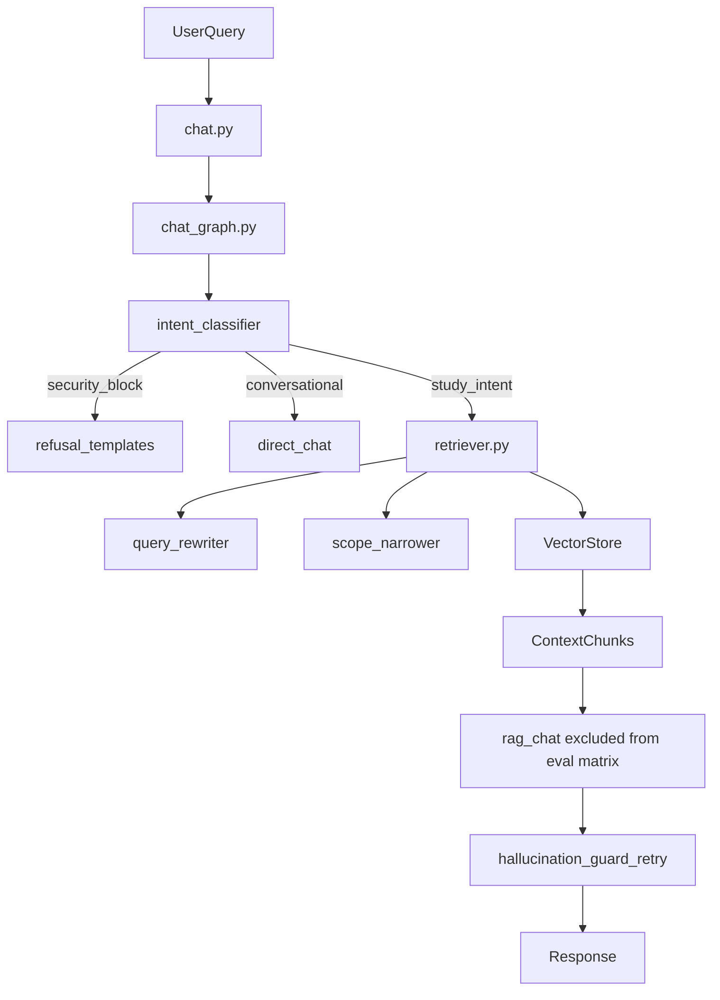
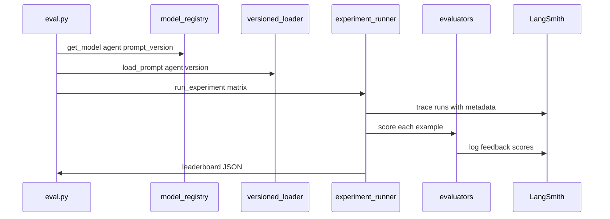

# ScholarSync — Current Architecture (Evaluation Baseline)

Generated as the baseline for the Agentic RAG Evaluation & Optimization framework.

## Agent Inventory (33 in-scope; excludes #7 RAG Chat Response Generator)

| S.no | Agent ID | Category | Tier | Prompt template(s) | Model task key |
|------|----------|----------|------|-------------------|----------------|
| 1 | `intent_classifier` | Routing | 1 | `agents/intent_classifier_*.j2` | `intent_classifier` |
| 2 | `query_rewriter` | Retrieval | 1 | `agents/query_rewriter_*.j2` | `query_rewriter` |
| 3 | `query_decomposer` | Retrieval | 3 | inline / decomposer | `query_decomposer` |
| 4 | `scope_narrower` | Retrieval | 3 | `agents/scope_narrower_*.j2` | `scope_narrower` |
| 5 | `chat_policy_block` | Generation | 3 | `policies/chat_policy.default.yaml` | — |
| 6 | `direct_chat` | Generation | 3 | `chat/direct_chat.j2` | `chat` |
| 8 | `chat_summarizer` | Generation | 2 | `chat/chat_summarizer_prompt.j2` | `chat` |
| 9 | `hallucination_guard_retry` | Generation | 3 | suffix in `chat_graph.py` | `chat` |
| 10 | `studio_system_json` | Studio | 3 | `studio/system_educational_json_markdown.j2` | studio tasks |
| 11 | `studio_quiz` | Studio | 2 | `studio/quiz_prompt.j2` | `quiz` |
| 12 | `studio_flashcards` | Studio | 2 | `studio/flashcards_prompt.j2` | `flashcards` |
| 13 | `studio_mind_map` | Studio | 2 | `studio/mind_map_prompt.j2` | `mind_map` |
| 14 | `studio_slide_deck` | Studio | 2 | `studio/slide_deck_prompt.j2` | `slide_deck` |
| 15 | `studio_fallback_legacy` | Studio | 2 | `studio/fallback_task_prompt.j2` | studio |
| 16 | `studio_context_embedding_query` | Studio | 3 | `studio/context_embedding_query.j2` | — |
| 17 | `problem_dna_analyzer` | Problem | 1 | `problem_solver/dna.j2` | `problem_solver_dna` |
| 18 | `explain_from_basics` | Problem | 1 | `problem_solver/explain_from_basics.j2` | `problem_solver_mode` |
| 19 | `show_best_approach` | Problem | 1 | `problem_solver/show_best_approach.j2` | `problem_solver_mode` |
| 20 | `show_missing_idea` | Problem | 1 | `problem_solver/show_missing_idea.j2` | `problem_solver_mode` |
| 21 | `help_me_solve_it` | Problem | 1 | `problem_solver/help_me_solve_it.j2` | `problem_solver_mode` |
| 22 | `problem_solver_followup` | Problem | 2 | `problem_solver/follow_up.j2` | `problem_solver_mode` |
| 23 | `tutor_notebook_bootstrap` | Tutor | 2 | `tutor/notebook_bootstrap.j2` | `chat` |
| 24 | `tutor_follow_up_questions` | Tutor | 1 | `tutor/follow_up_questions.j2` | `tutor_follow_ups` |
| 25 | `source_question_extraction` | Source | 1 | `source_questions/extract.j2` | `source_question_extract` |
| 26 | `document_sketch` | Source | 3 | `rag/document_sketch.j2` | `chunk_contextualization` |
| 27 | `ncert_document_sketch` | Source | 3 | `rag/ncert_document_sketch.j2` | `ncert_chunk_contextualization` |
| 28 | `chunk_contextualization` | Source | 3 | `rag/chunk_contextualization.j2` | `chunk_contextualization` |
| 29 | `whole_file_map_summarizer` | Source | 2 | `rag/whole_file_map_prompt.j2` | `chat` |
| 30 | `whole_file_reduce` | Source | 2 | `rag/whole_file_reduce_prompt.j2` | `chat` |
| 32 | `image_ocr` | Source | 2 | inline vision prompt | `source_image_ocr` |
| 33 | `diagram_label_ocr` | Source | 2 | inline vision prompt | `source_image_ocr` |
| 34 | `refusal_templates` | Safety | 3 | `refusal_templates.py` | — |

**Excluded from optimization scope:** #7 `rag_chat_response_generator` (`chat/rag_prompt.j2`) — use `evals/datasets/retrieval_golden.json` for retrieval; RAG answer evals tracked separately.

## Orchestration Entrypoints

| Path | Role |
|------|------|
| `apps/api/routes/chat.py` | Chat SSE; creates `LangGraphChatPipeline` |
| `packages/core/langgraph/chat_graph.py` | Main StateGraph: moderation → intent → retrieval → generation → guard |
| `packages/core/rag/retriever.py` | Hybrid retrieval + agent chain |
| `packages/core/services/studio_service.py` | Studio task orchestration |
| `packages/core/services/problem_solver_service.py` | Problem solver state machine |
| `packages/core/services/tutor_notebook_bootstrap_service.py` | Tutor bootstrap + follow-ups |

## Data Flow (Runtime)

## Data Flow (Evaluation Loop)

## Current Models

Default routing: `packages/core/llm/factory.py` → mostly `gpt-4o-mini` per task type.

Production overrides: `config/production.yaml` (frozen winners).

Experiment candidates: `config/models.yaml`.

## Existing Evaluation Assets

| Asset | Path | Status |
|-------|------|--------|
| Retrieval golden set | `evals/datasets/retrieval_golden.json` | Production gate |
| Tiered prompt datasets | `evals/datasets/prompt_tiered/` | 33 datasets, 510 items |
| Retrieval runner | `evals/runners/retrieval_eval.py` | Functional |
| Guardrails/IPI judges | `tests/helpers/*_judge.py` | Heuristic |
| LangSmith bootstrap | `packages/core/monitoring/langsmith_bootstrap.py` | Runtime ON when env set |

## Observability Gaps (pre-framework)

1. LangSmith tracing enabled at startup but agent boundaries lack uniform metadata (prompt version, model, cost).
2. Internal `pipeline_trace.py` is in-memory only — not durable across instances.
3. No automated experiment matrix (prompt × model) uploaded to LangSmith.
4. `evals/runners/base_eval.py` and `evals/metrics/` were stubs.
5. No CI regression gate for prompt/model changes.

## Mitigations (implemented in this framework)

- `packages/core/config/model_registry.py` — config-driven model/prompt versions
- `packages/core/prompts/versioned_loader.py` — versioned prompt loading
- `packages/core/observability/langsmith.py` — unified trace metadata
- `packages/core/evaluation/` — datasets, evaluators, experiments, e2e
- `eval.py` / `eval_e2e.py` — CLI entrypoints
- `.github/workflows/eval-regression.yml` — soft-fail CI gate
